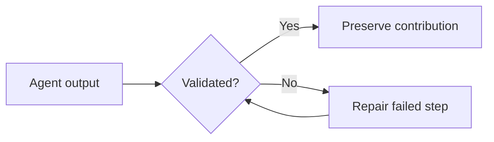

# Interactive figures in AI Frontier briefings

The Markdown files in `wiki/` remain the source of truth. The Pages build converts fenced `chart`, `vega-lite`, `mermaid`, and `graph` blocks into interactive figures. Ordinary Markdown images remain supported.

## Simple chart

```chart
{
  "type": "bar",
  "title": "Multi-agent task accuracy",
  "caption": "Illustrative values from the November 2 briefing; verify primary-source methodology.",
  "labels": ["Native execution", "Dittany"],
  "datasets": [{"label": "Task accuracy (%)", "data": [58.01, 84.76]}],
  "yAxis": {"min": 0, "max": 100, "title": "Accuracy (%)"}
}
```

Supported simple chart types: `bar`, `line`, `scatter`, `pie`, `doughnut`, and `radar`. Simple chart specs are translated to Vega-Lite. For more complex interactive plots, use `vega-lite` directly:

```vega-lite
{
  "title": "Token usage by strategy",
  "mark": "bar",
  "data": {"values": [{"strategy":"Baseline","tokens":100},{"strategy":"Optimized","tokens":62}]},
  "encoding": {
    "x": {"field":"strategy","type":"nominal"},
    "y": {"field":"tokens","type":"quantitative"},
    "tooltip": [{"field":"strategy"},{"field":"tokens"}]
  }
}
```

## Mermaid architecture



## Interactive graph

```graph
{
  "title": "Agent system dependencies",
  "caption": "Click a node to open its referenced source.",
  "nodes": [
    {"id":"planner","label":"Planner","url":"https://github.com/hexsecs/ai-frontier"},
    {"id":"executor","label":"Executor"},
    {"id":"validator","label":"Validator"}
  ],
  "edges": [
    {"source":"planner","target":"executor"},
    {"source":"executor","target":"validator"}
  ]
}
```

## Authoring and security notes

- Every visualization must have real, sourced data. Never fabricate benchmark measurements to fill a figure.
- Include descriptive labels, units, a meaningful caption, and source links in surrounding Markdown.
- Keep specs below 100 KB; use repository-hosted images for screenshots or photographs.
- Do not embed JavaScript, raw HTML scripts, arbitrary Vega expressions, or remote data sources in a briefing.
- The website loads Vega-Lite, Mermaid, and Cytoscape from versioned public CDNs. An internet connection is required for interactive figures; Markdown source remains readable without them.
- Interactive charts are rendered on the GitHub Pages site, not directly in GitHub's native Markdown viewer (which displays their fenced definitions).

## OpenShelf token-budget override

OpenShelf recommends a 2,500-token L2 page budget. Longer research briefings may deliberately exceed this advisory limit. Add a justification to the Markdown page:

```markdown
<!-- openshelf:budget-override reason="Full research context and sourced technical evidence belong in this dated briefing." -->
```

The validation workflow acknowledges the L2 budget warning for that page and prints the justification. **All actual OpenShelf errors remain fatal**, including metadata, links, and schema errors. The override does not modify OpenShelf's own validator or exempt a page from linting. Keep the explanation specific and avoid using overrides for unnecessary repetition.

## Native ChatGPT chart import

The Pages build automatically converts ChatGPT's native `<Chart content={{...}}/>` JSON component or a `chatgpt-chart` fenced JSON block into Vega-Lite. Supported native types are `bar`, `line`, and `scatter`; unsupported types fail the build rather than silently losing data. Conversion retains numeric data, series labels, x-axis values, axis labels, and y-axis bounds. Additional display options may require an explicit Vega-Lite specification.

Example native import (use a `chatgpt-chart` fence):

```chatgpt-chart
{"chartType":"bar","xKey":"method","series":[{"dataKey":"rate","label":"Attack success","valueSuffix":"%"}],"yAxisMin":0,"data":[{"method":"Non-adaptive","rate":15.24},{"method":"ANGLER","rate":20.36}]}
```

The converter is `scripts/chatgpt_charts.py`. The Pages workflow runs regression tests before publishing. This is a format converter, not a way to retrieve missing ChatGPT automation history.
