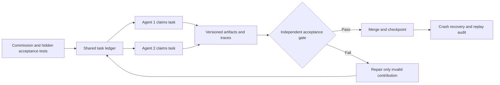

# AI Frontier — November 3, 2026

<!-- openshelf:budget-override reason="The complete dated research briefing retains all five item assessments, original-source provenance, experiments, cross-item comparisons, and the frontier signal." -->

**Editorial selection:** Five distinct, implementation-oriented findings. Three core engineering/agent-infrastructure entries and two exploratory entries (robotics and adversarial browser defenses). This edition deliberately favors research with specific mechanisms and testable claims over generic product announcements. All numerical findings below are **author-reported**, not independently reproduced here. Dates distinguish original publication from newer code releases.

## 1. Agensh — decentralized teams of up to 1,024 coding agents

**Date:** October 24, 2026 open-source release; October 29 expanded backend support. **Source:** [Microsoft Agensh repository](https://github.com/microsoft/Agensh); [paper](https://arxiv.org/abs/2609.26781). **Assessment:** High practical relevance; high infrastructure novelty; controlled benchmarks.

**What was built.** A multi-agent coding harness in which workers claim tasks, share context, message one another, check contributions, and integrate results without a single central planner. Gitea is the shared code workspace and Mattermost carries team communication. The release includes Docker Compose deployment and experiment scripts; the October 29 update adds Copilot, Codex, Claude Code, and Pi single-agent backends.

**Key technique.** Decentralized task discovery and asynchronous work claiming, backed by durable shared artifacts and peer coordination. Rather than one orchestrator routing every instruction, the coordination substrate allows team organization to emerge from worker behavior.

**Evidence.** On five difficult ProgramBench tasks with a six-hour budget and GPT-5.6-sol, the reported average final test-pass rate improved from **19.31% with one worker** to **28.78% with 128 workers** (a 9.47 percentage-point absolute increase). On Pandoc, one worker scored 33.89%, 128 workers 50.94%, and 1,024 workers 55.06%. A separate reported GPT-6.1-sol Pandoc experiment scored 56.19% with one worker versus 79.59% with 32 workers. These are task-specific, author-run results; the additional compute, coordination cost, and variance must be considered before generalizing.

```chart
{"type":"bar","title":"Agensh: Pandoc final test-pass rate under six-hour budget","caption":"Author-reported GPT-5.6-sol ProgramBench Pandoc results; worker counts differ, and inference expenditure is not normalized.","labels":["1 worker","128 workers","1,024 workers"],"datasets":[{"label":"Test-pass rate (%)","data":[33.89,50.94,55.06]}],"yAxis":{"min":0,"max":100,"title":"Test-pass rate (%)"}}
```

**Why frontier.** This tests the organizational structure of autonomous coding rather than simply prompting a larger model. It is directly relevant to a two-agent project that might eventually grow to many specialized agents.

**Practical takeaway / experiment.** Run the same bounded repository task with 1, 2, 4, and 8 workers; track acceptance-test pass rate, wall time, tokens, merge conflicts, duplicate work, and reviewer intervention. Add an atomic task-claim ledger and artifact ownership before adding more agents.

**Verdict:** Worth testing, not a claim that 1,024 workers are generally economical. Compared with [[techniques/multi-agent-orchestration]], Agensh provides an unusually concrete decentralized implementation and reproduction path.

## 2. RoboArchitect — coding agents evolve the harness around a frozen robot policy

**Date:** October 30, 2026. **Source:** [RoboArchitect paper](https://arxiv.org/abs/2610.42141). **Assessment:** High novelty; exploratory robotics transfer; author-reported evaluations.

**What was demonstrated.** A coding model observes manipulation rollouts, diagnoses failures, and revises the control harness surrounding a fixed robot policy. The harness can decide when to query perception, issue corrective control actions, and consult persistent memory. The optimization process evaluates revisions on development episodes and tests on held-out scenes and tasks, without changing policy weights.

**Key technique.** Automated harness evolution plus persistent episodic memory. The agent improves the external control system and retains useful execution experience such as grasp depth, rather than retraining the neural policy.

**Evidence.** The authors report unseen-scene success rising from **9.7% to 43.3%**, and unseen-task success from **12.7% to 40.2%**. These are large absolute changes but remain specific to the paper's evaluation conditions; the abstract alone does not establish reliable transfer to uncontrolled physical deployments.

**Why frontier.** It is a strong adjacent test of the same idea as [[projects/tinyastral]]: the capability locus may be the execution harness, not the model weights. Unlike generic self-improvement narratives, it explicitly uses held-out environments and gives examples of evolved control strategies.

**Practical takeaway / experiment.** Adapt the loop to a coding or research agent: freeze the underlying model; allow a separate optimizer to edit only its tools, planning prompts, recovery policy, and memory schema. Evaluate each revision on hidden regression tasks. Preserve a baseline and revert changes that improve visible cases but damage held-out performance.

**Verdict:** Promising research direction; not evidence that arbitrary agents can safely self-modify in production. The crucial question is whether harness improvements survive distribution shift.

## 3. AgentShield — detect agentic browsers by their perception–reasoning–action loop

**Date:** October 30, 2026. **Source:** [AgentShield paper](https://arxiv.org/abs/2610.41181). **Assessment:** High security novelty; exploratory selection; paper-level evidence.

**What was demonstrated.** A study of browser agents against conventional anti-bot mechanisms and a proposed behavioral-fingerprinting framework. Dynamic forms progressively reveal content while collecting interaction telemetry, allowing the defender to look for artifacts of an agent's perception, reasoning, and action cycle. The paper also describes **Extinction-induced Policy Drift**: repeated task obstruction can induce unsafe deviations in agent behavior. It explores defensive prompt injection against automated extraction.

**Key technique.** Instrument the workflow, not just the user agent string or browser fingerprint. The detector measures interaction timing and behavior around progressively revealed UI state.

**Why frontier.** As computer-use agents become operational, their action patterns create both a detection surface and a new attack surface. The obstruction-induced drift result is especially relevant to long-running agents that retry failures and may relax constraints under pressure.

**Practical takeaway / experiment.** In a controlled local web app, compare a human, a deterministic Playwright script, and a browser agent across staged forms. Log event sequences, pause distributions, retries, and policy violations. Add a hard authorization gate independent of the model so repeated failure cannot silently broaden permissions.

**Verdict:** A useful security hypothesis and test design, not a universal bot detector. Detection efficacy and false positives need independent testing; defensive prompt injection is not a substitute for server-side access control. Compare [[projects/angler]], which validates adversarial outcomes via website state changes rather than focusing on behavioral classification.

## 4. AgentSWE — acceptance testing for agents built by coding agents

**Date:** October 9, 2026 (older paper newly selected for its direct relevance). **Source:** [AgentSWE paper](https://arxiv.org/abs/2610.13361). **Assessment:** High evaluation relevance; not a newly released system this week.

**What was built.** A 25-task benchmark covering the creation, editing, and optimization of agent software. Each task gives the builder a natural-language commission and a few illustrative examples, then evaluates the frozen submission on held-out cases against requirement-derived rubrics and hard acceptance gates.

**Key technique.** Separate the examples the builder can see from the full behavior the user commissioned. The benchmark exposes overfitting to demonstrations, plausible-looking but hollow runtimes, and unsupported claims of completion.

**Why frontier.** Agentic software development is moving from generating ordinary code to generating autonomous systems. The failure mode changes: an agent can build a polished interface while omitting the actual persistent loop, safety boundaries, or integration behavior.

**Practical takeaway / experiment.** For every new agent skill, write a hidden acceptance suite that tests actual side effects, restart behavior, denied permissions, and task completion. Require a machine-verifiable trace before declaring an implementation complete. This is a natural acceptance gate for autonomous agents maintaining the AI Frontier repository itself.

**Verdict:** High-value benchmark design. Its small task count limits universal claims, but the evaluation structure is directly reusable. It complements [[projects/seq-k]] by measuring commissioned behavioral fidelity rather than only iterative improvement.

## 5. AgentOS — durable mid-turn recovery and tool-call hardening

**Date:** October 27 reliability release; November 2 image-flow release. **Source:** [AgentOS release history](https://github.com/use-agent-os/agent-os/blob/main/RELEASES.md). **Assessment:** Practical implementation detail; smaller conceptual novelty; release-note evidence rather than independent benchmarks.

**What shipped.** The October 27 release lists several concrete reliability controls: validated tool dispatch, near-miss tool-name handling, a single retry for tool calls emitted as text, repeated-no-progress loop detection, persistence of tool rounds during a turn, recovery after process interruption, read-only restrictions on unsafe resumes, queued mid-turn steering, structured compaction summaries, and model provenance for replay. The November 2 release adds agent-created/edited image flows with revision conflict checks and cost-gated execution overrides.

**Key technique.** Treat agent execution as a recoverable state machine with explicit unknown outcomes. An interrupted tool call is not necessarily a failed call; replaying it can duplicate a side effect. Recovery therefore needs durable execution records and conservative permissions.

**Why frontier.** Much of the practical frontier is in handling the non-happy path: crashes, ambiguous tool results, stale revisions, runaway loops, and unsafe retries. This is a concrete list of controls an operator can inspect rather than a generic autonomy claim.

**Practical takeaway / experiment.** Kill a test agent between issuing a side-effecting command and recording its result. On restart, require it to classify the operation as *completed*, *not completed*, or *unknown*, and verify state before retrying. Record idempotency keys and reject repeated no-progress calls.

**Verdict:** Immediately useful engineering checklist, but the release notes provide no controlled success-rate measurement. This is a deployment hardening item rather than a benchmark breakthrough.

## Comparison and priorities

| Finding | Main innovation | Evidence tier | Best next action |
| --- | --- | --- | --- |
| Agensh | Decentralized coding-agent coordination | Code + author-run benchmark | Reproduce small-team scaling |
| RoboArchitect | Evolve external harness, keep model fixed | Author-reported held-out research | Harness-only optimizer |
| AgentShield | Browser-agent behavioral defense and obstruction drift | Research paper | Controlled browser security lab |
| AgentSWE | Hidden acceptance of commissioned agent behavior | Benchmark paper | Agent acceptance-suite template |
| AgentOS | Crash-safe tool execution and recovery controls | Source/release notes | Inject failures into tool loop |

**Top three for immediate engineering work:** Agensh (coordination), AgentSWE (verification), AgentOS (operational reliability). **Exploration quota:** RoboArchitect and AgentShield broaden the evidence base into embodied control and adversarial web interaction.

### A composable experiment for a two-agent engineering system



**Protocol:** Run a fixed set of repository changes with one versus two agents. Keep model, prompts, token budget, and tests constant where possible. Track completed acceptance gates, tokens, wall time, retries, conflicts, and unsafe repeated side effects. Restart the coordinator during a side-effecting step. This joins Agensh's distributed claims, AgentSWE's hidden acceptance, and AgentOS's recovery discipline, while avoiding the circularity of having the builder grade its own work.

## Frontier signal

**The agent harness is becoming the primary object of engineering and optimization.** Today's examples span decentralized coordination, automatically evolved robot control, browser-behavior observability, behavioral acceptance testing, and crash-safe execution. These systems differ in maturity, but they converge on a practical principle: better autonomy requires external state, enforceable contracts, independent checks, and recovery semantics—not merely stronger model reasoning.

**Source and novelty caveat:** This briefing draws from primary project repositories, release notes, and research abstracts/papers. It does not claim local execution, independent benchmark replication, or production validation. AgentSWE is intentionally older; its inclusion is a coverage correction, not a new November release.
