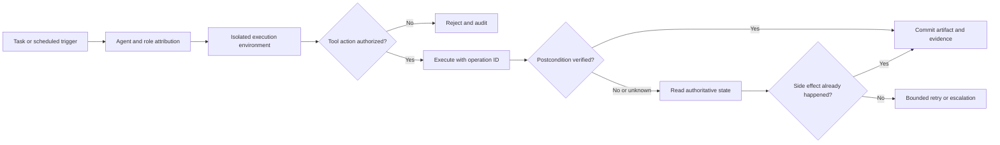

# AI Frontier — November 4, 2026

<!-- openshelf:budget-override reason="Retain the full six-item research briefing with source provenance, limitations, comparisons, experiments, and cross-item synthesis rather than reducing it to a title index." -->

**Selection:** Four core engineering and infrastructure findings plus two deliberate exploratory/adjacent selections (declarative tool security and enterprise CI automation). This edition deliberately changes sources and mechanisms after the November 3 focus on Agensh, RoboArchitect, AgentShield, AgentSWE and AgentOS. Newly opened PRs are **proposals**, not merged product capabilities. No implementation was run locally and no benchmark was independently replicated. Where a source is older, its age is explicit.

## 1. GitHub Octoverse 2026 — measured agent participation in software delivery

**Date:** October 28, 2026. **Primary source:** [GitHub's 2026 Octoverse report](https://github.blog/news-insights/octoverse/octoverse-commits-pushes-reach-new-highs-in-2026-as-developers-build-with-agents/). **Verdict:** High relevance, strong platform-scale observational evidence, low algorithmic novelty.

**What was measured.** GitHub reports that more than 40% of pull requests started with an agent in September 2026, up from 17% in March, with 110 million agent-started PRs in September. The share of agent-involved PRs merged within two weeks reportedly reached 90% in September, compared with about 86% without detected agent involvement. The annual report also identifies repositories with agent configuration files as having eight times as many commits *on average* as new repositories without them. These figures measure activity and association, not agent-caused productivity or correctness.

**Key technique:** Task-level delegation into cloud coding agents, followed by human or automated review gates. The important shift is from chat-assisted editing to PR-centric work units with observable acceptance and merge outcomes.

**Why interesting:** Unlike another model benchmark, this is real workflow telemetry at platform scale. It suggests engineering bottlenecks increasingly move toward review, test infrastructure and coordination. GitHub also reports 61% of model-selecting Copilot users chose multiple models in September, supporting model-routing as an observed practice rather than merely a design proposal.

**Practical takeaway:** For an autonomous repository maintenance agent, track PR creation-to-merge latency, review iterations, CI retries, revert rate and regression escapes, not commit volume. Compare agent-originated and human-originated changes on matched tasks.

**Limitations:** Vendor-defined agent detection, selection effects, and non-equivalent PR complexity preclude a causal claim. The report's observation window ends September 30.

```chart
{"type":"bar","title":"Agent-started share of GitHub pull requests","caption":"GitHub Octoverse 2026: platform-reported shares, March vs September 2026; observational and not causal.","labels":["March 2026","September 2026"],"datasets":[{"label":"Share (%)","data":[17,40]}],"yAxis":{"min":0,"max":100,"title":"Share of PRs (%)"}}
```

*Note: September is reported as **more than** 40%; 40 is the conservative lower bound used for the chart, not a precise estimate.*

## 2. CUA AgentEnv — macOS VM provider for computer-use agents

**Date:** November 3, 2026 PR activity. **Primary source:** [trycua/cua PR #6405](https://github.com/trycua/cua/pull/6405) and [follow-up #6407](https://github.com/trycua/cua/pull/6407). **Verdict:** High practical relevance for macOS workflows; early implementation, unmerged at discovery.

**What was built or proposed.** The CUA repository has an AgentEnv plugin proposal for macOS virtual machines using the Lume provider and a macOS driver, with a follow-up extending driver and benchmark app coverage. These are specific integration changes, not evidence of a stable released capability.

**Key technique:** Provide a replaceable virtual desktop substrate behind the computer-use agent interface. A VM can isolate state, make test environments reproducible and reduce the damage of an agent interacting with the wrong application.

**Why interesting:** Desktop automation evaluation often conflates model ability with inconsistent UI state. VM-backed sessions make setup, teardown, snapshots and repeatability part of the harness. This complements yesterday's browser-observation work but addresses the *execution environment* rather than detecting agents.

**Practical takeaway:** Build a disposable macOS test VM with a deterministic app/task fixture; run the same agent task from a fresh snapshot and measure task success, action count, recovery after UI focus loss, and unintended filesystem changes.

**Limitations:** PR titles and descriptions establish proposed implementation direction, not measured reliability or merged availability. Verify merge state, installation and license before adoption.

## 3. BuilderIO agent-native — unknown write outcomes as an explicit failure state

**Date:** November 3, 2026. **Primary source:** [BuilderIO/agent-native PR #8670](https://github.com/BuilderIO/agent-native/pull/8670). **Verdict:** Narrow but unusually concrete reliability finding; unmerged PR at discovery.

**What was proposed.** The PR addresses agent runs ending in a `write_tool_outcome_unknown` state even when a rejected write persisted nothing. The failure mode is not a model reasoning error: it is ambiguity between an attempted side effect, tool response, and actual committed state.

**Key technique:** Distinguish *intent*, *tool acknowledgment*, and *observed persisted effect*. A recovery mechanism should reconcile authoritative state before retrying a write or reporting success.

**Why frontier:** Long-running agents fail at integration boundaries that are invisible in normal prompt demos. This is a small, inspectable example of the durability problem discussed in yesterday's AgentOS item, but from a different application and with a precise false-unknown outcome.

**Practical takeaway:** Wrap all write tools with an operation ID, precondition, postcondition and read-after-write reconciliation. Fault-inject timeouts before and after the actual write. Never infer success from a fluent agent message.

**Limitations:** The PR title does not establish that the patch is correct, merged, or comprehensively tested; treat it as a candidate design and regression test.

## 4. Claude Agent ACP — explicit subagent role metadata

**Date:** November 2, 2026 release PR. **Primary source:** [agentclientprotocol/claude-agent-acp PR #1516](https://github.com/agentclientprotocol/claude-agent-acp/pull/1516). **Verdict:** Incremental implementation, strategically useful interoperability signal.

**What was proposed.** The ACP adapter's release activity includes exposing explicit subagent role metadata. Rather than treating every agent message as an undifferentiated stream, clients can present or process information about which delegated role produced it.

**Key technique:** Typed role provenance across the agent-to-client boundary. This can support audit logs, UI grouping, and specialized handling of delegated work.

**Why interesting:** For multi-agent systems, attribution is a prerequisite for assessing individual contributions and failures. Compared with Agensh's decentralized work claiming, this is a smaller protocol-interface feature; it does not itself solve task scheduling or conflict resolution.

**Practical takeaway:** Add `agent_id`, `role`, `parent_task`, `artifact_id`, and `verification_status` to every agent result. Keep role metadata descriptive, not an authorization source.

**Limitations:** No evidence here of cross-client compatibility or measured improvement. The release PR is not proof of a stable deployment.

## 5. ToolGuardian — declarative authorization for agent tools (exploration)

**Date:** July 23, 2026 paper, selected now as a security architecture comparison. **Primary source:** [ToolGuardian paper](https://arxiv.org/abs/2607.21835). **Verdict:** High technical relevance but **not recent**; exploratory catch-up, author-reported evaluation.

**What was built.** A two-stage tool security framework: characterize MCP-style tools from descriptions, syscall traces, mock execution and source analysis, then use Answer Set Programming to decide tool admission and runtime authorization based on capabilities, effects, context and composition.

**Key technique:** Separate evidence gathering about tool behavior from deterministic policy evaluation. An LLM need not be the final authority on whether a side effect is permitted.

**Evidence:** The authors report 0.86 deny-class F1 and 88% accuracy for one vetting configuration across 16 tools, including eight malicious variants, plus 20 runtime scenarios. These are small, constructed evaluations, not production detection rates.

**Why frontier:** As agent systems acquire arbitrary tools, descriptions are inadequate as security boundaries. Declarative policy can make composition and least privilege inspectable. This is distinct from yesterday's AgentShield, which studied browser-agent detection and obstruction-induced drift.

**Practical takeaway:** For an MCP or agent-skill gateway, first inventory capabilities and side effects, then apply an independent allow/deny policy to each requested action and multi-tool chain. Test benign/malicious lookalikes and false denials.

**Limitations:** Small tool sample, curated scenarios and author-reported results; rule coverage and tool characterization remain open problems.

## 6. GitHub Agentic Workflows — natural-language CI automation with constrained outputs (exploration)

**Date:** June 11, 2026 public preview, selected as a practical deployment example rather than a fresh release. **Primary source:** [GitHub changelog](https://github.blog/changelog/2026-06-11-github-agentic-workflows-is-now-in-public-preview/). **Verdict:** Strong implementation relevance; vendor claims, older release.

**What was built.** Markdown-defined agentic workflows compile to GitHub Actions YAML for tasks such as issue triage, CI failure analysis, documentation maintenance, and security remediation. The preview describes read-only permissions by default, sandbox execution, a workflow firewall, safe outputs and threat scanning.

**Key technique:** Compile high-level agent instructions into a constrained automation runtime, with explicit permission and output boundaries. The agent reasons within a job; the surrounding workflow controls what can be applied.

**Why interesting:** This is a concrete route from personal coding-agent experiments to maintainable repository operations. Compared with generic scheduled prompts, it uses the repository's existing CI and review infrastructure as the execution and trust substrate.

**Practical takeaway:** Prototype a nightly read-only issue-triage or documentation-drift workflow, generating a proposed PR or artifact through an approval gate. Verify that untrusted issue content cannot expand permissions.

**Limitations:** Customer testimonials and performance claims are vendor-supplied; the preview announcement does not prove reliability, security or economic value in a particular repository.

## Cross-item comparison and experiment

The six findings cluster into three layers: **work delegation and provenance** (Octoverse, ACP), **reproducible and recoverable execution** (CUA, BuilderIO), and **enforced authorization** (ToolGuardian, Agentic Workflows). These layers are complementary, not competing substitutes.



**Recommended experiment: durable two-agent GitHub maintenance.** Start with one deterministic repository task and one reviewer agent. Run it in a disposable environment with role-tagged traces. Simulate a write that succeeds but times out, and a write that fails before persistence. Require read-after-write reconciliation, policy checks, CI acceptance and a human-reviewed PR. Measure false success, duplicate side effects, latency, token cost and acceptance-test pass rate. Repeat from clean snapshots. This is more informative than maximizing agent count.

## Preference audit

Recent briefings repeatedly emphasize multi-agent orchestration, harness optimization and evaluations. Today's deliberate adjustment favors **production-adjacent implementation details and actual developer behavior**, including three small engineering changes that would be easy to overlook in paper-only searches. The two exploratory selections (security policy and GitHub workflow compilation) broaden application areas while preserving technical specificity. This is a search-strategy adjustment, not a claim of new user feedback.

## Frontier signal

**Agent engineering is converging on explicit contracts at every boundary.** The interesting advances are not simply more autonomous decisions: they are attributable delegated work, isolated execution, reconciled side effects, and policies enforced outside the model. The next useful benchmark is whether an agent can recover from uncertain outcomes without duplicating actions or misreporting completion.

**Evidence note:** Dates and links refer to original primary-source publications or repository PRs. PRs were observed as proposed changes; no merge, deployment, benchmark replication, or local execution is asserted.