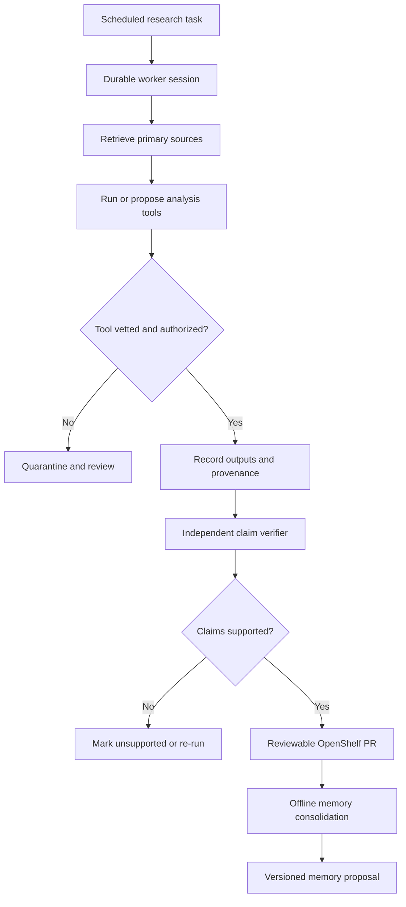

# AI Frontier — November 5, 2026

<!-- openshelf:budget-override reason="Preserve seven complete primary-source research assessments, limitations, experiment design, and the provenance architecture in the historical briefing rather than truncating evidence." -->

**Selection:** Five core implementation and infrastructure findings and two exploratory research findings (71% / 29%). New items are not repeats of November 3's Agensh, RoboArchitect, AgentShield, AgentSWE, AgentOS or November 4's Octoverse, CUA, BuilderIO, ACP, CrossSWE, ToolGuardian and GitHub Agentic Workflows. Sources were read or inspected as linked, but code was not run and results were not independently reproduced. Repository updates on November 5 are *activity dates*, not necessarily project launch dates.

**Executive finding.** Two related design shifts stand out: agents are being treated as durable processes whose memory and tool effects survive restarts; and improvement is moving into explicit executable procedures and provenance-gated tool libraries. The most distinctive new research is a real scientific analysis pipeline that allows agents to write tools while rejecting unsupported numbers in its final report.

## 1. auto_research — astronomy analysis with verifiable self-extension (exploration)

**Date:** November 3, 2026. **Source:** [primary paper](https://arxiv.org/abs/2611.05251). **Verdict:** High novelty; unusually concrete scientific deployment; early, author-reported validation.

**Built/demonstrated:** A semi-autonomous multi-agent pipeline that retrieves and analyzes raw High Energy Astrophysics Science Archive Research Center (HEASARC) data, writes new analysis tools as needed, and drafts reports about Imaging X-ray Polarimetry Explorer (IXPE) observations. The pipeline reproduced a published Cyg X-1 analysis, undertook a six-observation polarization-stability analysis, surveyed 29 observations for polarization–hardness relations, and searched for lag between Stokes parameters.

**Agentic mechanism:** Tool self-extension is staged. New tools undergo repeated automated runs, a fabricated-value-phrase scan, and cross-provider model review; a human approves promotion into the trusted branch. A reported number is allowed only if it appears in a recorded tool output, the request, or a located cited publication. The agent cannot merely narrate a plausible measurement.

**Evidence:** In a 65-defect injection study, 47 planted defects passed the automated checks and one passed the additional code review. The review also rejected 40 of 69 correct changes. The pipeline's 14 compared Cyg X-1 quantities agreed with published results within 3 sigma, although polarization-degree estimates were lower. With weaker main-role models, it recovered 12/14 quantities and explicitly marked two as unmeasured. These are the author's tests; the high false-rejection rate is material.

**Why frontier / comparison:** Unlike general self-improving coding agents, this explicitly connects generated code, scientific measurements and provenance. Compared with November 4's deterministic tool authorization, it addresses whether *results* are traceable to actual executions, not just whether a tool was permitted.

**Practical takeaway:** For automated research or knowledge-base ingestion, require every numeric assertion to carry a machine-checkable reference to a tool-output artifact or a cited source location. Keep human review for promotion of newly generated tools.

**Caveat:** Reproduction within 3 sigma is not proof of correct independent inference, and the review rejects many valid patches. Audit both false accepts and false rejects before deploying such a gate.

## 2. SeaFlow — semantic decomposition into executable agent workflows

**Date:** November 1, 2026 paper; repository inspected November 5. **Sources:** [paper](https://arxiv.org/abs/2611.01840), [implementation](https://github.com/Applied-Machine-Learning-Lab/NeurIPS2026_SeaFlow). **Verdict:** High relevance and actionable; author-reported competition evidence.

**Built/demonstrated:** A framework for decomposing complex tasks into procedures with explicit applicability conditions. Procedures either execute code or call a model; execution feedback refines the decomposition and procedure selection. The authors evaluated bargaining, negotiation and persuasion in the GLEE competition and report first overall in the competition in the repository description.

**Agentic mechanism:** Turn repeatable decision segments into code while reserving LLM reasoning for uncertain or context-dependent steps. This is *selective compilation of behavior*, not blind conversion of every agent thought into a script.

**Evidence:** The paper reports that most observed final-decision procedures are implemented as code. The repository contains an implementation, but the competition result and efficiency claims are author-reported here; no controlled local cost or accuracy comparison was performed.

**Why frontier / comparison:** Builds on the pattern in SkillCompiler already cataloged in the KB: the novel emphasis is semantic task decomposition with explicit applicability conditions and feedback-driven evolution in interactive strategic tasks. It suggests a useful optimization objective: replace repeated model calls with stable procedures without losing adaptability.

**Practical takeaway:** Instrument a recurring agent workflow and classify each decision as deterministic, bounded-choice, or genuinely open-ended. Compile only the first two classes, then measure cost, success and fallback frequency.

**Caveat:** Success in negotiation games does not establish performance in repository engineering or browser automation; applicability-condition errors may silently route work to an unsuitable procedure.

## 3. Adversarial Speculative Reasoning — changing long-horizon reliability through inference scheduling (exploration)

**Date:** November 3, 2026. **Source:** [primary paper](https://arxiv.org/abs/2611.05345). **Verdict:** High conceptual novelty; low immediate DIY accessibility.

**Built/demonstrated:** A speculative-decoding training method that deliberately encourages draft-model rejection at critical reasoning points so target-model verification restarts there. The authors report improved end-to-end coding-agent success without changing the target model's output distribution.

**Agentic mechanism:** Treat draft acceptance/rejection as a way to allocate numerical precision across a long reasoning trace. The paper argues that numerical noise across verification windows can compound after roughly 30 steps and change later decisions; training 0.06%–0.28% of hosted parameters can bias rejection toward consequential reasoning positions.

**Evidence:** Improvements on complex coding-agent benchmarks are reported in the abstract, but no specific percentage gain is asserted here because it was not verified from the full tables. This is not a claim that ordinary prompting or API model selection reproduces the technique.

**Why frontier / comparison:** Previous briefings emphasized external harness optimization; this explores a lower-level inference mechanism influencing long-horizon agents even when nominal target-model token distributions are unchanged.

**Practical takeaway:** For self-hosted speculative-decoding stacks, log draft acceptance, restart boundaries, and downstream task errors across long trajectories. For hosted APIs, treat this as a research watch item, not a deployable configuration.

**Caveat:** Hardware, numerical kernels and draft-model training conditions may determine transferability. Do not infer reproducibility on closed hosted models.

## 4. AgenticBench — observed agent-harness privacy and boundary controls

**Date:** Leaderboard updated November 4, 2026. **Source:** [benchmark and methodology](https://agenticbench.org/). **Verdict:** Strongly actionable security evaluation; narrow coverage, not a code-quality ranking.

**Built/demonstrated:** An independent rolling evaluation of what coding-agent harnesses do with local machine data, network egress, telemetry, workspace boundaries and secrets. The current v0.7.0 suite has 11 checks and 26 approved harness records. The November 4 additions include Step Code 0.1.6 and Amp build 0.0.1793692836-g3a602a, each 6/11; Hermes Agent 0.22.5 was tested October 30 and scored 7/11. The leaderboard lists Codex 0.163.0 and GitHub Copilot CLI 1.0.103 at 11/11 in their respective October tests.

**Agentic mechanism:** Test the execution *harness* rather than only the code the model generates. Tests assess observable security and privacy controls of a tool-using runtime.

**Why frontier / comparison:** November 4's ToolGuardian proposed policy enforcement; this benchmark examines deployed harness behavior. A passing coding benchmark cannot establish safe workspace isolation or secret handling.

**Practical takeaway:** Run an isolated acceptance suite against the exact installed Hermes/OpenCode/Codex versions before giving an agent real credentials. Record version, test definition, egress destinations, permission prompts, and secret exposure outcomes.

**Caveat:** A pass count is not a comprehensive security certification. The leaderboard explicitly counts not-applicable and untested checks in its denominator; different test versions and conditions must not be compared as though equivalent. No local verification of these scores was performed.

## 5. Rivet Agents — durable process per agent

**Date:** Repository active November 5, 2026 (not necessarily first released today). **Source:** [rivet-dev/agents](https://github.com/rivet-dev/agents). **Verdict:** High practical relevance; implementation exists, production claims unverified.

**Built/demonstrated:** An open-source TypeScript agent infrastructure project organized around a durable process for each agent, with state and memory intended to survive restarts. Its repository advertises sandbox integrations and coding-agent use cases.

**Agentic mechanism:** Model each long-running agent as a persistent actor/process rather than a one-shot prompt. The runtime owns lifecycle, resumability and isolation boundaries.

**Why frontier / comparison:** Complements November 3's AgentOS recovery concepts and November 4's uncertain-write analysis, but shifts the abstraction from an execution loop to a per-agent durable process. The key distinction to evaluate is whether state survives process failure *without* duplicating external effects.

**Practical takeaway:** Prototype a persistent research worker that stores its queue cursor, last verified artifact and tool-operation IDs. Kill it mid-task; restart and check that it resumes without replaying completed writes.

**Caveat:** The README's durability claim alone does not prove exactly-once execution or safe retries. Those properties require an application-level reconciliation test.

## 6. tigerless agent-memory — local Markdown memory with offline consolidation

**Date:** Repository active November 3–5, 2026; original launch date not verified. **Source:** [tigerless-labs/agent-memory](https://github.com/tigerless-labs/agent-memory). **Verdict:** Highly relevant to personal agent stacks; concrete architecture, effectiveness unbenchmarked here.

**Built/demonstrated:** A local-first memory runtime using plain Markdown as its source of truth, ranked retrieval, and a separate sleep-time Manage layer. Its project description says Claude Code and Codex can share the same memory store without an API key.

**Agentic mechanism:** Separate online memory retrieval from offline memory maintenance. The independent consolidation step can update durable knowledge between agent sessions rather than relying on each active task to summarize itself.

**Why frontier / comparison:** The distinctive pattern is a shared, user-owned, inspectable memory corpus across multiple agent harnesses. It overlaps with existing memory techniques, but the independent management phase offers a concrete experiment in reducing repeated context and stale assumptions.

**Practical takeaway:** Compare no memory, append-only memory and offline-managed memory on 20 repeated repository tasks. Measure relevant-fact recall, stale-memory errors, tokens injected and manual correction rate. Version the Markdown so a bad consolidation can be rolled back.

**Caveat:** Shared memory can also spread incorrect conclusions and secrets across agents. Do not equate local storage with safe isolation; add namespaces, provenance and retention controls.

## 7. OpenMA — self-hostable managed-agent sessions and recovery

**Date:** Repository active November 5, 2026; not necessarily launched today. **Source:** [openma-ai/open-managed-agents](https://github.com/openma-ai/open-managed-agents). **Verdict:** High operational relevance; claims need hands-on verification.

**Built/demonstrated:** OpenMA offers an open-source, self-hostable management layer for agent sessions, execution and recovery, with model, harness, sandbox and cloud-provider choices. The stated goal is to separate the lifecycle manager from the agent implementation.

**Agentic mechanism:** A control plane that tracks sessions and recovery while workers run in interchangeable sandboxes. This reduces coupling between orchestration policy and a specific model vendor.

**Why frontier / comparison:** Where Rivet's key abstraction is a durable process per agent, OpenMA emphasizes managed sessions and interchangeable execution substrates. Neither should be assumed to guarantee transactional side effects.

**Practical takeaway:** Compare a managed session against a custom cron-driven agent on restart, cancellation, tool timeout, sandbox cleanup and state restoration. Score the actual postconditions, not whether the process returned 'success'.

**Caveat:** The repository's feature description is not evidence of production-scale reliability, security or cross-provider compatibility. Test before adopting.

## Cross-item comparison

| Layer | Today's representative | Distinguishing question | Primary risk |
| --- | --- | --- | --- |
| Research provenance | auto_research | Can every result be traced to an execution or citation? | False accept/reject in validation |
| Adaptive workflow | SeaFlow | Which reasoning steps can safely become code? | Incorrect applicability conditions |
| Inference | Adversarial Speculative Reasoning | Does verification placement affect long-horizon outcomes? | Hardware/model dependence |
| Harness security | AgenticBench | What does the agent runtime actually expose? | Narrow test coverage |
| Durable execution | Rivet Agents | Does an agent process survive interruption? | Duplicate side effects |
| Durable knowledge | tigerless agent-memory | Does offline consolidation improve future work? | Stale or contaminated memory |
| Managed operations | OpenMA | Can sessions recover across harness/sandbox changes? | Hidden state mismatch |

## Recommended experiment: provenance-gated, crash-safe research agents

Use two workers: a **researcher** that retrieves primary sources and proposes analyses, and a **verifier** that independently checks each quantitative assertion against saved evidence. Store every artifact and operation ID in a durable state store; treat the Markdown KB as the reviewed knowledge output. A separate offline consolidation process can propose memory updates, but cannot directly overwrite verified source facts.

**Fault-injection plan:** (1) kill a worker after an external write but before acknowledgment; (2) inject a numeric claim absent from any tool output; (3) poison a memory summary with an outdated project status; (4) present an unapproved generated tool. For each, measure false-success claims, duplicate writes, unsupported numbers accepted, recovery latency, token cost, and reviewer interventions. Require **zero unsupported numeric claims in the final PR** and **zero duplicate side effects** in the bounded fixture; those are experiment goals, not measured outcomes.

**Adoption order:** First add provenance IDs and read-after-write checks to the existing agent workflow. Next test durable sessions. Only then add offline memory consolidation or self-evolving procedures, because they increase the surface area of unverified state.

## Preference and novelty audit

The November 3–4 reports concentrated on coding-agent infrastructure, reliability and security, with several GitHub PRs and older catch-up sources. This edition deliberately shifts toward primary research, one scientific deployment, an independent harness evaluation, and three active implementation repositories. Five of seven remain close to the recurring engineering/knowledge-management interests; the two research explorations expand into astronomy and inference internals. Repository activity timestamps are not misrepresented as new releases. No new explicit feedback was observed that warrants changing the underlying preference weights.

## Frontier signal

**Autonomy is becoming a data-integrity and lifecycle engineering discipline.** The strongest systems do not merely generate more actions: they preserve durable state, distinguish tool effects from claims, and require provenance before results become trusted memory or published knowledge. Self-improvement without verifiable evidence can compound errors faster than it compounds capability.
