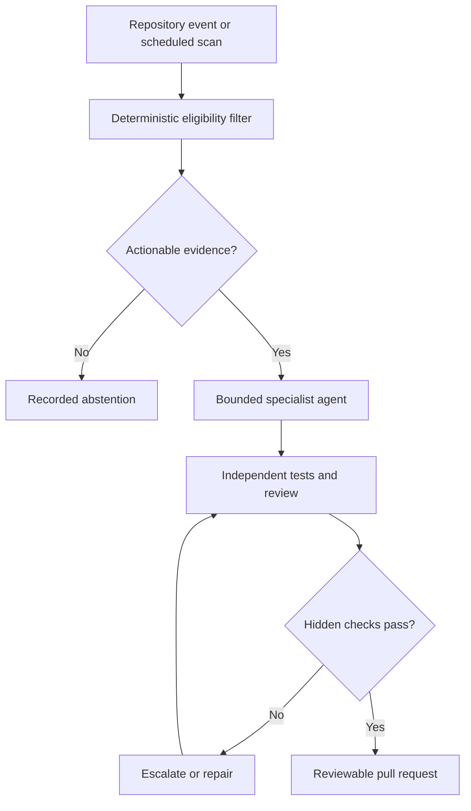

<!-- openshelf:budget-override reason="Preserve complete five-item evidence assessments, source-specific caveats, cross-day comparisons, experiment design and architecture in this dated research snapshot." -->

# AI Frontier — November 6, 2026

**Selection:** Three core engineering implementations and two exploratory discoveries (60%/40%); exploration is slightly above the usual 20–30% target because today's strongest independent research concerns warehouse robotics and the other discovery explores a different browser architecture. The remaining three selections share GitHub Agentic Workflows as a source family; this concentration is an acknowledged weakness to correct next time. None of these five repeats the November 3–5 canonical selections.

**Executive finding.** The most useful new idea is *selective autonomy*: deterministic filtering before inference, explicit no-op outcomes, bounded write surfaces, and held-out scoring before code changes are accepted. A spectacular benchmark number is less important than knowing the conditions where an agent's improvement disappears.

## 1. Late Autumn — coding agents specialize warehouse robot planning

**Date:** November 2, 2026. **Source:** [Primary source](https://arxiv.org/abs/2611.02391). **Category:** Exploration / strongest research.

**What was built or demonstrated:** Six autonomous coding-agent campaigns modified a lifelong task-assignment and multi-agent pathfinding planner for a modeled commercial warehouse, evaluating candidate commits on stochastic simulations and scoring against hidden seeds.

**Agentic technique:** Autonomous algorithm search over a real planner, hidden-seed evaluation, and reviewable chains of small commits rather than opaque final code.

**Evidence and limitations:** Authors report 22–60% throughput improvements; all six best patches beat baseline on 20 fresh seeds. Gains carried to 40 of 42 held-out configurations, but largely vanished under outbound-heavy demand. Some patches increased planner compute by more than 100×. Median improving step was 27 lines; final patches were 700–2,400 lines.

**Why this matters / comparison:** Unlike yesterday's scientific auto_research pipeline, this directly optimizes an operational control algorithm with a stochastic score and an explicit generalization test. It is a modeled warehouse, not evidence of deployed robot-fleet gains.

**Practical takeaway:** Use an autonomous coding agent to optimize a CAN parsing, scheduling, or embedded fuzzing heuristic against held-out traces. Require throughput, CPU budget, safety invariants, and reviewable incremental commits.

**Verdict:** High novelty and strong methodology, but author-reported simulation evidence; beware compute explosions and workload overfitting.

## 2. Matt Pocock Skills Reviewer — targeted, cost-routed PR reviews

**Date:** November 6, 2026. **Source:** [Primary source](https://github.github.com/gh-aw/blog/2026-11-06-agent-of-the-day/). **Category:** Core / observed workflow.

**What was built or demonstrated:** A GitHub Agentic Workflows PR reviewer imports a shared review base, selects engineering skills based on change type, uses economy-oriented model routing, and leaves a signed review linked to its run.

**Agentic technique:** Task-adaptive reviewer specialization with narrow, auditable write permissions and traceable review authorship.

**Evidence and limitations:** GitHub's published audit cites three successful PR-triggered runs lasting 13.1, 11.4, and 18.1 minutes, with 58,142, 51,209, and 103,570 log-summary tokens. One inspected run produced one inline comment and one review. The audit flagged high token use and a declared subagent not observed in requests.

**Why this matters / comparison:** A real, instrumented PR-review pipeline; the skill selection itself is incremental, but the run-level evidence makes it actionable.

**Practical takeaway:** Try a specialized reviewer on OpenShelf PRs that checks provenance, OpenShelf metadata, link validity, and unsupported depth promotions. Cap review comments and measure actionable findings per 10k tokens.

**Verdict:** Practical, observable; cost effectiveness remains unproven.

## 3. Code Simplifier — an agent that correctly chooses not to write

**Date:** November 5, 2026. **Source:** [Primary source](https://github.github.com/gh-aw/blog/2026-11-05-agent-of-the-day/). **Category:** Core / observed workflow.

**What was built or demonstrated:** A daily maintenance workflow inspects recently changed code, uses a file eligibility/language classifier and an extractive low-risk simplification scout, then applies language-specific review standards.

**Agentic technique:** Cheap staged triage and explicit abstention rather than forcing a PR every scheduled run.

**Evidence and limitations:** GitHub reports three successful runs on November 3–5 (6.2, 8.2, 8.8 minutes; 8,527, 9,486, 8,323 log-summary tokens) but zero safe-output items, so no PR was opened. A separate audit reported roughly 114k overall tokens; the metrics are different accounting views.

**Why this matters / comparison:** The important operational result is an honest null action. A successful run is not evidence that useful code was changed.

**Practical takeaway:** Make your daily agents emit a machine-readable no-change verdict and record why. Track false-positive PR rate and total cost per accepted change, not just successful scheduled runs.

**Verdict:** Good engineering pattern, not a breakthrough; no evidence of simplification quality yet.

## 4. PR Sous Chef — prefiltered agent coordination for stalled PRs

**Date:** November 4, 2026. **Source:** [Primary source](https://github.github.com/gh-aw/blog/2026-11-04-agent-of-the-day/). **Category:** Core / observed orchestration.

**What was built or demonstrated:** A five-minute scheduled workflow deterministically prefilters actionable PRs, then gives an agent a compact queue. The agent may dispatch PR Finisher, add limited comments, approve allowlisted runs, or escalate via an expiring issue.

**Agentic technique:** Deterministic prefilter + bounded agent decision + safe-output dispatch to another workflow.

**Evidence and limitations:** Four inspected runs included two successes and two failures; one successful run took 9.9 minutes and an audit estimated 249k tokens, with 72% of turns potentially reducible to deterministic data gathering. Two downstream PR Finisher runs reportedly succeeded.

**Why this matters / comparison:** A real multi-agent operations loop with explicitly bounded delegation and documented failure cases. This goes beyond yesterday's generic managed-agent control planes.

**Practical takeaway:** Build a queue prefilter for stale GitHub issues/PRs, then delegate only the ambiguous cases to a model. Use idempotent dispatch keys and a human escalation path; measure queue age and duplicate dispatches.

**Verdict:** High implementation relevance; reliability and cost remain significant concerns.

## 5. Browser4 — hybrid browser agent with deterministic extraction

**Date:** Repository inspected November 6, 2026; launch date not verified. **Source:** [Primary source](https://github.com/platonai/browser4). **Category:** Exploration / infrastructure.

**What was built or demonstrated:** An open-source browser engine exposing CDP-native browser automation via CLI and MCP, interactive element snapshots, batch actions, deterministic X-SQL/CSS extraction, crawl jobs, reusable selector experience, and a programming-agent tool kernel.

**Agentic technique:** Hybridize expensive model-guided navigation with deterministic selectors and reusable browser knowledge, keeping stateful browser sessions available to agents.

**Evidence and limitations:** The README documents the CLI, MCP, snapshot and extraction interfaces, and claims 100k–200k complex page visits per machine per day. This throughput is a project claim, not independently benchmarked here. The repository was not executed.

**Why this matters / comparison:** More operationally interesting than another chat-driven browser: its zero-token extraction and experience-store pattern could reduce repeated perception calls. Compared with November 4's macOS VM computer-use work, this optimizes the browser interface rather than environment isolation.

**Practical takeaway:** Benchmark browser4 against Playwright on 20 recurring source-ingestion tasks, measuring successful extraction, tokens, selector breakage, network safety, and recovery after DOM changes.

**Verdict:** Promising concrete infrastructure, but launch date and performance claims require verification.

## Comparison and experiment

The three GitHub workflows illustrate distinct control patterns: Skills Reviewer optimizes *which review lens* to apply, Code Simplifier permits *no action*, and PR Sous Chef limits *what action* may be taken after a deterministic prefilter. Late Autumn supplies a stronger scientific acceptance pattern: hidden-seed generalization and explicit compute accounting. Browser4 offers a separate infrastructure bet: replacing repeated model reasoning with reusable deterministic extraction.

**Recommended experiment:** Create a sandboxed maintenance-agent benchmark for AI Frontier and CANarchy. Use a deterministic prefilter to collect changed files and failing tests; assign a small agent to triage; run an independent reviewer; permit a PR only when acceptance tests pass. Include hidden regression cases, forced tool timeouts, and a no-change day. Compare single-agent, staged multi-agent, and rule-only baselines on acceptance-test pass rate, unnecessary PRs, duplicate writes, wall time, token cost, and reviewer effort. A model's completion statement is not a measured outcome.

### Quantitative context: warehouse planner

The source reports a **range**, not comparable individual campaign values. It is deliberately not converted into an invented bar chart. Across six campaigns, improvements were **22–60%** in the abstract; the paper body also states **22–63%** for fresh-seed best-patch comparisons. This difference reflects reporting context and should not be collapsed into a single precise claim. Some candidate patches increased compute by over 100×. [Source](https://arxiv.org/abs/2611.02391).

### Preference and novelty audit

Recent briefings favored tool reliability, provenance, durable execution, and practical coding agents. There is no new explicit preference feedback since the last briefing, so no change to the preference model is asserted. Today's exploration includes industrial robotics and browser extraction. Three of five findings come from one project family; next selection should deliberately prioritize independent laboratories, builders, and production deployments outside GitHub's agent-workflow blog.

### Frontier signal

**The frontier is moving from always-act agents toward evidence-gated, selective execution.** The credible systems decide when *not* to act, shrink model work through deterministic prefilters, limit allowed side effects, and validate algorithm changes on unseen cases. Cost and compute overhead are still often undermeasured.

### Source provenance

- https://arxiv.org/abs/2611.02391
- https://github.github.com/gh-aw/blog/2026-11-06-agent-of-the-day/
- https://github.github.com/gh-aw/blog/2026-11-05-agent-of-the-day/
- https://github.github.com/gh-aw/blog/2026-11-04-agent-of-the-day/
- https://github.com/platonai/browser4

**Verification note:** All numeric results are source-reported; no repository code was executed and no benchmark independently replicated. Browser4's project launch date and claimed crawl throughput are not established by this briefing.
