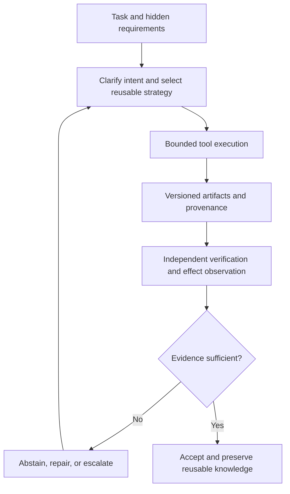

<!-- openshelf:budget-override reason="Full five-item research narrative, numerical caveats, experiments, provenance, knowledge mining and cross-project comparison are required for faithful dated archival." -->

# AI Frontier — November 7, 2026

**Selection:** Five new primary-source research implementations dated November 2–5, 2026; three core (Strategist, FINCOSMOS, ChemE-as-Code) and two exploratory (FA-Agent, ControlAnything), a 60%/40% split. Exploration exceeds the 20–30% target because the prior briefing overconcentrated on three GitHub Agentic Workflows blog entries and today's cross-domain examples contain unusually transferable mechanisms. None repeats November 3–6 selections.

**Executive finding:** A useful agent system is increasingly an *evidence-producing execution environment*: reusable strategies are learned outside model weights; engineering artifacts carry provenance; and evaluators must check hidden intent and external effects rather than trust plausible completion narratives.

## 1. Strategist — reusable inference strategies that evolve across tasks

**Date:** November 2, 2026. **Primary source:** https://arxiv.org/abs/2611.03618. **Category:** Core; high novelty.

**What was built:** A meta-agent that searches a persistent library of executable strategy blueprints, writes new reasoning/inference procedures, tests them on development samples, revises them, and saves candidates for reuse on later tasks.

**Key technique:** Cross-task *inference-program evolution*. The reusable unit is the reasoning strategy itself, not a prompt or model fine-tune. Retrieval and empirical feedback make the strategy library an external learning substrate.

**Evidence:** Authors report that Strategist outperformed the strongest baseline on 24 of 30 benchmarks, and averaged **74.7% accuracy versus 74.0%** at **39% lower inference cost**. They report transfer to unseen tasks and other models without further search. These are author-reported results; benchmark composition and potential search/evaluation leakage require closer audit.

**Why frontier / comparison:** SkillCompiler (already covered in this KB) selectively compiles individual skill operations into deterministic programs. Strategist instead searches and transfers *whole inference strategies* across task families. Both improve frozen-model behavior through persistent external state, but at different levels of abstraction.

**Practical takeaway:** Build a library of executable research strategies for source retrieval, evidence grading and OpenShelf relation extraction. Run candidate strategies on a development corpus, then test transfer on genuinely held-out documents.

**Verdict:** High-interest, technically distinct, with a concrete efficiency claim; independent replication not established.

## 2. FINCOSMOS — agents pass user approval yet fail objective verification

**Date:** November 5, 2026. **Primary source:** https://arxiv.org/abs/2611.07464. **Category:** Core; strongest negative evaluation.

**What was built:** An open-world evaluation for financial research agents. A simulated user holds a hidden compositional trading strategy and reveals requirements only if asked. The agent must discover intent, acquire its own web data, construct a point-in-time backtest, and submit independently recomputable results.

**Key technique:** *Hidden-intent elicitation plus executable veto checks.* The evaluation recomputes claimed metrics, enforces data cutoffs, checks the delivered strategy against hidden intent and rejects runs failing any of **15 veto checks**, even if the simulated user accepts the report.

**Evidence:** Across **150 sessions** involving four coding agents and one no-tools model, **zero sessions were accepted**. Agents surfaced only **54–64%** of unspecified details. Human experts attributed **88.33%** of failures to agents. The authors additionally report that persistent-memory feedback let an agent learn ten tasks; this does not by itself establish generalization to unseen tasks.

**Why frontier / comparison:** Yesterday's selective-autonomy systems decide whether to act; FINCOSMOS tests whether an apparently successful action satisfies a specification the agent had to discover. It turns the dangerous gap between user satisfaction and verified correctness into a measurable outcome.

**Practical takeaway:** For autonomous security reports, hide key requirements in a simulated requester and enforce source cutoffs, independent recomputation, provenance and hard rejection of unsupported conclusions.

**Verdict:** High-value falsification benchmark. Finance is the domain, but the evaluation pattern transfers to engineering and autonomous research.

## 3. ChemE-as-Code — agent-driven engineering with a verifiable artifact graph

**Date:** November 5, 2026. **Primary source:** https://arxiv.org/abs/2611.07947. **Category:** Core; engineering workflow.

**What was built:** An open-source environment where an agent produces interconnected process-engineering files: simulations, process and instrumentation diagrams, layouts, safety analyses, equipment data and environmental calculations. Artifacts are machine-readable, linked and versioned in Git.

**Key technique:** *Provenance-bearing engineering-as-code*. Calculation programs run outside the LLM; values record inputs and origins; checks detect stale or inconsistent dependent artifacts by file and line. Domain expertise is packaged as skills and deterministic tools for one general-purpose agent rather than relying on many discipline-specific agents.

**Evidence:** An illustrative ammonia project generated a preliminary engineering package with **USD 224 of API expenditure** for design sessions. Planted faults and design changes show that checks detect some errors but miss others. The author explicitly states that **no independent engineer reviewed the design**, and the demonstration does not establish productivity gains or safe deployability.

**Why frontier / comparison:** This resembles OpenShelf's canonical evidence and relationship graph, but extends the same principle into executable engineering files with dependency invalidation. The interesting part is not text generation; it is the ability to trace how a changed assumption invalidates downstream outputs.

**Practical takeaway:** Represent embedded-security assurance artifacts as linked, Git-versioned evidence: threat analysis, controls, tests, findings and claims. When a test or dependency changes, invalidate affected conclusions automatically.

**Verdict:** Strong architectural example with honest validation limits; proof of workflow feasibility, not validated engineering correctness.

## 4. FA-Agent — multimodal seismic analysis with conservative deletion of weak evidence

**Date:** November 4, 2026. **Primary source:** https://arxiv.org/abs/2611.06555. **Category:** Exploration; scientific data processing.

**What was built:** A visual agent that inspects seismic gathers, selects suspicious regions, zooms in, invokes signal-processing and quality-control tools, then **keeps, corrects or removes** candidate first-arrival picks. Expert-reviewed cases can be added to reusable skills; local model deployment supports confidential survey data.

**Key technique:** *Visual triage with explicit uncertainty and expert-guided skill accumulation.* Unlike a predictor forced to output a pick for every trace, the agent can reject insufficiently supported observations.

**Evidence:** The authors describe semi-synthetic tests with known arrivals and processing **1,000 randomly sampled field gathers**, with three field examples presented in detail. Qualitative success is reported, but this briefing does not claim a verified aggregate accuracy improvement or independent replication.

**Why frontier / comparison:** This is a physical-data counterpart to the KB's abstention-as-a-first-class-verdict concept. Here the operational decision is not just 'unknown'; it is to remove an unreliable measurement that could bias downstream inversion.

**Practical takeaway:** Test keep/correct/remove triage on noisy CAN classification or telemetry anomaly labels, measuring decided precision, coverage, and expert review burden separately.

**Verdict:** Interesting domain transfer; limited public quantitative evidence, so treat performance claims cautiously.

## 5. ControlAnything — coding agents write device connectors while the user waits

**Date:** November 5, 2026. **Primary source:** https://arxiv.org/abs/2611.08321. **Code and video:** https://github.com/Apolotary/controlanything. **Category:** Exploration; embedded/device interaction and generative UI.

**What was built:** A Quest 3 user selects a physical object and asks for an interaction. A laptop coding agent writes and executes a Node connector, tests it against hand-written MIDI/Bluetooth/keyboard transports, and produces AR controls or per-frame hand programs. Demonstrated targets include an OP-1 Field synthesizer and a gimbal.

**Key technique:** *Just-in-time device integration*, not just generative interface layout. The agent creates the transport-facing glue after a device is selected, while a constrained host validates generated bindings and provides a stop path independent of the model.

**Evidence:** In **one author-only technical session**, **9 of 10** requests reached a ready state; the tenth was stopped by the wearer. Median ready time was **32.5 seconds** (range **24.9–57.8 seconds**, excluding transcription); sequential model calls accounted for median **89.9%** of that time. The evidence demonstrates transport acknowledgements, **not observed physical effects**. There is no independent user study.

**Why frontier / comparison:** Existing generative UI often assumes a prebuilt device API. ControlAnything generates both the control surface and the missing connector. Its most important limitation mirrors FINCOSMOS: an acknowledgement is not an independently verified outcome.

**Practical takeaway:** Prototype agent-generated MIDI mappings for an existing synth/controller, but gate all commands through a capability allowlist, human stop control and independent observation of actual parameter changes.

**Verdict:** A compelling, inspectable proof of concept with unusually explicit latency and evidence boundaries; not a mature general device-control system.

## Quantitative comparison and evidence limits

| Finding | Reported observation | What it does NOT prove |
| --- | --- | --- |
| Strategist | 24/30 benchmark wins; 74.7% vs 74.0% accuracy; 39% lower inference cost | Independent transfer across arbitrary tasks |
| FINCOSMOS | 0/150 accepted sessions; 15 veto checks; 54–64% missing details elicited | That persistent memory generalizes beyond the ten reported learned tasks |
| ChemE-as-Code | USD 224 API cost for illustrative design sessions | Independent design correctness or productivity gains |
| FA-Agent | 1,000 field gathers processed; three examples presented | A validated aggregate improvement over expert or model baselines |
| ControlAnything | 9/10 ready; median 32.5 s; 89.9% median time in sequential model calls | Verified physical effect or first-time-user success |

These measurements use different units, tasks and evidence tiers. **Do not aggregate them into a cross-project performance ranking or chart.**

## Architecture: evidence-gated autonomous work

The diagram is a proposed synthesis of the five sources, **not** a single deployed architecture.

## Recommended experiment: autonomous security-research acceptance test

Build 20 held-out prompts for an agent that researches an automotive security claim and generates an OpenShelf entry. A simulated requester withholds one to three material requirements; the agent must ask clarifying questions. Independent programs check source freshness, exact numerical provenance, quoted claims, relation endpoints, metadata and reproducibility. Compare: (A) one generalist, (B) strategy-library agent, (C) deterministic evidence checker plus bounded agent. Track *fully accepted artifacts*, unresolved requirements, abstentions, false source claims, token cost, and time. Avoid training on held-out cases. A successful PR or satisfied simulated requester is not the acceptance metric.

## Preference and novelty audit

The latest explicit feedback asks for **every briefing to be ingested and mined into canonical concepts and relations** and for validated PRs to auto-merge. This is a real preference update: raise the weight of source-backed reusable mechanisms and knowledge-graph enrichment. Recent source concentration in GitHub's agent-workflow blog is corrected here: all five selections originate in distinct research projects. The two cross-domain explorations are justified by transferable uncertainty-handling and device-integration patterns.

### What I learned about your interests

You explicitly value cumulative, deduplicated **knowledge mining and relationship discovery**, not just a daily article archive. This run therefore treats canonical page updates as part of the deliverable.

### Frontier signal

**Verification is migrating from prose review to executable, provenance-bearing artifacts.** Reusable strategy libraries increase what agents can attempt; hidden-intent tests, dependency invalidation and physical-effect checks determine what deserves to be trusted.

## Knowledge mining

### Canonical updates

Created five canonical project pages: [[projects/strategist]], [[projects/fincosmos]], [[projects/cheme-as-code]], [[projects/fa-agent]], and [[projects/controlanything]]. Updated the projects and briefing indexes and maintenance log. The existing concept taxonomy was reused rather than minting a redundant umbrella concept.

### Relations and evidence

- **[[projects/strategist]] implements [[concepts/improvement-lives-in-external-state]]**: executable strategy blueprints persist and transfer without model-weight updates (https://arxiv.org/abs/2611.03618). It **compares_with [[projects/skillcompiler]]** at strategy-level versus operation-level reuse; this is an analyst comparison of two papers, not a controlled head-to-head.
- **[[projects/fincosmos]] evaluates [[concepts/scoped-assurance]]** and **[[concepts/protocol-relative-scores]]**: hidden intent, point-in-time constraints and 15 vetoes change what counts as a successful run (https://arxiv.org/abs/2611.07464).
- **[[projects/cheme-as-code]] implements [[concepts/structural-constraint-over-instruction]]** in a limited sense: external programs and Git-linked provenance constrain what can be checked, but do not prove design safety (https://arxiv.org/abs/2611.07947).
- **[[projects/fa-agent]] implements [[concepts/abstention-as-first-class-verdict]]** operationally through removal of untrustworthy picks; no cross-domain benchmark equivalence is claimed (https://arxiv.org/abs/2611.06555).
- **[[projects/controlanything]] tests the boundary of [[concepts/scoped-assurance]]**: a transport acknowledgement does not establish a physical outcome (https://arxiv.org/abs/2611.08321).

### Mining audit

Five primary sources inspected, five new canonical projects, five sourced concept-family links, one additional analyst-level comparison with SkillCompiler. Existing project-index titles and arXiv IDs were checked for duplicates; none of these five appeared as canonical entries. No new standalone concept was created because each proposed theme maps to an existing evidenced concept. The five project pages remain **brief**, not deep: source abstracts and selected full-text sections were inspected, but no code was run, independent benchmark reproduced, or source-level counterfactual audit completed. Open questions: Strategist's leakage controls, FINCOSMOS memory generalization, ChemE engineering validity, FA-Agent aggregate accuracy, and ControlAnything physical-effect observation.

## Source provenance

- https://arxiv.org/abs/2611.03618
- https://arxiv.org/abs/2611.07464
- https://arxiv.org/abs/2611.07947
- https://arxiv.org/abs/2611.06555
- https://arxiv.org/abs/2611.08321
- https://github.com/Apolotary/controlanything

**Verification note:** All performance figures are reported by their authors. No benchmark was independently reproduced and no untrusted repository code was executed.
