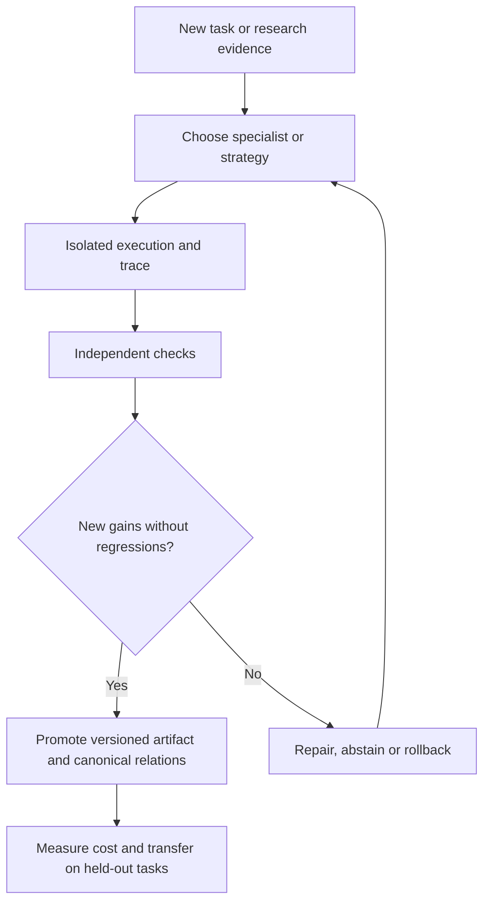

<!-- openshelf:budget-override reason="The complete five-item research narrative, independent evidence limitations, architecture, experiments and mandatory knowledge-mining audit must remain together in this historical snapshot." -->

# AI Frontier — November 8, 2026

**Selection:** Five new-to-this-KB findings: three aligned core selections (EvoAudit, TandemBench, MASBench) and two exploratory selections (ST-Bench and Agent Orchestrator). The exploration share is 40%, above the 20–30% target, to diversify source domains and avoid repeating yesterday's papers. Two October benchmarks are explicitly older gap-fills, not misrepresented as fresh launches.

**Executive finding:** Agent evolution and multi-agent orchestration need independent verification of *what was preserved*, *whether the candidate set was adequate*, *who could observe which information*, and *what cost bought the improvement*. A higher overall score is not proof of safer or more transferable autonomy.

## 1. EvoAudit / Beneath the Surface

**Date:** 2026-11-05. **Primary source:** https://arxiv.org/abs/2611.07624. **Selection:** Core.

**What was built:** Researchers compared four harness-evolution methods across general and coding tasks, repeated trials, controlled expansions, component interventions, and candidate-admission replays. EvoAudit revises the selection, analysis, mutation and gate stages in response.

**Key agentic technique:** Preservation-aware recursive self-improvement: compare per-task coverage before and after mutation, measure deployment cost and transfer, and avoid selecting candidates by a single aggregate score.

**Evidence and limits:** All 16 evolved agents gained some previously unsolved tasks while losing some previously solved tasks. One general-task case gained 5.2 reliability points but lost ten previously covered tasks. The highest-scoring candidate was not the best mean improver in any of four candidate pools. Results are author-reported, not independently reproduced.

**Why frontier / comparison:** High: directly exposes regressions hidden by self-improvement leaderboards, complementing yesterday's Strategist strategy library and the existing capability-locus concept.

**Practical takeaway:** For each evolving OpenShelf extraction strategy, retain a task-by-task regression ledger, deployment cost, held-out transfer tests and a rollback candidate.

**Verdict:** Strong diagnostic research; prioritize preservation metrics over headline gains.

## 2. TandemBench

**Date:** 2026-11-04. **Primary source:** https://arxiv.org/abs/2611.05827. **Selection:** Core.

**What was built:** A 1,200-question benchmark based on 200 collaborative cooking scenarios and 30 recipe tasks. Execution and exact search determine the best plan; paired questions include or omit the optimal candidate.

**Key agentic technique:** Paired counterfactual optimality verification: distinguish selecting a good supplied plan from detecting when every supplied plan is suboptimal.

**Evidence and limits:** 40 native decision models and 10 general language models were evaluated. The strongest native decision model reached 62.50% decision accuracy, while optimality-verification performance stayed near chance. Dataset and evaluation code are public at https://github.com/lililibaohang/TandemBench. Author-reported.

**Why frontier / comparison:** High for multi-agent decision verification: a router may rank alternatives reasonably but cannot reliably tell when its option set is deficient.

**Practical takeaway:** For a coding-agent scheduler, generate paired task-allocation cases with and without the truly optimal plan and score the ability to request a new plan.

**Verdict:** Reproducible benchmark design, limited to fully observable simulated coordination.

## 3. MASBench

**Date:** 2026-10-03. **Primary source:** https://arxiv.org/abs/2610.04672. **Selection:** Core / older gap-fill.

**What was built:** A multi-agent evaluation suite with reasoning, scheduling and game tasks where each participant sees only partial information. It tests protocol, memory and routing mechanisms and scores task performance alongside communication cost.

**Key agentic technique:** Partial-observability collaboration evaluation, with explicit cost effectiveness rather than assuming all agents can see the global state.

**Evidence and limits:** Authors publish code at https://github.com/BUPT-GAMMA/MASBench and describe deterministic evaluation metrics. This briefing does not extract a single comparable aggregate performance gain from the paper.

**Why frontier / comparison:** Useful methodological correction: TandemBench supplies full global information, while real agent teams often operate with access boundaries and missing observations.

**Practical takeaway:** Test multi-agent OpenShelf mining with per-agent source subsets and measure the information exchanged, final relation accuracy, and token cost.

**Verdict:** Important gap-fill rather than a new November launch; inspect code before adopting its scoring.

## 4. ST-Bench

**Date:** 2026-10-06. **Primary source:** https://arxiv.org/abs/2610.07763. **Selection:** Exploration / older gap-fill.

**What was built:** Researchers adapted 100 Earth-science data-analysis tasks into 2,067 paper-grounded queries, then compared five generated multi-agent systems under two training protocols against single-agent baselines on the same GPT-5 backbone.

**Key agentic technique:** Separates coverage (producing a realistic metric) from conditional metric quality, and measures inference time as a first-class constraint.

**Evidence and limits:** Nine of ten multi-agent configurations beat the cheapest single-agent baseline; the strongest nearly tripled the composite score but required about four times the inference time. A more economical configuration retained much of the benefit at under twice the time. These are author-reported benchmark findings.

**Why frontier / comparison:** The gains largely arise from answering more queries, not necessarily better numbers once a plausible number is produced. This complicates generic claims that more agents mean higher accuracy.

**Practical takeaway:** For research extraction, track answered-question coverage, conditional correctness, and total inference time separately. Compare specialist teams to one agent on the same model.

**Verdict:** Substantive evaluation, but older than the preferred window and scientific tasks differ from production workflows.

## 5. Agent Orchestrator (OrchestratorInc)

**Date:** 2026-11-08 (inspection date, not verified release date). **Primary source:** https://github.com/OrchestratorInc/agent-orchestrator. **Selection:** Exploration / repository inspected 2026-11-08.

**What was built:** An open-source fleet manager for parallel coding agents, with isolated worktrees, branches and pull requests, configurable runtime/agent adapters, and event-driven reactions to CI failures and review comments. Repository describes desktop and mobile supervision.

**Key agentic technique:** Lifecycle orchestration with event-triggered repair and human escalation instead of an always-running supervising model.

**Evidence and limits:** The public repository and README document implementation surfaces and configuration, but this briefing has not reproduced throughput, reliability or cost improvements. Repository inspection date is not a release date; the repository's original launch date is unverified.

**Why frontier / comparison:** Incremental components but practical integration: directly relevant to automating OpenShelf PR repair. Unlike a generic multi-agent chat framework, the control unit is a worktree/PR lifecycle.

**Practical takeaway:** Pilot two parallel coding agents on low-risk KB maintenance issues, enforce a two-retry CI repair cap, and track merge-ready PRs per dollar plus human intervention rate.

**Verdict:** Practical implementation worth evaluating; do not mistake repository features for production evidence.

## Comparative evidence: do not collapse distinct metrics

| Finding | Observable result | Critical limitation |
| --- | --- | --- |
| EvoAudit | 16/16 evolved agents both gain and lose task coverage; one +5.2-point reliability change loses 10 old tasks | Author-reported evolution pools, not independent field trials |
| TandemBench | 1,200 questions; best decision accuracy 62.50%; verification near chance | Simulated cooking, globally visible state |
| MASBench | Three task families; protocol, memory and routing measured with communication costs | October study; no single generalizable gain |
| ST-Bench | 2,067 queries; strongest nearly 3× composite score at ~4× inference time | Scientific benchmark; gain mainly from coverage |
| Agent Orchestrator | Public worktree/PR/CI reaction implementation | No independently measured production efficiency |

The values above are **not comparable performance measures**. The reported 3× composite-score gain and 4× time are approximations from ST-Bench's authors; they are not cross-project speedups.

## Architecture: evidence-preserving agent operations

This is a proposed synthesis, **not** a deployed architecture or a verified relationship among the research teams.

## Recommended experiment: regression-preserving knowledge-mining agents

Use 30 labeled OpenShelf extraction tasks with a frozen baseline and held-out set. Let an agent evolve relation-mining instructions or reusable scripts. Compare: (A) best aggregate development score; (B) preservation-aware selection rejecting losses on previously correct cases; and (C) preservation-aware selection with a cost cap. Score per-task gains and losses, canonical-entity correctness, unsupported relations, abstentions, tool cost, and held-out transfer. Repeat across several seeds. Add a second paired test in which the correct project page is deliberately absent from the candidate list: the agent must request retrieval rather than select a wrong page.

**Success criterion:** Improve held-out relation precision without losing baseline-correct cases, or document the tradeoff explicitly. Do not promote a new strategy merely because its aggregate development score rises.

## Preference and search audit

The explicit preference remains reproducible, code-first autonomous engineering with cumulative OpenShelf knowledge mining, not press-release aggregation. No new preference change is inferred today. The prior week included repeated source concentration in GitHub's Agentic Workflows blog; today's selection spans four independent research papers and one independently maintained implementation. Three papers address coordination and evaluation, so future searches should rebalance toward real deployed operations and embodied demonstrations.

## Frontier signal

**Agentic improvement is becoming a preservation problem.** It is no longer enough to show more tasks solved or more agents deployed: a trustworthy system must reveal which old capabilities disappeared, whether its proposed options excluded the right answer, what information each participant actually had, and how much extra compute the apparent gain cost.

## Knowledge mining

### Canonical updates

Created canonical project records: [[projects/evoaudit]], [[projects/tandembench]], [[projects/masbench]], [[projects/st-bench]], and [[projects/agent-orchestrator]]. Each records the original source, method, evidence limits, practical test, and relation candidates. Updated the project and briefing indexes plus log.md. No prior briefing or existing project identity was overwritten.

### Relations and evidence

- **EvoAudit → evaluates harness evolution / compares_with Strategist:** both modify external strategies or harness state, but EvoAudit specifically audits regressions and transfer. Sources: https://arxiv.org/abs/2611.07624 and https://arxiv.org/abs/2611.03618. Analytical comparison, not a claim that either author evaluated the other.
- **TandemBench → evaluates multi-agent decision optimality:** exact search provides an independent reference for plan selection and whether a better option is missing. Source: https://arxiv.org/abs/2611.05827.
- **MASBench → evaluates partial-observability coordination:** distinguishes information-limited collaboration from TandemBench's globally observable decision setting. Sources: https://arxiv.org/abs/2610.04672 and https://arxiv.org/abs/2611.05827. Cross-paper comparison is analyst-derived.
- **ST-Bench → evaluates multi-agent scientific coverage/cost:** separates coverage from conditional quality, qualifying generic multi-agent accuracy claims. Source: https://arxiv.org/abs/2610.07763.
- **Agent Orchestrator → implements worktree-isolated coding-agent lifecycle and CI reaction handling:** documented in repository source; claimed performance not independently tested. Source: https://github.com/OrchestratorInc/agent-orchestrator.

### Mining audit

Five candidates, five new canonical project records, zero duplicate canonical URLs in the reviewed project index, and five sourced relationship statements. No new cross-project concept page was created: the existing concepts of capability locus, scoped assurance, and external-state improvement already cover the stronger themes; creating another concept from this single briefing would risk redundant ontology growth. A repository launch date and production efficiency for Agent Orchestrator remain unverified. All numerical claims are labeled author-reported. This audit is structural and source-based, not an independent replication of any paper.
