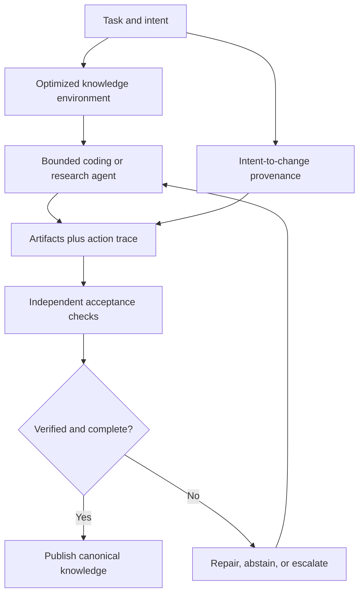

<!-- openshelf:budget-override reason="Full-fidelity five-item technical briefing with evidence, comparisons, experiments, source provenance and required canonical knowledge-mining audit." -->

# AI Frontier — November 9, 2026

**Selection:** Three core (EnvOpt, Tracybot, ProcGrep) and two exploratory gap-fills (WeaveBench and production assurance case). The 40% exploration share exceeds the usual 20–30% target because primary-source search returned only three sufficiently distinct recent core findings; this avoids fabricating freshness or repeating November 3–8 discoveries. Dates are publication/revision dates, not repository inspection dates.

**Executive finding:** Agents can be made cheaper by improving their information environment, and more accountable by tracing intent and actual action trajectories. However, production assurance evidence shows that monitors and checklists can themselves fail silently. Evidence provenance must connect the request, execution, result and independently observed check.

## 1. EnvOpt

**Date:** 2026-11-05. **Source:** https://arxiv.org/abs/2611.07372. **Selection:** Core.

**What was built:** Automated end-to-end modification of stationary agent environments such as document, ticket and workspace information organization, using tasks without reference answers or explicit graders.

**Key technique:** Environment optimization as a third optimization axis alongside model weights and agent harnesses.

**Evidence:** On AutomationBench, authors report Claude Haiku 4.5 cost reduced 72.7% and pass rate improved 14.34%; transfer to Opus 5 reduced cost 68.1% and improved pass rate 1.34%. On top of an optimized Meta-Harness, a further 83.4% cost reduction and 11.17% accuracy increase are reported. Units for accuracy improvements are as described in the abstract and should not be casually interpreted as percentage points.

**Frontier significance and comparison:** A shared knowledge base can itself be optimized for agent consumption. Unlike the earlier Context as Infrastructure project, the intervention searches the environment end to end rather than only changing retrieved claim representations.

**Practical takeaway:** A/B test AI Frontier's current Markdown/wiki layout against agent-optimized entry points on 30 held-out ingestion tasks, measuring token cost, verified relationship precision, and navigation failures.

**Verdict / limitations:** Author-reported benchmarks; no independent replication inspected. Environment changes can benefit a benchmark while harming other users or downstream tools.

## 2. Tracybot

**Date:** 2026-11-06. **Source:** https://arxiv.org/abs/2611.09395 · **Implementation:** https://github.com/TracyTeam/tracybot. **Selection:** Core.

**What was built:** Open-source VS Code/Git integration that records planning and build prompts as Tasklets, maps agent-generated code changes to Tasklets at line level, and exports significant decisions as architecture records.

**Key technique:** Line-level code-to-intent provenance with tasklet identity surviving the conversation-to-commit boundary.

**Evidence:** Two design-science iterations; a seven-person focus group and 24-person survey found the approach perceived as useful and understandable. This is usability evidence, not a measured reduction in defects.

**Frontier significance and comparison:** Compared with the earlier Claude ACP provenance and GitHub review traces, Tracybot attaches intent to specific changed lines, making future reviewers less dependent on a lost chat transcript.

**Practical takeaway:** Prototype an equivalent source-to-claim provenance ledger: each OpenShelf concept assertion points to the source excerpt, mining run, reviewer decision and commit.

**Verdict / limitations:** Small subjective usability study, not a controlled test of code correctness, audit coverage, or production reliability.

## 3. ProcGrep / Agent Trajectories as Programs

**Date:** 2026-11-02. **Source:** https://arxiv.org/abs/2606.16988. **Selection:** Core.

**What was built:** A procedural representation and ProcGrep auditing library for coding-agent trajectories; compares how agents act across SWE-bench tasks instead of merely scoring final correctness.

**Key technique:** Induce compact procedural vocabularies from traces, then compare action-pattern distributions and behavioral fingerprints.

**Evidence:** The paper reports identification of unseen trajectories from ten agents at 85.7% accuracy and a Jensen–Shannon divergence of 0.25 for a teacher/student comparison. Revised November 2; first posted June 15.

**Frontier significance and comparison:** Complements EvoAudit's per-task regression accounting by measuring changes in the process used to obtain outcomes; can detect procedural drift even when headline success is unchanged.

**Practical takeaway:** Fingerprint the source-selection, test-running and citation-checking trajectories of two OpenShelf agents before and after harness changes; flag new shortcuts and missing verification stages.

**Verdict / limitations:** Identification accuracy does not imply safety or correctness. Version update is recent, underlying project is older.

## 4. WeaveBench

**Date:** 2026-10. **Source:** https://aclanthology.org/2026.emnlp-main.658/. **Selection:** Exploration.

**What was built:** A 114-task benchmark across eight work domains using a real Ubuntu desktop, requiring mixed GUI, command-line and coding actions within the same long-horizon workflow.

**Key technique:** Cross-interface trajectories with a judge that examines files, screenshots, logs and actions, including shortcut or fabricated-evidence detection.

**Evidence:** Best reported PassRate is 41.2% across evaluated model/runtime pairings. Outcome-only grading overestimated performance. Peer-reviewed EMNLP 2026 publication in October; not a November release.

**Frontier significance and comparison:** A stronger end-to-end test than browser-only or terminal-only benchmarks, directly relevant to agents that edit code, inspect browser output and manipulate desktop tools.

**Practical takeaway:** Construct ten mixed-interface tests for a local agent: read a repository, use a browser to inspect source docs, modify code, run tests, and provide verifiable screenshots and artifacts.

**Verdict / limitations:** Benchmark conditions are specific to the configured Ubuntu desktop and judge; no evidence of generalized real-world reliability.

## 5. A Case Study in Assuring AI-Written Software

**Date:** 2026-10-06. **Source:** https://arxiv.org/abs/2610.08651. **Selection:** Exploration.

**What was built:** A production healthcare-platform case study in which a non-programmer operator supervised a code-writing agent with reviewer agents, monitors, tests and an evolving project rulebook.

**Key technique:** Human-led meta-agent governance with explicit linking of intent, acceptance evidence, tool permissions and final human decisions.

**Evidence:** Qualitative firsthand case study: monitors tracked proxies instead of outcomes, audits silently failed, missing checks disappeared from reports, and an automated repair disrupted operations. No controlled comparative benchmark.

**Frontier significance and comparison:** Unlike simulation-first agent evaluations, this exposes actual governance failures in an operational software system; it is a useful counterweight to benchmark-driven hype.

**Practical takeaway:** Make AI Frontier publication checks fail closed on missing checks, record actual executed validators (not merely requested validators), and require human review for high-impact security-sensitive changes.

**Verdict / limitations:** One case; outcomes and generalizability cannot be quantified from this account.

## Cross-project synthesis

The research distinguishes three loci of improvement: **environment structure** (EnvOpt), **intent and execution provenance** (Tracybot, ProcGrep), and **independent, cross-interface assurance** (WeaveBench and the production case). Better results can be bought by optimizing any one of them, but the production case warns that a supposedly independent checker may omit failures or report a proxy. The strongest architecture records actual executed checks, not declarations that checks exist.

**Diagram:** Proposed architecture synthesized from five independent sources, not a demonstrated integrated system.

## Recommended experiment — provenance-aware OpenShelf ingestion

Take 30 held-out automotive cybersecurity research documents. Compare (A) current wiki layout and ordinary agent, (B) an agent-optimized wiki environment, and (C) environment optimization plus a provenance ledger mapping each relation to source excerpts and executed validation evidence. Measure verified relation precision, recall, token expenditure, elapsed time, silent missing checks, and regression against prior known-good relations. Include adversarial cases where the checker is absent, a tool silently fails, or the same entity has two aliases. Treat abstention as a valid outcome and reject a relation when source provenance is missing.

**Decision rule:** Promote (C) only if it reduces cost without sacrificing held-out precision, check coverage or previously correct relations. Report new wins and lost coverage separately, following EvoAudit.

## Research and preference audit

No new preference shift is inferred today. Explicit prior feedback continues to favor cumulative canonical wiki enrichment, evidence-backed relationships, security, reproducibility and GitHub automation. The prior November 3–8 briefings concentrated heavily on agent harnesses, benchmark scores and GitHub workflows. This edition deliberately introduces code-intent traceability, real production assurance and mixed-interface verification; two selections are older, clearly dated gap-fills. No item from November 3–8 is repeated as a new discovery.

## Frontier signal

**The agent environment and its evidence trail are becoming first-class optimization targets.** Optimizing a model or harness alone is insufficient if the surrounding knowledge layout is wasteful or if the checks supposedly governing autonomous action are unobservable, incomplete or circular.

## Knowledge mining

### Canonical updates

Create five canonical project records: [[projects/envopt]], [[projects/tracybot]], [[projects/procgrep]], [[projects/weavebench]], and [[projects/assuring-ai-written-software]]. Each preserves primary-source provenance, evidence tier, comparison and experiment. Existing EvoAudit, Strategist, and capability-locus concepts are comparison targets, not duplicated projects. No concept page is created from a single-source claim.

### Relations and evidence

- **EnvOpt — optimizes — agent information environment:** source https://arxiv.org/abs/2611.07372. Analyst comparison with [[projects/context-as-infrastructure]]; methods are distinct, not a claim of direct dependence.
- **Tracybot — traces — code changes to developer intent:** https://arxiv.org/abs/2611.09395. Analyst analogy to provenance needed for wiki claims.
- **ProcGrep — evaluates — coding-agent procedural behavior:** https://arxiv.org/abs/2606.16988. Analyst comparison with [[projects/evoaudit]]; outcomes versus trajectories.
- **WeaveBench — evaluates — hybrid GUI/CLI/code agents:** https://aclanthology.org/2026.emnlp-main.658/. Analyst comparison with [[projects/vericua]]; trajectory-aware evaluation versus active verification.
- **Assurance case — documents limitations of — automated monitors and repair agents:** https://arxiv.org/abs/2610.08651. Supports the existing [[concepts/scoped-assurance]] concept, but no claim that one case establishes a population-wide failure rate.

### Mining audit

Five new source-identified project candidates, five canonical pages to create, five source-backed relations documented, and no duplicate projects. The two October items are explicitly identified as older exploratory gap-fills. Unresolved: EnvOpt independent replication; Tracybot impact on defect rates; ProcGrep relationship between fingerprint drift and correctness; WeaveBench judge transfer; production case generalizability. No unsupported metric is promoted into a cross-project chart; a portable Mermaid architecture captures the qualitative synthesis. The full Markdown body is retained for Pages search.
