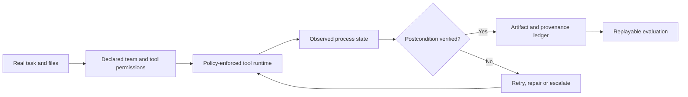

<!-- openshelf:budget-override reason="Preserve the complete five-item research briefing, measurements, caveats, comparisons, experiments and mandatory canonical knowledge-mining audit." -->

# AI Frontier — November 10, 2026

**Selection:** Three core findings and two exploratory open-source implementations (60/40). Exploration exceeds the 20–30% target to diversify beyond the recent paper-heavy briefings; no previously covered item is reintroduced as new. Research publication dates are distinguished from repository inspection dates.

**Executive finding:** Agent reliability depends increasingly on the execution substrate: whether commands actually finish, whether test environments reflect real state transitions, whether deliverables are grounded in real files, and whether permissions persist across tools. This is more actionable than another model leaderboard.

## 1. RECEIPT — Process-aware tool execution

**Date:** 2026-11-01. **Primary source:** https://arxiv.org/abs/2611.01930. **Selection:** core.

**Built or demonstrated:** A tool-execution protocol and process inspector that detects programs waiting for input, then exposes that state to otherwise unchanged agents. Its Litmus catalog covers 158 checked command invocations; Tripwire has 25 paired tasks with and without an interactive question.

**Key agentic technique:** Observe syscall-level wait states and explicitly represent incomplete operations instead of treating exit code zero as proof of task completion.

**Evidence:** Authors analyze 91,469 production tool calls and 89,047 public agent trajectories. They report 11.5% false-success status-zero invocations with closed input, 2.9× token use for an unanswered terminal question, and a 73.5% reduction in false-success claims across five LLMs with RECEIPT.

**Novelty verdict:** High: a concrete, measured harness-level failure mode that cannot be repaired by prompt wording alone.

**Comparison:** Complements the Nov 9 production-assurance case and ProcGrep: those examine governance and trajectories; RECEIPT identifies a specific unobserved execution state.

**Practical experiment:** Instrument ten common deployment commands, including confirmation prompts, password requests and editor invocations; assert both process completion and target-state postconditions.

**Limitations:** Author-reported evaluation; not independently replicated here. Results depend on commands, operating systems and harness input wiring.

## 2. ToolSpace — Execution-grounded tool environments

**Date:** 2026-11-03. **Primary source:** https://arxiv.org/abs/2611.05036. **Selection:** core.

**Built or demonstrated:** A pipeline for synthesizing realistic multi-tool agent tasks from real MCP traces. It extracts data, state and retry dependencies from adjacent calls, clusters tool-composition graphs, generates stateful scenarios and retains only tasks replayable from a known initial state.

**Key agentic technique:** Execution-witnessed dependency graphs, state-aware random walks, rollback, and assertion-based task checks.

**Evidence:** Authors report that harder benchmark variants reduce seven frontier models' scores by as much as 38.2 points; average score for Qwen3.6-35B-A3B rises from 23.0 to 41.0 with their training pipeline (43.2 with RL).

**Novelty verdict:** High: uses observed tool interactions as the foundation of environment synthesis, rather than LLM-imagined workflows.

**Comparison:** Extends the Nov 9 EnvOpt theme in a different direction: EnvOpt reorganizes environments for better agents; ToolSpace constructs execution-valid environments to train and stress agents.

**Practical experiment:** Capture sanitized GitHub, CI and OpenShelf tool traces; infer state dependencies, synthesize 20 replayable multi-tool tasks, and compare against manually written test tasks.

**Limitations:** Training and benchmark scores are author-reported; synthetic environments may omit real service outages and permission boundaries.

## 3. Agent-R² — Real-source productivity task synthesis

**Date:** 2026-11-05. **Primary source:** https://arxiv.org/abs/2611.08219. **Selection:** core.

**Built or demonstrated:** A training-data pipeline grounded in occupational task seeds, workflow evidence and authentic web-sourced attachments. From 10,000 candidates it constructs 4,000 tasks with multi-format files and deliverable-level rubrics, then trains a 4B agent with supervised and reinforcement learning.

**Key agentic technique:** Real-document task grounding, fine-grained deliverable rubrics, and training against shortcut-prone agent behavior.

**Evidence:** Authors report Agent-R²-4B scores 51.0% on GDPval and 14.8% on OfficeQA, versus 48.0% and 13.8% for their cited Qwen3-235B comparison.

**Novelty verdict:** High: shifts optimization toward realistic file-grounded deliverables instead of isolated tool-call benchmarks.

**Comparison:** Like WeaveBench from Nov 9, it evaluates deliverables; unlike WeaveBench, it synthesizes training examples and trains a smaller model.

**Practical experiment:** Create 20 real-document deliverable tasks from permission-cleared technical standards and project files; grade factual grounding, artifact correctness and unsupported shortcuts separately.

**Limitations:** Author-reported model comparison; benchmark task distributions and model settings matter, and no independent replication was checked.

## 4. Strands Box — Stateful policy sandbox for agents

**Date:** 2026-11-10 (repository inspected; not a release date). **Primary source:** https://github.com/strands-agents/box. **Selection:** exploration.

**Built or demonstrated:** An open-source Rust sandbox for Linux and Apple-silicon macOS combining OS access restrictions, egress control, an MCP broker and a policy engine. Policies can condition an outbound request on previous file reads or elapsed time.

**Key agentic technique:** Default-deny semantic and temporal policies enforced outside the agent process, with event history shared across tool gateways.

**Evidence:** The public repository includes code, tests, examples and documentation; no independently verified effectiveness metric was identified in this review.

**Novelty verdict:** Promising implementation of cross-tool, history-dependent permissions rather than static allowlists.

**Comparison:** Complements previously covered Agensh and ToolGuardian: the distinctive idea is policy conditioned on action history across interpreters and gateways.

**Practical experiment:** In a disposable VM, test whether reading a designated secret file reliably blocks subsequent outbound HTTP and MCP calls; test bypass paths and policy logging.

**Limitations:** Preview-stage project; do not infer production hardening or complete containment from its README. Updated repository activity does not establish launch date.

## 5. AgenTopology — Declarative multi-agent topology

**Date:** 2026-11-10 (repository inspected; v0.4 described, release date unverified). **Primary source:** https://github.com/agentopology/agentopology. **Selection:** exploration.

**Built or demonstrated:** A declarative `.at` language for defining agent roles, flows, memory and tool permissions. The CLI validates topologies, visualizes dependencies, scaffolds platform-specific configurations, or issues a plan for an existing coding agent to execute with subagents.

**Key agentic technique:** Harness-as-code with explicit handoff contracts, blind roles, validation and disclosure of features that cannot be enforced in fileless mode.

**Evidence:** Repository contains parser/source, examples, a CLI and tests. Claims of cross-platform support are implementation claims; no comparative productivity benchmark was verified.

**Novelty verdict:** Medium-high: topology as a portable typed artifact, not another chat-based swarm demo.

**Comparison:** A practical configuration-layer counterpart to the previously covered agent orchestration and ACP provenance work; unlike those, it focuses on declarative portability.

**Practical experiment:** Describe the same researcher–builder–adversarial-reviewer team for Hermes and Codex; diff generated permissions and explicitly record non-enforceable constraints.

**Limitations:** Portability and enforcement differ by target runtime; never mistake a declared restriction for a sandbox-enforced one.

## Cross-project synthesis

RECEIPT shows that a successful process return is not proof of a successful operation. ToolSpace insists on execution-replayable tool compositions. Agent-R² uses authentic files and deliverable rubrics to discourage superficial completion. Strands Box moves authorization into a stateful, external policy layer. AgenTopology declares team structure, but makes clear that declaration and runtime enforcement differ. These are complementary controls, not a validated integrated architecture.

**Figure:** Proposed synthesis, not a measured architecture. Sources: https://arxiv.org/abs/2611.01930 ; https://arxiv.org/abs/2611.05036 ; https://arxiv.org/abs/2611.08219 ; https://github.com/strands-agents/box ; https://github.com/agentopology/agentopology.

## Recommended experiment — truthful CI agent execution

Use a disposable repository and test environment. Run 25 paired agent tasks that include noninteractive and confirmation-gated Git operations, build scripts, package updates and publication actions. Compare a baseline command tool against a process-aware wrapper with independent target-state assertions. Log whether each tool was invoked, whether it waited for input, its exit status, whether the intended side effect occurred, and whether the agent falsely claimed success. Run the same task suite under two different harnesses and separate model behavior from transport behavior. Add a default-deny egress policy and check that policy failures are surfaced rather than silently bypassed.

**Decision rule:** Adopt only when false-success rates fall without unacceptable task-completion or latency regressions; require proof of final repository state, not only a green command exit. Do not treat the paper's reported improvements as expected local results.

## Research audit

Reviewed November 6–9 briefings and canonical project index. Avoided FA-Agent because November 7 already covered it; avoided repeating EnvOpt, Tracybot, ProcGrep, WeaveBench, EvoAudit and Agent Orchestrator. The current shortlist is three November papers plus two directly inspected repositories, reducing reliance on model/vendor launch claims. Unresolved blind spots: independent security evaluation of sandbox bypasses, longitudinal adoption, and field-tested operational failure rates. No change to the preference model is inferred from silence; engineering evidence, tool correctness and reproducible workflows remain established priorities.

## Frontier signal

**The next competitive boundary is executable evidence, not just agent reasoning:** state-aware tool calls, replayable environments, independently checked artifacts and policies enforced outside the model increasingly define trustworthy autonomy.

## Knowledge mining

### Canonical updates

Created five source-scoped canonical project records: [[projects/receipt]], [[projects/toolspace]], [[projects/agent-r2]], [[projects/strands-box]], [[projects/agentopology]]. No existing source identity matched the inspected canonical project index; do not infer this proves no aliases elsewhere.

### Relations and evidence

- [[projects/receipt]] **mitigates** false tool completion assumptions; https://arxiv.org/abs/2611.01930. Analyst comparison with [[projects/procgrep]] (execution state versus trajectory patterns).
- [[projects/toolspace]] **constructs** replayable tool-dependency environments; https://arxiv.org/abs/2611.05036. Analyst comparison with [[projects/envopt]] (training environment versus agent information environment).
- [[projects/agent-r2]] **trains on** authentic-file deliverable tasks; https://arxiv.org/abs/2611.08219. Analyst comparison with [[projects/weavebench]] (training synthesis versus evaluation).
- [[projects/strands-box]] **enforces** history-sensitive access policy outside the agent process; https://github.com/strands-agents/box. Related to [[projects/agensh]] as an analyst comparison, not an established dependency.
- [[projects/agentopology]] **declares** portable agent-team topology; https://github.com/agentopology/agentopology. Cross-platform policy enforcement remains a hypothesis to test.

### Mining audit

Five new candidate identities, five canonical pages created, five source-linked mechanism relations documented, zero intentional duplicates. No new cross-project concept was created: the substrate-evidence signal is consistent with existing assurance themes but needs independent operational replication. Proposed reproducible CI experiment above. Negative evidence: repository presence does not prove effectiveness, and author benchmarks are not independently reproduced. Source diversity: three arXiv papers and two GitHub implementations; further industry deployment evidence is needed.
