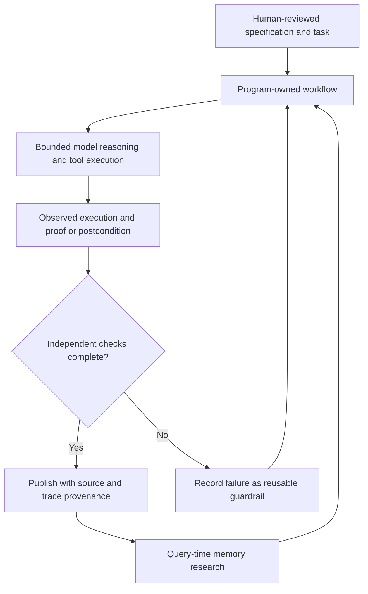

<!-- openshelf:budget-override reason="Complete five-item primary-source briefing with dated evidence, comparisons, experiments and mandatory mining audit must remain a full historical record." -->

# AI Frontier — November 11, 2026

**Selection:** Three core and two exploratory items (60/40). The exploration share exceeds the 20–30% goal because few independently verifiable fresh implementations survived today's search. Only two items are from November; the others are explicitly older technical studies, not represented as new releases. This is an evidence-first briefing rather than a manufactured freshness claim.

**Executive finding:** A productive agent stack increasingly separates *deterministic orchestration*, *mechanically checked outcomes*, *query-time reconstruction of past evidence*, and *persistent research states*. These mechanisms can be tested independently instead of asking a model to be its own planner, executor, witness and judge.

## 1. LLM-as-Code: Agentic Programming for Agent Harness

**Date:** 2026-11-09 revision (original June 14). **Primary source:** https://arxiv.org/abs/2606.15874. **Selection:** core.

**Built or demonstrated:** A program-directed agent harness where deterministic code owns branching, looping and stopping while models are invoked for bounded reasoning; the paper includes a computer-use case study and links implementation code.

**Key agentic technique:** Call-tree/DAG-derived context and deterministic control flow rather than an LLM controlling every step.

**Why interesting / novelty verdict:** Separates the model's probabilistic judgments from the workflow's correctness-critical transitions. A substantive recent revision, not a newly introduced November project.

**Comparison with prior briefings:** Complements RECEIPT's execution-state observation: control-flow ownership and truthful completion are distinct layers.

**Practical takeaway / experiment:** Refactor one 20-step browser or CI workflow into explicit program-owned states with model calls only for ambiguous decisions; compare retries, token usage and unverified completion.

**Evidence limitations:** The abstract reports greater stability without a headline quantitative figure; no independent replication was conducted.

## 2. Modern Software Engineering with Verification Agents

**Date:** 2026-11-01. **Primary source:** https://arxiv.org/abs/2611.02285. **Selection:** core.

**Built or demonstrated:** A proposed spec-first software engineering architecture with verification IR, agent-authored implementations and proofs, semantic merge-conflict detection, and a zero-copy authenticated-router illustration.

**Key agentic technique:** Treat formal specifications as human-reviewed source of truth and generated code/proofs as regenerable outputs, gated by mechanical checks.

**Why interesting / novelty verdict:** A radical change in the human review surface for agent-produced software, especially safety-critical embedded components.

**Comparison with prior briefings:** Unlike yesterday's process-execution evidence, this targets correctness of the resulting implementation relative to a specification.

**Practical takeaway / experiment:** Prototype a small authenticated message parser: write explicit input/output invariants, generate code and tests, and measure human review time and proof coverage against a conventional PR.

**Evidence limitations:** Primarily an architectural proposal; its >90% review-attention reduction is explicitly an estimate, not an observed result. Do not adopt zero-human-code-review as a proven practice.

## 3. Just-In-Time Agent Memory with Runtime Agentic Research (JAM)

**Date:** 2026-09-28. **Primary source:** https://arxiv.org/abs/2609.34385. **Selection:** core.

**Built or demonstrated:** A two-part memory system: a Memorizer stores complete history in hierarchical pages, and a trained Researcher investigates original records at query time. Memory-Gym synthesizes grounded tasks across nine types and six domains; source code is released.

**Key agentic technique:** Query-conditioned multi-step evidence retrieval over preserved raw history, rather than pre-compressing everything into fixed summaries.

**Why interesting / novelty verdict:** Provides an actionable architecture for long-lived agents whose historical evidence is too valuable to discard.

**Comparison with prior briefings:** Extends the evidence-provenance theme from Tracybot and OpenShelf by reconstructing the relevant past at the moment of need.

**Practical takeaway / experiment:** Index 100 archived agent runs with compact summaries plus raw logs; compare JAM-style iterative navigation against single-shot retrieval on 30 provenance questions.

**Evidence limitations:** Reported quality/cost gains are author-reported; September publication is deliberately labeled older, selected for architectural relevance.

## 4. AutoSR: Automatic Symbolic Regression by Searching Research States

**Date:** 2026-08-17. **Primary source:** https://arxiv.org/abs/2608.16876. **Selection:** exploration.

**Built or demonstrated:** An automated scientific-discovery system that searches persistent research states containing candidate equations, motivations, code, diagnostics, failed trials and independent reviewer findings. It uses progressive-widening Monte Carlo tree search.

**Key agentic technique:** Branch-local research memory plus asynchronous proposer/reviewer experiments and evidence-preserving tree search.

**Why interesting / novelty verdict:** Searches auditable investigations, not just candidate outputs. Authors report exact recovery on nine selected benchmark challenges, including three unsolved by twelve compared systems.

**Comparison with prior briefings:** A scientific analogue of provenance-aware coding agents: experimental criticism survives into future search decisions.

**Practical takeaway / experiment:** Apply research-state trees to three automotive-security hypotheses; require each branch to preserve failed tests, source excerpts, counterevidence and reviewer notes.

**Evidence limitations:** Older exploratory selection; nine selected cases are feasibility evidence, not a demonstrated broad generalization or repeated-run reliability.

## 5. Harnessing Agent Memory to Build Lifelong AI Partners for Materials Scientists

**Date:** 2026-07-25. **Primary source:** https://arxiv.org/abs/2608.11224. **Selection:** exploration.

**Built or demonstrated:** A portable memory of facts, executable skills, failure boundaries and validation guards for computational materials-science agents, evaluated on tool-use questions, equation-of-state calculations and simulation workflows.

**Key agentic technique:** Turn observed execution failures into reusable pre-execution guardrails and model-independent procedural memory.

**Why interesting / novelty verdict:** One of the more concrete demonstrations of memory changing actual scientific tool behavior: 49 questions/138 subtasks, 92% of repeated errors avoided in a reported setting, and more than 2x fewer tool calls by round three in 13 workflows.

**Comparison with prior briefings:** Goes beyond static retrieval: remembered failures change subsequent tool policies, complementing Strands Box's enforcement approach.

**Practical takeaway / experiment:** Record recurring OpenShelf CI failures as executable preflight checks, then compare third-run retries and tool calls against a memory-free baseline.

**Evidence limitations:** Older domain-diversifying study; author-reported results in computational materials workflows, not production generality.

## Proposed architecture — executable evidence loop

**Diagram status:** Proposed synthesis of the five cited works; no integrated deployment or quantitative outcome is claimed.

## Recommended experiment — evidence-carrying CI agent

Take 25 repository maintenance tasks with deterministic postconditions. Compare (A) free-form model-directed tool loops, (B) program-owned state transitions, and (C) program-owned transitions with memory of prior failures and independent outcome verification. Hold model, tools, tasks and budget fixed. Record completion rate, false-success rate, tool calls, tokens, retry count, missing validations and human review minutes. Include adversarial prompts, interactive commands, stale state, a missing validator and a failed Pages deployment. Promote (C) only if the independently verified success rate improves without silently reducing check coverage; retain failures as versioned test cases rather than merely prompt hints.

## Frontier signal

**Agents are becoming auditable programs with learned components, rather than autonomous conversations with loosely observed side effects.** The strongest emerging design is a narrow probabilistic decision component surrounded by explicit state, retained evidence and independently enforced acceptance checks.

## Research and preference audit

Reviewed the November 3–10 briefing sequence and existing canonical project index. The sequence already emphasizes orchestration, environment optimization, provenance and CI reliability, so no previously covered project is repackaged here. This run deliberately adds formal specification engineering and scientific memory transfer, but source diversity remains weak: all five primary sources are arXiv research reports. No new preference shift is inferred from the available feedback. Next selection should prioritize newly released working repositories, production incident reports and independent replication over additional adjacent benchmark papers. The older exploration selections are not claimed to satisfy the usual freshness goal.

## Knowledge mining

### Canonical updates

Five source-identified candidates were reviewed: [[projects/llm-as-code]], [[projects/spec-first-verification-agents]], [[projects/just-in-time-agent-memory]], [[projects/autosr]], and [[projects/lifelong-materials-agent-memory]]. Canonical pages are added with source URLs and evidence-scoped caveats. No new cross-project concept page is justified solely by this briefing.

### Relations and evidence

- **LLM-as-Code — separates — deterministic orchestration from model decisions:** https://arxiv.org/abs/2606.15874; analyst comparison with [[projects/receipt]], not a demonstrated dependency.
- **Spec-first verification — proposes — proof-gated agent software synthesis:** https://arxiv.org/abs/2611.02285; proposed architecture, not proven organization-wide replacement for review.
- **JAM — reconstructs — query-relevant memory from raw history:** https://arxiv.org/abs/2609.34385; analyst comparison with prior provenance systems.
- **AutoSR — searches — evidence-preserving scientific research states:** https://arxiv.org/abs/2608.16876; independent reviewer role described by authors.
- **Materials memory — converts — prior failure observations into guardrails:** https://arxiv.org/abs/2608.11224; domain-specific author-reported computational results.

### Mining audit

Five candidate projects, five new source-scoped pages, five evidence-labeled relations in this report. Existing November 10 entries were not duplicated. Unresolved: independent replication of LLM-as-Code computer-use stability, proof soundness and real review-cost outcomes for spec-first synthesis, JAM generalization to repository history, AutoSR repeated-run robustness, and transfer of materials-memory guardrails to software engineering. No cross-project causal relation is asserted from analogies alone. Historical snapshots remain unchanged.
