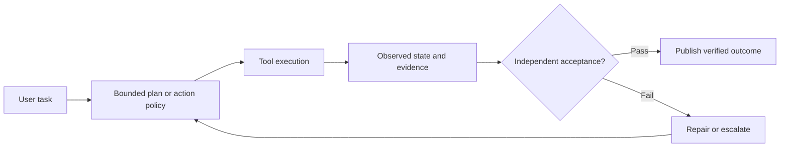

<!-- openshelf:budget-override reason="Complete source-backed daily briefing with five experiments, comparison, synthesis and knowledge-mining audit must remain intact." -->

# AI Frontier — November 12, 2026

**Selection:** four core findings (80%) and one exploratory media-production implementation (20%). **Evidence:** two November primary papers and three inspectable open-source repositories. Repository inspection dates are not release dates. Author-reported benchmark numbers are not independent replication.

## Executive finding

**The practical frontier is shifting from model-level safety prompts to code-owned control boundaries and evaluation of what the agent actually did.** Today's strongest contrast is between ahead-of-time web-program compilation, harness-level adversarial measurement, and real-agent CI evaluation. The domain exploration asks whether the same constrained-tool approach transfers to media editing.

## Findings

### 1. Baya — Securing Web Agents with Compile-Then-Execute

**Date:** 2026-11-04. **Selection:** core. **Primary source:** https://arxiv.org/abs/2611.06039

**Built or demonstrated:** Baya compiles a user's web request into Python against a Trusted Website API before seeing the live page. The compiled program can consume website data and choose among precompiled branches, but untrusted page content cannot induce fresh model-planned operations.

**Key agentic technique:** Compile-then-execute; isolate the planner from untrusted observations and constrain actions to an ahead-of-time program.

**Evidence and limitations:** Across 581 valid WebArena Verified tasks, the authors report 77.8% aggregate utility versus 55.1% browser-only ReAct and 66.7% API-enabled ReAct. On WASP, they report 0% attack success versus 25.5% and 16.2% respectively. These are author-reported benchmark results, not a universal security guarantee.

**What is frontier / comparison:** This is a stronger structural answer to prompt injection than merely instructing the agent to ignore malicious text. Compared with November 11's LLM-as-Code, it specifically blocks live webpage text from changing model-authored control flow.

**Practical takeaway / experiment:** Build ten synthetic web tasks with injected instructions in product descriptions and comments. Compare a ReAct agent with a precompiled task-specific API program, recording legitimate-task completion, unauthorized actions and tasks requiring unexpected branching.

**Verdict:** High novelty and strong quantitative evidence, bounded by the tested API coverage, websites and attack suite.

**Canonical record:** [[projects/baya-compile-then-execute]]

### 2. Harness Matters — Measuring and Dissecting Security Resilience in Web Agents

**Date:** 2026-11-09. **Selection:** core. **Primary source:** https://arxiv.org/abs/2611.11971

**Built or demonstrated:** WebTrap Farm is a systematic evaluation framework spanning malicious user instructions, prompt injection and deceptive web designs. It decomposes a web-agent harness into goal interpretation, perception, planning and execution, and pairs attacks with usability calibration tasks.

**Key agentic technique:** Stage-localized adversarial evaluation with matched benign controls, separating a model's inability to finish a task from a genuine security defense.

**Evidence and limitations:** The authors report vulnerable behavior across evaluated harnesses, including some unsafe actions in the absence of overt malicious content. Both model and harness have statistically significant effects in their analysis; the abstract does not provide a defensible universal attack-rate figure.

**What is frontier / comparison:** It supplies a way to evaluate whether Baya-like structural changes really improve safety rather than merely making an agent unable to act. Unlike November 10's Strands Box, this measures harness susceptibility rather than enforcing policy.

**Practical takeaway / experiment:** Build 12 paired benign/adversarial browser tasks, vary only the harness while holding model, websites and budgets constant, and classify errors by perception, planning and execution stage.

**Verdict:** High evaluation relevance; new November research, but no independently replicated measurements here.

**Canonical record:** [[projects/harness-matters-web-agent-security]]

### 3. Coder Eval — Declarative CI Tests for Coding Agents

**Date:** 2026-11-12 (repository inspected; original release date unverified). **Selection:** core. **Primary source:** https://github.com/UiPath/coder_eval

**Built or demonstrated:** UiPath's open-source Coder Eval executes actual coding agents such as Codex, Claude Code, OpenCode and Pi in sandboxes using declarative YAML tasks. It scores generated files, command outcomes and weighted criteria, records tool/token telemetry and supports A/B configurations and GitHub Actions gates.

**Key agentic technique:** Harness-agnostic execution-grounded evaluation; independent task assertions, skill-trigger detection, and regression gating.

**Evidence and limitations:** The repository includes implementation, example tasks, tests, a CLI and a CI action. No independent benchmark proving general agent quality improvements was established; its value is test infrastructure, not a published leaderboard.

**What is frontier / comparison:** Directly applicable to validating AI Frontier PR-writing agents and agent skills. Compared with ToolSpace's synthetic execution-witnessed environments, this runs user-defined domain tasks against actual coding harnesses.

**Practical takeaway / experiment:** Define 12 tasks covering Markdown frontmatter, broken internal links, source provenance, CI repairs and branch cleanup. Run two agents on identical fixtures, require file-state assertions, and publish pass rates and tool cost per verified task.

**Verdict:** Immediately actionable implementation; newer repository activity is not evidence of a new launch.

**Canonical record:** [[projects/coder-eval]]

### 4. fastbrowse — Bounded Browser Agent with Quote-Level Evidence

**Date:** 2026-11-12 (repository inspected; release date unverified). **Selection:** core. **Primary source:** https://github.com/agent-labs-dev/fastbrowse

**Built or demonstrated:** A Rust/Python browser agent indexes controls that actually exist on each page, uses a choice model to select actions, and has an LLM compose answers grounded in quoted page evidence. Code gates submit, payment, deletion and sending; secrets are restricted to declared origins.

**Key agentic technique:** Constrained action selection, quote-linked provenance, origin-bound credentials, code-owned authorization and resource budgets.

**Evidence and limitations:** Its maintainers report 99.2% successful runs versus 96.3% for a hosted Browser Use agent across 46 tasks run three times each, with reported per-run costs $0.0296 versus $0.3180. This is a developer-run comparison, not an independent result; its documented campaign did not measure runtime.

**What is frontier / comparison:** Combines answer provenance and action boundaries in a working browser harness. Baya precompiles all operations; fastbrowse instead bounds the runtime action space to controls present on the page and protects sensitive side effects.

**Practical takeaway / experiment:** Use ten controlled pages containing benign controls, misleading buttons, prompt injections and source citations. Compare quoted-evidence correctness and unauthorized-action attempts, without real credentials or payments.

**Verdict:** Interesting engineering tradeoff and code artifact; claims about cost and reliability require reproduction.

**Canonical record:** [[projects/fastbrowse]]

### 5. KinoCut — Guardrailed Video-Editing MCP Tools

**Date:** 2026-11-12 (repository inspected; launch date unverified). **Selection:** exploration. **Primary source:** https://github.com/KyaniteLabs/kinocut

**Built or demonstrated:** An open-source MCP server, Python client and CLI expose video editing, FFmpeg operations, subtitle work and repurposing workflows as agent-invocable operations with documented guardrails.

**Key agentic technique:** Tool-oriented creative production: an LLM plans edits while deterministic media tooling executes transforms and can be checked against file properties.

**Evidence and limitations:** Public code, documentation and examples exist, but no independently validated quality, speed or cost comparison was established. Repository activity on November 12 does not establish a release date.

**What is frontier / comparison:** An exploration outside software-engineering research: it tests whether narrow, inspectable tools make creative work more reproducible than open-ended desktop automation.

**Practical takeaway / experiment:** Give a media agent a short rights-cleared clip and require a 30-second cut, captions and two aspect ratios. Verify durations, codec metadata, captions and absence of unintended edits before human quality review.

**Verdict:** Practical domain-diversifying experiment; engineering implementation is more credible than any unverified marketing claim.

**Canonical record:** [[projects/kinocut]]

## Quantitative comparison (author-reported)

Baya's evaluated WebArena utility and WASP attack-success numbers come from https://arxiv.org/abs/2611.06039. They describe two distinct evaluation protocols; higher utility and lower attack success are desirable. These measurements are not independent replications.

```chatgpt-chart
{"chartType":"bar","xKey":"agent","series":[{"dataKey":"utility","label":"WebArena utility","valueSuffix":"%"}],"yAxisMin":0,"yAxisMax":100,"data":[{"agent":"Baya","utility":77.8},{"agent":"API ReAct","utility":66.7},{"agent":"Browser ReAct","utility":55.1}]}
```

WASP attack success: Baya 0%; API ReAct 16.2%; browser-only ReAct 25.5% (author-reported, same source).

## Architecture: independent execution evidence



This is a **proposed synthesis**, not a tested integrated system. Baya provides the compile boundary; fastbrowse supplies constrained actions and quote provenance; Coder Eval supplies sandboxed outcome checks; WebTrap Farm supplies paired adversarial controls. Their integration is unproven.

## Recommended 25-task experiment

Create ten prompt-injection browser tasks, ten repository maintenance tasks and five controlled creative-media tasks. Run matched agent/harness configurations with fixed models, token budgets and repeatable fixtures. Record verified success, unauthorized side effects, false-success reports, prompt-injection success, citation correctness, tokens, dollars and latency. Treat a refusal or inability to perform the benign task as a usability failure, not a successful defense. For coding tasks, use Coder Eval-style file and command assertions. For browser tasks, compare reactive planning against precompiled operations where the action API covers the task. For media, verify codecs, duration and output hashes before subjective review. Do not use real credentials or irreversible transactions.

**Decision rule:** prefer a new harness only if it reduces unauthorized or unverified outcomes without an unacceptable legitimate-task completion penalty. Pre-register thresholds rather than cherry-picking successful runs.

## Cross-briefing audit and selection adjustments

The November 10 report emphasized RECEIPT, ToolSpace, Agent-R², Strands Box and AgenTopology; November 11 emphasized LLM-as-Code, verification agents, JAM, AutoSR and materials-science memory. Today's set avoids repeating those systems. The earlier two days were dominated by academic papers; today's three working repositories diversify source types, and KinoCut deliberately explores a creative workflow. Repository recency is explicitly distinguished from release recency. The most important open gap is **independent replication**: even detailed benchmark tables can reflect author-controlled harness choices. No inference of negative feedback is made from silence.

## Frontier signal

**Code-owned boundaries and independently checked effects are converging into the agent runtime's control plane.** Compiled plans, constrained browser actions, adversarial calibration and executable CI assertions address different failure modes; the frontier experiment is to combine them without sacrificing task utility.

## Knowledge mining

### Canonical updates

Created five source-scoped canonical pages: [[projects/baya-compile-then-execute]], [[projects/harness-matters-web-agent-security]], [[projects/coder-eval]], [[projects/fastbrowse]], [[projects/kinocut]]. Updated the projects and briefing indexes and the root latest-briefing link. The full narrative, source URLs, figure and experiments are preserved here; no historical snapshot was rewritten.

### Relations and evidence

- [[projects/baya-compile-then-execute]] **compares_with** [[projects/fastbrowse]]: ahead-of-time operation compilation versus constrained runtime action selection; distinct security boundaries, not a measured head-to-head. Evidence: https://arxiv.org/abs/2611.06039 and https://github.com/agent-labs-dev/fastbrowse.
- [[projects/harness-matters-web-agent-security]] **evaluates** the *class* of web-agent harness security (not a claimed test of Baya or fastbrowse specifically); it supplies a paired-control methodology to test either. Evidence: https://arxiv.org/abs/2611.11971.
- [[projects/coder-eval]] **compares_with** [[projects/harness-matters-web-agent-security]] as complementary evaluation designs: domain-specific coding postconditions versus stage-localized web-agent security. This is an analyst comparison, not measured integration. Evidence: https://github.com/UiPath/coder_eval and https://arxiv.org/abs/2611.11971.
- [[projects/kinocut]] is a **transfer hypothesis** for the bounded-tool pattern; no evidence establishes that browser security results transfer to creative video workflows. Evidence: https://github.com/KyaniteLabs/kinocut.

### Mining audit

Deduplicated by canonical arXiv IDs and repository URLs against known November 10–11 findings; none of the five repeats those items. New named artifacts justify project records, but **no new cross-project concept is established** by these sources alone. Candidate synthesis: structural action constraints versus reactive planning, bounded by WebTrap Farm's usability calibration and the absence of independent Baya/fastbrowse replication. Follow-up experiment above is the testable outcome. The existing synthesized security and verification pages should be revisited after controlled replication; no stronger causal relation is asserted today.
