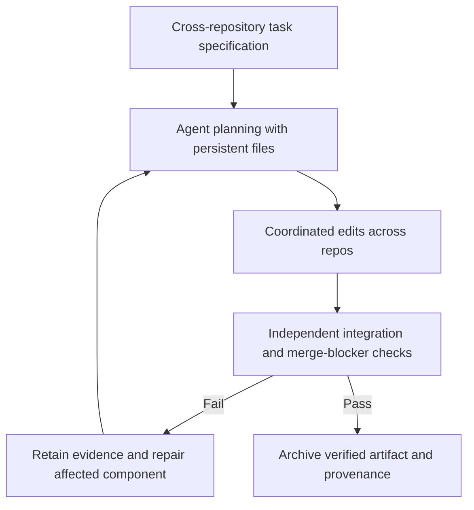

<!-- openshelf:budget-override reason="Complete five-item research narrative, comparisons, source provenance, experiments and knowledge-mining audit are required for immutable briefing fidelity." -->

# AI Frontier — November 13, 2026

**Selection:** five findings, four core (80%) and one exploratory (20%). Four papers were published November 1–10 and one revised November 12. All are primary research; this is a source-diversity weakness, not evidence of real-world deployment. Earlier November 10–12 briefings already covered RECEIPT, ToolSpace, Agent-R², JAM, Baya, Coder Eval and other adjacent mechanisms; these are new source identities, not repeats.

**Thesis:** The new frontier is evaluating *systems of agent actions*—memory across context resets, dynamic multi-agent workflows, realistic merge gates, measured infrastructure performance and typed non-text artifacts—rather than just a single final answer. The most useful near-term opportunity is independent acceptance and regression testing for multi-agent deliverables.

## 1. Coding Agent Memory Post-Training II (CAMP-II)

**Date:** 2026-11-10; revised 2026-11-12. **Selection:** core. **Primary source:** https://arxiv.org/abs/2611.14009.

**Built or demonstrated:** CAMG-II spans Shop, Coding, AutoResearch, General and Visual long-horizon environments, giving agents ordinary Bash and persistent workspaces. CAMP-II uses asynchronous on-policy distillation from a frozen teacher to learn when to write, revise, search and reuse files across context replacements.

**Key agentic technique:** Train memory operations through familiar filesystem tools, rather than introducing an unfamiliar memory API.

**Evidence:** Authors report 2.97× the gain of the strongest on-policy-distillation baseline on CAMG-II, with improvements on Terminal-Bench 2.1 and SWE-Bench Pro V2. This is an author-reported relative gain, not 2.97× task success.

**Novelty and comparison:** Substantive new training approach to file-based long-horizon memory. Contrasts with JAM's query-time retrieval and materials-memory's reusable guards: CAMP-II changes the policy's learned file-operation behavior.

**Practical experiment:** On 20 interrupted coding tasks, compare raw transcript compaction, file-based memory with explicit prompts, and learned/file-operation policies. Measure task success, memory read/write count, context resets, token cost, and negative transfer.

**Verdict and limitation:** Training apparatus and gains are not independently replicated here; no production deployment established. **Assessment:** Worth reading for concrete engineering methodology.

## 2. ExpertCrowd-SWE

**Date:** 2026-11-09. **Selection:** core. **Primary source:** https://arxiv.org/abs/2611.13246.

**Built or demonstrated:** A benchmark of 100 expert-authored, multi-file tasks across 87 open-source projects and 11 languages, each with pinned code, sealed reference solutions and weighted executable graders including must-pass merge blockers.

**Key agentic technique:** Calibrated partial-credit grading with adversarial, inert and lazy control patches, instead of relying on final-text evaluation or one binary test.

**Evidence:** Seven frontier models, five attempts each, 3,495 scored runs. Reported scores: Claude Opus 5.5 67.3%, GPT-6 Astra 63.7%, with no statistically significant gap. Twenty-four tasks and graders are released; 76 remain held out.

**Novelty and comparison:** Stronger task and grader realism than shallow code benchmarks; compare with Coder Eval's harness-level checks and November 11's deliverable grading. Not a new agent runtime.

**Practical experiment:** Replicate three public tasks with an independent coding harness; verify that no-op and superficially plausible patches score zero and must-pass blockers are enforced.

**Verdict and limitation:** Task selection is conditioned on difficulty for current frontier models; held-out grading limits full independent audit. Model rankings are protocol-specific. **Assessment:** Worth reading for concrete engineering methodology.

## 3. WorkflowArena: Benchmarking Executable Multi-Agent Orchestration

**Date:** 2026-11-09. **Selection:** core. **Primary source:** https://arxiv.org/abs/2611.12856.

**Built or demonstrated:** WorkflowArena evaluates 145 long-horizon tasks across eight professional domains, including software engineering, mathematics, legal analysis and 3D production. Each task has an initial workspace, interdependent deliverable components and a hidden verifier. Agents can choose when to delegate, how many workers to create and how to integrate their outputs.

**Key agentic technique:** Runtime-authored executable delegation workflows with explicit worker organization, artifact integration and independently evaluated deliverables.

**Evidence:** Nine models were evaluated. The authors report that no one workflow configuration wins across all domains; Claude Code configurations at high effort tend to invoke fewer but larger worker groups, whereas Codex configurations delegate more frequently to smaller groups. Holding the executor model fixed on a difficult subset, workflows authored by Claude Opus 5.5 substantially improved weaker executors. The abstract provides no universally comparable improvement percentage; do not infer one.

**Novelty and comparison:** Measures the quality of the *orchestration structure itself*, not just the underlying model or end-task score. Unlike prior [[projects/crossswe]], which tests cross-repository consistency, this tests dynamic division of labor, context allocation and integrated output verification. The November 11 LLM-as-Code finding concerns deterministic workflow control, while WorkflowArena evaluates model-authored multi-agent structures.

**Practical experiment:** Give three agent harnesses the same five interdependent repository-and-document tasks, holding executor model and budget constant. Compare a single worker, fixed two-worker pipeline and model-authored workflow; verify the integrated artifact and measure delegation overhead, retries and uncompleted components.

**Verdict and limitation:** Primary research with an explicit task/verifier protocol, but all comparisons are author-reported and model/runtime-dependent. No production reliability claim follows. **Assessment:** Worth reading and reproducing for agent orchestration design.

## 4. ServerBench: Agent-Designed LLM Serving Systems

**Date:** 2026-11-04. **Selection:** core. **Primary source:** https://arxiv.org/abs/2611.06841.

**Built or demonstrated:** A benchmark where coding agents modify complete specialized LLM serving systems and experiment against latency-qualified token value per GPU dollar, with stateful replay and independent verification.

**Key agentic technique:** Closed-loop infrastructure optimization with workload-relevant experiments, stateful session replay and acceptance tests for optimized execution paths.

**Evidence:** Across 11 agent models and three deployments, 22 of 33 runs produced verified systems and 13 beat the strongest baseline. Best reported result is 2.97 value-dollars per GPU dollar on Gemma E4B, 4.87× the vLLM reference.

**Novelty and comparison:** Moves beyond patch correctness to autonomous systems-performance engineering with an externally measurable objective. Unlike EnvOpt, the optimized artifact is a serving system rather than the agent's own task environment.

**Practical experiment:** In a sandbox, let two coding agents optimize a small inference service against a fixed replay trace; require correctness, p95 latency and cost accounting before accepting throughput gains.

**Verdict and limitation:** Author-reported on specified GPU deployments; best-run comparisons do not establish typical improvement or generalization. **Assessment:** Worth reading for concrete engineering methodology.

## 5. GeoFaham: Multi-Agent Disaster Geospatial Analytics

**Date:** 2026-11-03. **Selection:** exploration. **Primary source:** https://arxiv.org/abs/2611.04977.

**Built or demonstrated:** Specialist agents for vector operations, map features, imagery discovery and raster analysis, coordinated by a dual-ledger orchestrator. A Response Store persists full spatial artifacts with typed metadata while agents exchange compact identifiers.

**Key agentic technique:** Artifact-centric multi-agent coordination with dependency-aware planning, validation and replanning across spatial and temporal data.

**Evidence:** On a 40-task benchmark grounded in 17 disaster records, the authors report 0.940 overall versus 0.879 for the next-best baseline and 7.5× fewer tokens. Code and benchmark are linked from the paper.

**Novelty and comparison:** An unusual, consequential deployment domain where correctness depends on provenance of huge non-text artifacts, not just chat history. Strong exploration candidate.

**Practical experiment:** Replay five public disaster tasks and inspect coordinate reference systems, timestamp lineage, raster-vector alignment and artifact handoffs; compare with a single general coding agent.

**Verdict and limitation:** Reported benchmarks are author-run, not proof of emergency-response readiness; scoring allows non-rigid ground truth. **Assessment:** Worth exploring for cross-domain artifact coordination.

## Quantitative evidence: expert-authored coding benchmark

The following scores are from a **single author-reported protocol**, not a universal model ranking. Source: https://arxiv.org/abs/2611.13246.

```chatgpt-chart
{"chartType":"bar","xKey":"model","series":[{"dataKey":"score","label":"Weighted score","valueSuffix":"%"}],"yAxisMin":0,"yAxisMax":100,"data":[{"model":"Claude Opus 5.5","score":67.3},{"model":"GPT-6 Astra","score":63.7}]}
```

## Proposed engineering integration



**Reproducible proposed test:** Build a 25-task benchmark: ten context-interrupted coding tasks, five multi-agent workflow orchestration tasks, five adversarially graded patch tasks and five performance/typed-artifact tasks. Hold model, time budget and fixtures constant. Track independently verified success, regression rate, partial-repository false success, missing acceptance checks, memory operations, token use and wall time. Do not accept claims of deployment without checking the deployed state. This is a proposal, not a run performed for this briefing.

## Traceable seven-briefing audit (November 6–12)

The previous seven archived reports are [[briefings/2026/11/2026-11-06]], [[briefings/2026/11/2026-11-07]], [[briefings/2026/11/2026-11-08]], [[briefings/2026/11/2026-11-09]], [[briefings/2026/11/2026-11-10]], [[briefings/2026/11/2026-11-11]], and [[briefings/2026/11/2026-11-12]]. The November 11 and 12 reports and canonical records are present in the merged chronological history before this briefing. CrossSWE is already in [[briefings/2026/11/2026-11-04]] and is a prior comparison only, not a new selection. Today's WorkflowArena adds executable delegation-structure evaluation absent from these seven selected-item sets. Comparisons below are analyst synthesis, not independent head-to-head tests.

## Cross-briefing synthesis and source audit

The November 10–12 sequence focused on truthful process completion (RECEIPT), code-owned control flow (LLM-as-Code/Baya), memory retrieval and guardrails (JAM/materials memory), and executable acceptance (Coder Eval). Today's papers extend the *scope* of acceptance: long-horizon state, model-authored delegation, sealed human-authored grading, measured service performance and typed geospatial artifacts. The evidence is mixed in kind: benchmark success and training gains are not interchangeable, and no combined system has been tested here. Counterevidence includes partial-repository edits that fail integration, benchmark calibration effects, and memory negative transfer documented in the earlier technique synthesis.

**Source audit:** Five academic papers and zero verified independent production deployments; freshness is good but source diversity is poor. Next discovery pass should explicitly search builders' implementation logs, changelogs, issue discussions and reproducible open-source release notes before considering more papers. No user feedback change is inferred from non-engagement.

## Frontier signal

**Acceptance is becoming compositional.** Successful agent work increasingly requires persistent evidence and independently checked invariants across multiple tools, files, repositories, and artifact types; an apparently correct local step is not enough.

## Knowledge mining

### Canonical updates

Created five new source-scoped project records, including WorkflowArena, and updated the existing CrossSWE canonical comparison: [[projects/coding-agent-memory-post-training-ii]], [[projects/expertcrowd-swe]], [[projects/workflowarena]], [[projects/serverbench]], [[projects/geofaham]]. Updated [[techniques/agent-skills-and-memory]] to distinguish trained filesystem memory from retrieval and gated procedural memory. Updated [[concepts/verified-completion-vs-apparent-success]] with cross-repository and task-grader scope. The root and category indexes and log are updated.

### Relations and evidence

- [[projects/coding-agent-memory-post-training-ii]] **compares_with** [[techniques/agent-skills-and-memory]]: policy-trained filesystem memory versus external-store admission/retrieval; author-reported source https://arxiv.org/abs/2611.14009. This is an architectural contrast, not a head-to-head result.
- [[projects/expertcrowd-swe]] **compares_with** [[projects/crossswe]]: realistic merge blockers in one unfamiliar codebase versus multi-repository consistency; sources https://arxiv.org/abs/2611.13246 and https://arxiv.org/abs/2611.01484. Scores are not comparable across protocols.
- [[projects/serverbench]] **supports** [[concepts/verified-completion-vs-apparent-success]]: independent execution-path verification for optimized systems; https://arxiv.org/abs/2611.06841. Only the evaluated workloads are covered.
- [[projects/geofaham]] **compares_with** [[projects/crossswe]]: typed geospatial artifact consistency versus code interface consistency; sources https://arxiv.org/abs/2611.04977 and https://arxiv.org/abs/2611.01484. This is an analyst analogy, not a measured causal relation.

### Mining audit

Canonical URL audit found CrossSWE already covered in the November 4 briefing and therefore excluded it from today's five selected findings. Its existing UID and analysis are preserved; the comparison remains in synthesis only. Five source records are new, including WorkflowArena. No new concept page is justified solely by these papers. WorkflowArena is a new source identity, not a repeated CrossSWE selection. Open question: whether learned memory operations improve cross-repository repair rather than merely raising isolated benchmark success. Independent replication is absent; the proposed 25-task experiment tests this gap. Historical briefings remain unchanged.
