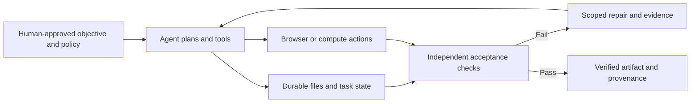

<!-- openshelf:budget-override reason="Five independently sourced technical case studies require full mechanisms, evidence limits, comparisons and reproducible experiments." -->

# AI Frontier — November 14, 2026

**Thesis:** The most actionable developments replace unverified agent assertions with externally checked artifacts, durable execution state, and explicit tool boundaries. Three selections concern releases or research from the last month; two older, underexplored implementations provide cross-domain comparison. The November 13 briefing already examined trained memory, realistic code grading and orchestration benchmarks; these selections emphasize deployed mechanisms rather than another model leaderboard.

## 1. AlphaProof Code: Verifying Signal's Security at the Machine-Code Level

**Date:** November 10, 2026. **Source:** https://deepmind.google/documents/36/Formal_Verification_of_Signal_4.pdf. **Verdict:** High novelty; strongest technical finding.

**What was demonstrated:** Google DeepMind reports a human-guided specification agent and autonomous prover agents that produce Lean proofs for selected security properties of Signal's `libsignal` reference implementation at the AArch64 machine-code level. The paper reports approximately **6.5 million lines of machine-checked Lean proof code**, based on roughly **26,000 lines of trusted specifications and machine-code semantics**. Covered components include the PQXDH handshake and Triple Ratchet, with stated properties including forward secrecy, authentication, post-compromise security and handshake secrecy. These are author-reported scope and quantities, not an independently reproduced audit.

**Technique:** Separate *specification authority* from autonomous proof search. Humans approve the formal target; agent-produced proof artifacts are accepted only by the Lean kernel. The proof checker, not the model, decides whether the artifact satisfies the approved formal specification.

**Why frontier:** Unlike [[projects/spec-first-verification-agents|spec-first verification architectures]] discussed November 11, this reports a substantial machine-code-level application to a cryptographic implementation. It is not a claim that all Signal applications, all threat models, or the full protocol were verified. Correctness of the specification and trusted semantics remains a critical assumption.

**Practical takeaway and experiment:** For an embedded crypto or secure-boot component, choose a narrowly scoped routine and security invariant, freeze the implementation and compiler/architecture assumptions, write a human-reviewed specification, then measure the agent's proof-generation effort and the independent checker acceptance rate. Track specification changes separately from proof changes.

## 2. agent-browser v0.42–v0.43: Recorded Browser Flows and Better Grounded Controls

**Dates:** November 10 and 12, 2026. **Sources:** https://github.com/vercel-labs/agent-browser/releases/tag/v0.42.0 and https://github.com/vercel-labs/agent-browser/releases/tag/v0.43.0. **Verdict:** Practical, moderately novel engineering increment.

**What was built:** The v0.42 release adds experimental saved flows: record a browser task, then attempt to replay it using direct HTTP, in-page requests, or recorded browser commands, retaining the successful tier. The release says request targets are restricted to public addresses. v0.43 adds contextual hints for accessibility controls with missing or ambiguous labels, using available icons, test IDs, field names and nearby row text. It also improves handling of closed tabs and large accessibility snapshots.

**Technique:** Promote a discovered GUI interaction into a replayable, lower-cost execution path, with a browser fallback. Ground element selection in local structural evidence rather than guessing ambiguous button names.

**Why frontier:** [[projects/fastbrowse|fastbrowse]] and [[projects/baya-compile-then-execute|Baya]] previously addressed constrained browser actions and compiled execution. This is an implementation-level extension: *record once, replay via a hierarchy of mechanisms*. It creates a new risk boundary: HTTP replay may not reproduce all browser-side state or authorization semantics.

**Practical takeaway and experiment:** Record five repetitive browser workflows in a disposable test account. Compare live agent execution against saved-flow replay on latency, tokens, functional outcome, stale-session handling and unintended writes. Require a read-after-write check before accepting a replay as complete. Release notes establish shipped functionality, not a measured improvement on these tasks.

## 3. Paperclip v2026.1005.0: Durable Agent Files and Human-Takeover Browsers

**Date:** October 5, 2026. **Source:** https://github.com/paperclipai/paperclip/blob/master/releases/v2026.1005.0.md. **Verdict:** Useful operations implementation; older than the preferred discovery window.

**What was built:** The release notes describe agent-owned files retained across tasks, GitHub-synchronized company skills, Browser Use Cloud sessions that operators can observe and take over, Slack conversation round trips, and reliability work on sandbox transport and heartbeat scheduling. It also changes coordination semantics: mentioning an agent no longer starts a run; explicit assignment or review request is required.

**Technique:** Durable workspace state plus explicit task ownership and human intervention surfaces. The system treats an agent as an ongoing worker with recoverable state, rather than a disposable chat completion.

**Why frontier:** This is closer to a production operations substrate than an academic agent benchmark. Relative to [[projects/agent-orchestrator|Agent Orchestrator]], the interesting distinction is cross-task memory and operator takeover alongside task assignment. Release notes document features, not independent reliability or security measurements.

**Practical takeaway and experiment:** Run an agent through ten task handoffs, forced restarts and one human takeover. Check whether its files, task ownership, browser session and audit trail survive correctly; verify that a mere mention cannot trigger execution. Score recovery and duplicate-action incidence rather than number of tasks claimed complete.

## 4. The Agentic Researcher: Sandboxed CLI Agents Running Long Scientific Experiments

**Date:** March 16, 2026. **Source:** https://arxiv.org/abs/2603.15914. **Code:** https://github.com/ZIB-IOL/The-Agentic-Researcher. **Verdict:** Exploration selection; older but unusually concrete long-running workflow.

**What was demonstrated:** An open-source framework that wraps existing CLI coding agents in methodological instructions and sandboxed execution, supporting mathematical and ML research from a laptop to multi-node GPU clusters. The authors report a longest autonomous session exceeding **20 hours**, dispatching experiments across multiple nodes. One documented screenshot depicts six concurrent GPU training runs and three scheduled monitoring tasks. These are author-reported observations, not a reliability distribution.

**Technique:** Persistent research objectives, scheduled checks and distributed experiments with the agent idle between checks rather than continuously consuming tokens. Human researchers still set direction and judge results.

**Why frontier:** Unlike [[projects/autosr|AutoSR]]'s specialized scientific search, this is a reusable research workflow built on ordinary CLI agents and existing compute infrastructure. It offers an architecture worth adapting even if the specific research results do not transfer.

**Practical takeaway and experiment:** Run a bounded overnight parameter sweep in an isolated environment. Require immutable experiment configurations, per-run provenance, cost ceilings and independent evaluation of best results. Measure unattended duration, successful recovery and reproducibility, not just total GPU hours.

## 5. SOPGuard: Enforcing Origin Boundaries for Agentic Browsers

**Date:** June 12, 2026. **Source:** https://arxiv.org/abs/2606.14027. **Code:** https://github.com/wxl-lxw/BrowserOS-SOPGuard. **Verdict:** Exploratory security architecture; not a new November release.

**What was demonstrated:** The researchers introduce SOPBench for agent-mediated same-origin-policy violations and implement SOPGuard in the open-source BrowserOS agentic browser. Their experiments report that agent-mediated cross-origin flows can violate traditional browser assumptions, and that their enforcement mechanism preserves utility with relatively small overhead. The available abstract does not provide an independently verified overhead number.

**Technique:** Apply origin-sensitive information-flow constraints to the *agent's actions*, not just to webpage scripts. The agent itself can bridge otherwise isolated page content when it reads one origin and writes to another.

**Why frontier:** [[projects/harness-matters-web-agent-security|Harness Matters]] evaluates browser harness attack susceptibility; SOPGuard targets a specific architectural trust boundary. This is an especially relevant counterweight to recorded HTTP flows and broadly permissioned browser agents.

**Practical takeaway and experiment:** Build a local two-origin test harness containing a canary secret. Ask a browser agent to complete benign cross-site tasks while adversarial content attempts to move the canary across origins. Record prevented leaks, false positives and workflow breakage. Never test with real credentials.

## Architecture: independent acceptance across agent workflows

This diagram is a proposed synthesis, **not** an architecture claimed by any single source. AlphaProof Code offers the strongest independent acceptance boundary through a formal proof kernel. agent-browser and Paperclip emphasize operational execution and recovery; The Agentic Researcher emphasizes durable scientific experiments; SOPGuard constrains cross-origin information flow. Their measurements are not comparable and none proves that a combined system is safe.

## Recommended experiment: one trusted agent operations harness

Create a sandboxed five-task evaluation with (1) a formal or deterministic acceptance check, (2) a recorded browser workflow, (3) a forced agent restart, (4) a long-running scheduled compute job, and (5) an adversarial cross-origin canary. Hold the model and time budget constant. Record verified completion, duplicate writes, restart recovery, provenance completeness, cost, and any secret-flow violation. Compare a baseline agent with a version that adds explicit policy, durable state and independent acceptance. **No such combined experiment was performed for this briefing.**

## Frontier signal

**Agents are becoming auditable operators rather than merely autonomous responders.** The common pattern is a durable action substrate with narrowly defined authority and a separate mechanism that verifies the consequential outcome. Formal proof kernels are the strongest example; browser replay and multi-task orchestration still need comparable acceptance boundaries.
