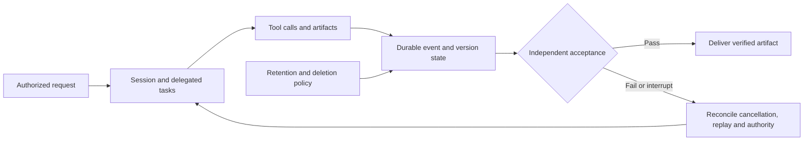

<!-- openshelf:budget-override reason="Complete five-item source-backed implementation analysis, evidence limitations and reproducible experiments." -->

# AI Frontier — November 16, 2026

**Thesis:** The strongest implementation signal this week is *lifecycle correctness*: agent systems are exposing replay, deletion, authority and cancellation as explicit state rather than trusting an agent's final message. Four core items concern agent protocols, runtimes and desktop connector authorization; one exploratory item examines artifact collaboration. All five are source-documented releases, not independently reproduced benchmark results. The November 13–14 briefings already covered memory training, agent orchestration benchmarks, formal proofs, browser replay and durable operations; today's findings are narrower implementation deltas.

## 1. Agent Client Protocol 1.18

**Date:** 2026-11-14. **Selection:** core. **Primary source:** https://github.com/agentclientprotocol/agent-client-protocol/blob/main/CHANGELOG.md. **Verdict:** High architectural relevance; mostly experimental protocol evolution.

**Built or demonstrated:** [[projects/agent-client-protocol|Agent Client Protocol 1.18]] — ACP 1.18.0 adds unstable-v2 skill commands and content blocks, subagents without the earlier unstable_subagents feature, a replay_complete session update, prompt suggestions, and initial configuration on forked sessions. These are schema/protocol changes, not evidence that every editor and agent implements them.

**Key agentic technique:** Explicit session lifecycle and interoperable subagent/skill event surfaces instead of proprietary orchestration state.

**Why it matters / what's new:** It extends the agent-to-editor interface toward persistent, replayable delegated work. Compared with earlier ACP provenance coverage, the meaningful delta is richer subagent, replay and skill semantics; all cited features are marked unstable.

**Practical takeaway and reproducible experiment:** Build a minimal ACP v2 adapter between two CLI agents; fork a session, dispatch a subagent, replay a saved event sequence and check whether the client can reconstruct final status without inventing tool results.

**Evidence limit:** Repository maintainers' release notes establish a reported implementation change, not independent functional testing or a production success rate. The experiment is proposed and has not been run.

## 2. Framerslab AgentOS 0.18–0.19

**Date:** 2026-11-14–15. **Selection:** core. **Primary source:** https://github.com/framerslab/agentos/releases/tag/v0.18.0. **Verdict:** Substantive implementation of memory governance; no independent reliability study.

**Built or demonstrated:** [[projects/framerslab-agentos|Framerslab AgentOS 0.18–0.19]] — AgentOS 0.18 adds a forgotten-user ledger, tombstones persisted outside the main memory store, deletion of associated traces/chunks, SQLite secure_delete and retention choices for shared stores. Version 0.19 makes persistence, prompt profiles and date tools explicit host configuration rather than implicit runtime defaults.

**Key agentic technique:** Durable negative memory: enforce deletion/retention across restored databases and derived retrieval indexes, while making host authority explicit.

**Why it matters / what's new:** Many agent-memory projects optimize recall but under-specify deletion, provenance and consent. This release treats forgetting as a durable state transition that must survive backup restore. That is an engineering mechanism, not a measured privacy guarantee.

**Practical takeaway and reproducible experiment:** Create synthetic user memories, delete one subject, restore an older SQLite snapshot and attempt dense, exact and recency retrieval. Assert zero recovered content, inspect tombstone state and verify unrelated subjects remain accessible.

**Evidence limit:** Repository maintainers' release notes establish a reported implementation change, not independent functional testing or a production success rate. The experiment is proposed and has not been run.

## 3. Compozy 0.7.1–0.7.2

**Date:** 2026-11-15. **Selection:** core. **Primary source:** https://github.com/compozy/compozy/blob/main/CHANGELOG.md. **Verdict:** High operational value; maintenance release rather than new research.

**Built or demonstrated:** [[projects/compozy|Compozy 0.7.1–0.7.2]] — Compozy fixes parent wakeups when delegated subagents are deleted or canceled, orphan reconciliation at boot, long-running gate leases, subprocess output retention, session authority preservation and default child-tool scope narrowing. These are explicit production-oriented failure-mode fixes, not benchmarked success rates.

**Key agentic technique:** Reconcile a durable delegation tree and tool-authority ceiling across cancellation, deletion, process exit and restart.

**Why it matters / what's new:** The novelty is operational evidence of where multi-agent runtimes fail: a child can disappear while its parent remains blocked or inherits excessive authority. Compared with WorkflowArena's orchestration scoring, this addresses lifecycle correctness.

**Practical takeaway and reproducible experiment:** Fault-inject 100 delegated tasks with random child deletion, cancellation and daemon restart. Verify every parent eventually reaches a terminal state, no orphan retains a tool grant and stdout survives process exit.

**Evidence limit:** Repository maintainers' release notes establish a reported implementation change, not independent functional testing or a production success rate. The experiment is proposed and has not been run.

## 4. Thunderbird Thunderbolt 0.1.164–0.1.165

**Date:** 2026-11-11–12. **Selection:** core. **Primary source:** https://github.com/thunderbird/thunderbolt/blob/main/CHANGELOG.md. **Verdict:** Real application integration, but mainly incremental reliability work.

**Built or demonstrated:** [[projects/thunderbolt|Thunderbird Thunderbolt 0.1.164–0.1.165]] — Thunderbolt adds reusable provider connections and authorization, improves MCP connection entry, and bounds WebKit renderer recovery after crashes. Its surrounding release history documents agent workspace attachments, browser/test workflows and authorization surfaces, but the cited versions do not establish autonomous email-task success.

**Key agentic technique:** Reusable connector identity and explicit authorization in an end-user agent workspace, with bounded GUI recovery.

**Why it matters / what's new:** A useful exploration outside coding agents: connector lifecycle and embedded browser crashes matter for consumer automation. Compared with generic MCP integrations, the concrete delta is provider authorization reuse and a recoverable desktop runtime.

**Practical takeaway and reproducible experiment:** Using a disposable account, authorize two providers once, interrupt the embedded web view and verify connection reuse, no silent privilege expansion and correct resumption of an unfinished draft.

**Evidence limit:** Repository maintainers' release notes establish a reported implementation change, not independent functional testing or a production success rate. The experiment is proposed and has not been run.

## 5. Open Artifacts 0.193–0.196

**Date:** 2026-11-15–16. **Selection:** exploration. **Primary source:** https://github.com/open-artifacts-ai/open-artifacts/releases. **Verdict:** Exploratory artifact collaboration; agentic novelty limited.

**Built or demonstrated:** [[projects/open-artifacts|Open Artifacts 0.193–0.196]] — Open Artifacts ships document version saving/restoring and selection comments (0.193), editable ask cards (0.194), and owner-controlled external sharing with email limits and explicit delivery feedback (0.195–0.196). These release notes document collaborative artifact infrastructure, not autonomous planning or measured agent performance.

**Key agentic technique:** Versioned human-reviewable artifacts and constrained external sharing as a substrate for agent-created deliverables.

**Why it matters / what's new:** This is a deliberately lower-ranked cross-domain signal: persistent artifact versioning and scoped sharing could make agents easier to supervise. It is not a new autonomous-agent algorithm and should not be presented as one.

**Practical takeaway and reproducible experiment:** Have an agent revise a document through three proposed changes, restore the second version, attach source-grounded comments and attempt an unauthorized external share; verify rollback fidelity and permission enforcement.

**Evidence limit:** Repository maintainers' release notes establish a reported implementation change, not independent functional testing or a production success rate. The experiment is proposed and has not been run.

## Architecture: lifecycle-aware agent execution

This is an analytical synthesis, not an architecture demonstrated by one vendor. ACP contributes session/subagent semantics; AgentOS contributes deletion and persistence controls; Compozy contributes child lifecycle reconciliation; Thunderbolt contributes connector authorization and GUI recovery; Open Artifacts contributes versioned deliverables. None establishes interoperability across all five.

## Recommended experiment

Build a disposable two-agent workflow with a parent, child, browser/connector tool and versioned output. Force child termination and process restart, revoke one user's memory, restore a backup, then replay events. Accept success only if the parent resolves, revoked data stays absent, the tool-authority ceiling holds and the output version can be restored. Measure verified completions, stranded parents, leaked grants, recovered deleted data and rollback mismatches. These are **proposed metrics**, not measured results.

## Frontier signal

**Agent infrastructure is becoming a lifecycle and authority system, not merely an inference loop.** The differentiator is whether an implementation handles revocation, replay, cancellation, recovery and independent artifact acceptance without silent state drift. Release notes show increasing engineering attention, but controlled comparative evidence remains thin.
