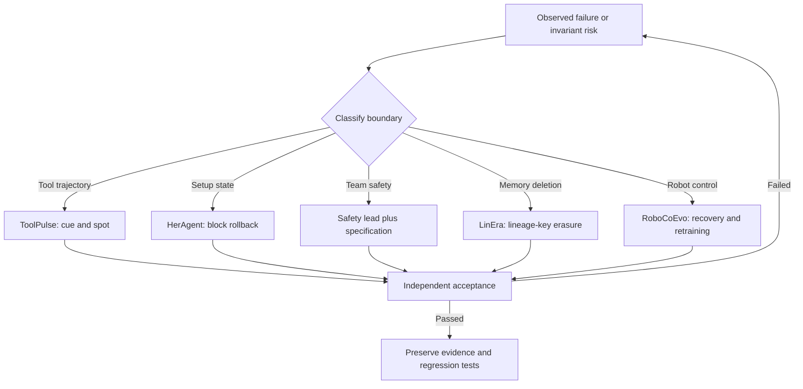

<!-- openshelf:budget-override reason="Preserve complete five-study primary-source evidence, comparisons, bounded experiments and architecture without truncation." -->

# AI Frontier — November 17, 2026

**Frontier thesis:** The valuable boundary is increasingly *between noticing a problem and demonstrating that it was corrected*. Runtime nudges can change tool-use behavior without fixing the code; meaningful checkpoints can improve setup completion; a team can lose a system-level safety obligation; a memory deletion can leave derived secrets recoverable; and a robot's recovery code can become training data for a changing policy. These are different interventions with different acceptance criteria.

**Evidence and selection:** Four engineering/security findings (80%) and one exploratory robotics study (20%), all primary papers dated November 13–14, 2026. Research papers provide implementation descriptions and author-reported experiments, not independent replication or production deployment. This is a source-type concentration limitation. Compared with November 16's ACP, Compozy and AgentOS release changes, today's findings provide new experiments and mechanisms, not another lifecycle patch announcement. No finding repeats a previously archived source identity.

## 1. ToolPulse — Cueing and spotting tool-use detours

**Date:** 2026-11-14. **Selection:** core engineering/research. **Primary source:** https://arxiv.org/abs/2611.19275. **Canonical entity:** [[projects/toolpulse]].

**Demonstrated capability:** Across 1,350 SWE-agent trajectories on 90 Python, C++ and Java bug-fix tasks, authors report substantive responses after 61.6–90.9% of valid detour triggers, but aggregate repair outcomes remain close to baseline; some configurations save tokens.

**General concept:** Runtime feedback intervention versus verified task repair. **Specific mechanism:** State-based pre-dispatch cues, execution-feedback inspection, semantic trajectory spotting and auxiliary-model advice. See [[techniques/adaptive-recovery]] and [[concepts/verified-completion-vs-apparent-success]] for relevant boundaries.

**What is genuinely new:** A rare process-level intervention evaluation that explicitly separates changed behavior from actual bug repair.

**Evidence and limits:** Author-reported experiments; intervention trigger validity and symptom cessation do not establish independent patch correctness. No result in this briefing was independently reproduced.

**Practical implication:** Instrument repetitive tool calls before dispatch and after tool results; do not reward an intervention unless the final test passes.

**Bounded reproducible experiment:** Run 30 fixed failing repository tasks with no intervention, short state-based cues, and richer advice. Freeze model and tool budget; report valid triggers, avoided repeat calls, independently passing tests, tokens and false interventions.

## 2. HerAgent — Semantic block checkpointing for coding environments

**Date:** 2026-11-13. **Selection:** core engineering/research. **Primary source:** https://arxiv.org/abs/2611.18443. **Canonical entity:** [[projects/heragent]].

**Demonstrated capability:** Across four environment-setup datasets and six prior agents, authors report Installamatic-Bench success rising from 52.0% to 85.0%, SetupBench from 46.3% to 70.4%, and up to 94.5% lower setup cost in selected comparisons.

**General concept:** Recovery granularity and checkpoint scope. **Specific mechanism:** Semantic setup blocks unify execution, validation, checkpointing, rollback and repair; failed setup can revert a coherent block instead of one command or the entire script. See [[techniques/adaptive-recovery]] and [[concepts/agent-state-and-lifecycle]] for relevant boundaries.

**What is genuinely new:** Checkpoint boundaries are meaningful units of setup work, not arbitrary shell lines; measurable outcome improvement unlike mere runtime plumbing.

**Evidence and limits:** Benchmarks and cost figures are author-reported, dataset-specific and not evidence of equivalent improvement for all coding tasks. No result in this briefing was independently reproduced.

**Practical implication:** Represent repository bootstrapping as validated phases (runtime, dependencies, build, tests) with checkpoint hashes and replayable setup artifacts.

**Bounded reproducible experiment:** On 20 pinned repositories, compare command-level, full-script and semantic-block rollback under injected dependency conflicts; require clean-container replay and successful tests.

## 3. Aligning AI Teams — System-level safety ownership

**Date:** 2026-11-13. **Selection:** core engineering/research. **Primary source:** https://arxiv.org/abs/2611.17820. **Canonical entity:** [[projects/aligning-ai-teams]].

**Demonstrated capability:** In two software-engineering scenarios and ten consulting tasks across five models, authors find that team critique and group chat do not reliably close single-agent safety gaps; a designated safety lead and explicit safety specification perform better in their studied settings.

**General concept:** Delegated responsibility and system-level acceptance. **Specific mechanism:** A designated safety lead checks whole-team objectives and a coordinator publishes a safety specification; researchers compare this with ordinary peer critique and group chat. See [[techniques/multi-agent-orchestration]] and [[concepts/contracts-and-compositional-correctness]] for relevant boundaries.

**What is genuinely new:** Demonstrates that individually aligned workers can collectively neglect a system-level invariant; role assignment alone is insufficient unless someone owns the invariant.

**Evidence and limits:** The evaluation intentionally constructs safety/business tradeoffs; it does not prove the same effect magnitude in routine repository teams or every safety domain. No result in this briefing was independently reproduced.

**Practical implication:** Assign one agent responsibility for cross-task invariants and require a signed-off acceptance artifact, not merely peer critique.

**Bounded reproducible experiment:** Use 12 seeded multi-agent coding tasks with cross-module safety invariants. Compare no lead, peer-review-only and safety-lead-plus-spec; score independently verified invariant violations, completion and cost.

## 4. LinEra — Cryptographic erasure across agent-memory lineage

**Date:** 2026-11-13. **Selection:** core engineering/research. **Primary source:** https://arxiv.org/abs/2611.18133. **Canonical entity:** [[projects/linera]].

**Demonstrated capability:** In the paper's largest-writer ten-conversation LoCoMo experiment, attacker recovery was 70/71 secrets after logical deletion, 67/71 with per-object/epoch keys, and 0/71 with LinEra. Forgetting 1% of turns made 73.0% of session-summary derivatives unreadable versus 3.8% with four-turn windows.

**General concept:** Cryptographic erasure versus logical forgetting. **Specific mechanism:** Derive memory encryption keys from the keys of all input memories; puncture a source key in a pseudorandom-function tree so dependent summaries, embeddings and backups become unreadable. See [[techniques/agent-skills-and-memory]] and [[concepts/delegated-authority-and-revocation]] for relevant boundaries.

**What is genuinely new:** Adds a cryptographic security boundary to memory lineage, not just a tombstone or deletion API. Exposes a measurable privacy/utility tradeoff determined by summarizer fan-in.

**Evidence and limits:** Author-reported prototype and threat model; lineage completeness depends on recording everything the writer saw, protecting current keys and not leaking plaintext through other channels. No result in this briefing was independently reproduced.

**Practical implication:** Treat derived memory as a dependency graph and keep summarization fan-in narrow; verify backup restoration under an attacker-with-storage-and-current-keys model.

**Bounded reproducible experiment:** On synthetic secrets in a local memory store, compare logical deletion, per-object encryption and lineage-key puncturing after snapshot restore; measure secret recovery, collateral memory loss and query quality.

## 5. RoboCoEvo — Agent-policy co-evolution for robot recovery

**Date:** 2026-11-14. **Selection:** exploratory robotics. **Primary source:** https://arxiv.org/abs/2611.19081. **Canonical entity:** [[projects/robocoevo]].

**Demonstrated capability:** Authors report successive improvements across BEHAVIOR-1K, RoboCasa and RoboTwin simulated robotics benchmarks; this briefing does not assert a pooled improvement number or physical-robot replication.

**General concept:** Coupled evolution of executable recovery knowledge and trained policy. **Specific mechanism:** A multimodal agent writes failure detectors and executable recovery programs for robot-policy rollouts; successful corrections become training data for a VLA policy, whose new failure distribution drives the next program revision. See [[techniques/embodied-and-scientific-agents]] and [[concepts/capability-locus]] for relevant boundaries.

**What is genuinely new:** Unlike frozen-model harness improvement, capability changes in both the external recovery programs and the learned robot policy, with failures routing updates between them.

**Evidence and limits:** Paper reports simulated benchmark improvements; no independent physical deployment or generalization to real hardware is established here. No result in this briefing was independently reproduced.

**Practical implication:** For autonomous embedded/robotic systems, separate recovery logic from learned control and measure both the newly fixed failures and regressions after policy retraining.

**Bounded reproducible experiment:** In a small deterministic simulator, seed three failure classes; compare fixed policy, recovery-script-only and recovery-plus-retraining over three rounds. Hold evaluation seeds out and report new failures as well as recovered tasks.

## Cross-study comparison: what is actually being accepted?

| System | Proposed intervention | Acceptance must establish | Failure to avoid |
|---|---|---|---|
| [[projects/toolpulse]] | Runtime cue or spotter | Tests pass after intervention | Mistaking symptom cessation for repair |
| [[projects/heragent]] | Semantic setup-block rollback | Clean-environment setup and test replay | Reusing polluted state |
| [[projects/aligning-ai-teams]] | Safety lead and explicit specification | Whole-system invariant holds | Diffused responsibility despite peer critique |
| [[projects/linera]] | Key-graph puncturing | Deleted plaintext and derivatives inaccessible under threat model | Residual secrets in backups or summaries |
| [[projects/robocoevo]] | Recovery programs plus VLA retraining | Held-out task gains without regression | Optimizing only observed failure classes |

This table is an analytical comparison of separately studied mechanisms, not a shared benchmark or proof that any intervention transfers across domains. A common testing discipline is to specify the state boundary, apply one controlled perturbation and independently verify the outcome.

## Architecture hypothesis

This diagram is a proposed decision taxonomy, not an implemented unified system. Each acceptance branch requires a different oracle and threat model; a single success percentage would obscure important failures.

## Recommended near-term experiment

Start with **HerAgent-style semantic checkpointing** in a disposable coding-agent setup pipeline. Use 20 pinned repositories, fixed models and budgets, three rollback granularities and injected dependency conflicts. Require successful clean-container replay, not merely successful shell commands. In parallel, test **ToolPulse-style short cues** on the same class of tasks, but report cue-trigger precision and final test success separately. Do not claim combined benefits without a factorial experiment.

For security-focused follow-up, LinEra's lineage-key deletion provides a concrete adversarial test: snapshot encrypted synthetic memories, request forgetting, restore old storage with only current keys, and attempt recovery of every derived secret. Compare loss of unrelated knowledge as well as privacy. These are proposed experiments; none has been executed in this briefing.

## Frontier signal

**Agent improvement needs typed acceptance at the correct boundary.** A prompt, tool trajectory, checkpoint, team contract, encryption key graph and learned policy can all be updated; the update is only valuable when an independent test checks the corresponding task, safety, privacy or regression obligation. ToolPulse's limited end-task gains despite high behavioral response are the clearest warning against equating agent self-correction with verified improvement.
