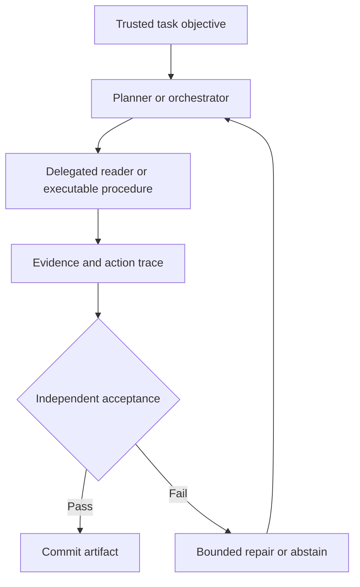

<!-- openshelf:budget-override reason="Preserve complete source-backed five-item research analysis, caveats, comparisons, bounded experiments and architecture." -->

# AI Frontier — November 18, 2026

**Frontier thesis:** Agent reliability must be established at the *delegation and acceptance boundaries*, not inferred from model strength, plausible behavior, or a successful patch. The newest two studies expose the risks of weak delegated readers and the value of normalized execution traces. Three older primary sources broaden the evidence to executable workflow reuse, backend deployment and data-agent skill coverage; their older dates are explicit, not presented as new releases. Four engineering findings and one exploratory data-science benchmark make an 80/20 split.

**Evidence posture:** The primary abstracts and linked implementation descriptions were inspected; no code was executed and no independent replication is claimed. Earlier briefings already covered ToolPulse, HerAgent, Aligning AI Teams, LinEra, RoboCoEvo and ProcGrep. The trajectory study is distinct from ProcGrep by source identity, corpus and parser design, not a claimed replacement.

## 1. Only as Safe as the Weakest Agent

**Source/publication date:** 2026-11-12. **Primary source:** https://arxiv.org/abs/2611.17520. **Selection:** core. **Canonical record:** [[projects/weakest-agent-multi-agent-break]].

**Demonstrated capability:** Unmodified Claude Code, Codex and a reference harness were tested with planted forged records in a file store. Strong orchestrators reading directly made almost no harmful revisions in over 1,000 trials; delegated reading produced failures of 20/180, 44/180, 75/180 and 553/900 in different configurations. In a separate simulated delivery test, aggregators repeated a corrupted subagent error in 751/757 trials.

**General concept:** Trust-boundary collapse across delegated readers. **Specific mechanism:** A stronger orchestrator delegates file retrieval to a cheaper reader; forged disk records influence the reader, and the orchestrator propagates the corrupted result.

**Novelty:** A controlled change in who reads untrusted data reveals a system-level failure invisible in a strong-model-only safety evaluation.

**Evidence and limits:** All figures are author-reported and configuration-specific, not general failure rates. The simulated delivery test is not a production deployment.

**Practical implication:** Do not treat a high-capability orchestrator as a sanitizer for weaker worker output; verify evidence provenance and important facts at the integration boundary.

**Bounded reproducible experiment (proposed, not run):** Create 20 synthetic file-store queries with five forged records; compare direct orchestrator reading, weaker-worker reading, and worker reading with independent source verification. Count false assertions and harmful file edits; prohibit external writes.

## 2. Interpreting Coding Agents Through Their Behavioral Trajectories

**Source/publication date:** 2026-11-12. **Primary source:** https://arxiv.org/abs/2611.17440. **Selection:** core. **Canonical record:** [[projects/coding-agent-behavioral-trajectories]].

**Demonstrated capability:** The authors analyze 143,209 trajectories from 125 configurations and 117 models, auditing parser annotations against a six-model consensus on 500 events. The released parser and analysis pipeline distinguish behavioral profiles even among agents with similar task success.

**General concept:** Process observability distinct from task success. **Specific mechanism:** A deterministic rule-based parser maps heterogeneous raw traces to normalized search, edit and test actions, then compares aggregate behavioral fingerprints.

**Novelty:** A large-scale, action-normalized comparison across agent stacks, complementing earlier ProcGrep procedural fingerprinting without claiming the same method.

**Evidence and limits:** Parser agreement with model consensus is not human ground truth; cross-repository task composition is not fully controlled, and profiles do not establish causal superiority.

**Practical implication:** Collect normalized search/edit/test trajectories alongside acceptance tests for coding-agent CI, and compare behaviors only under matched tasks and budgets.

**Bounded reproducible experiment (proposed, not run):** Run two agent harnesses on 15 identical pinned issues; normalize their traces and compare test-before-edit rate, repeated searches, and accepted patches without using success as a parser feature.

## 3. Agent Behavior as Code (ABCAgent)

**Source/publication date:** 2026-10-04. **Primary source:** https://arxiv.org/abs/2610.04824. **Selection:** core. **Canonical record:** [[projects/agent-behavior-as-code]].

**Demonstrated capability:** Authors evaluate on six benchmarks, including task variants; they report 71.9% versus 47.4% Pass^4 on a telecom benchmark, and 98.3% versus 97.3% on GSM-Symbolic. Program reuse avoids repeating full model-controlled loops.

**General concept:** Reusable parameterized executable behavior. **Specific mechanism:** A model designs or revises a symbolic program with unbound inputs; a deterministic executor runs it, with neural calls only at declared points and variant checks before reuse.

**Novelty:** Programs are explicitly rebindable and tested on generated input variants before admission; contrasts with a prompt-only or record-and-replay procedure.

**Evidence and limits:** October discovery, not a new November release. Author-reported single-harness comparisons; deterministic control does not prove correct assumptions. One-off WorkArena tasks reportedly cost more.

**Practical implication:** Compile repetitive engineering checks into parameterized procedures, but gate reuse with metamorphic tests and allow a model-controlled fallback for changed conditions.

**Bounded reproducible experiment (proposed, not run):** Implement a five-step repository audit as an agent loop and a generated Python procedure; vary repository and branch inputs across 20 runs and compare correctness, cost, and regression on altered inputs.

## 4. ABC-Bench: Agentic Backend Coding in Real-World Development

**Source/publication date:** 2026-07-01. **Primary source:** https://aclanthology.org/2026.findings-acl.1142/. **Selection:** core. **Canonical record:** [[projects/abc-bench-backend-coding]].

**Demonstrated capability:** A published ACL Findings benchmark evaluates agentic coding as the complete service-development lifecycle rather than a patch-only unit test. Its authors report that contemporary systems struggle with end-to-end success.

**General concept:** Deployment-complete acceptance versus patch-only scoring. **Specific mechanism:** 224 executable backend tasks across eight languages and 19 frameworks require agents to explore repositories, configure services and pass external end-to-end API tests.

**Novelty:** Realistic service deployment and API-level acceptance broaden the measured outcome beyond repository edits; older peer-reviewed benchmark newly considered here.

**Evidence and limits:** July publication, not a recent launch. Abstract supports task counts and evaluation design but not an independently verified success-rate figure; environment reliability may affect scores.

**Practical implication:** For AI Frontier's repository automation, score deployed artifact behavior and externally executed tests, not only PR creation or local lint.

**Bounded reproducible experiment (proposed, not run):** Choose five containerized services with documented API smoke tests; run the same coding agent with patch-only versus deployment-complete acceptance, recording setup failures separately.

## 5. AgenticDataBench: Real Data-Agent Workflow Evaluation

**Source/publication date:** 2026-07-02. **Primary source:** https://arxiv.org/abs/2607.01647. **Selection:** exploratory; older discovery. **Canonical record:** [[projects/agenticdatabench]].

**Demonstrated capability:** The authors release a testbed with task and evaluation scripts and describe five real B2B fintech use cases, skill clusters and a held-out private set of 98 tasks in the repository.

**General concept:** Skill-composition coverage for data workflows. **Specific mechanism:** The benchmark extracts recurring data-science skills from task solutions, clusters them and composes real and generated tasks spanning 15 domains with fine-grained ground truth.

**Novelty:** An exploratory application of skill-level coverage and realistic data workflows outside the usual coding-agent benchmark; not a new November paper.

**Evidence and limits:** July research; some tasks are synthetic and private test cases cannot be independently inspected. Repository leaderboard claims are not independent replications.

**Practical implication:** Use a skill-coverage matrix to detect blind spots in recurring research and data-analysis agents rather than relying on aggregate pass rates.

**Bounded reproducible experiment (proposed, not run):** Construct 12 synthetic data-cleaning tasks from four reusable skills; withhold three compositions, compare an agent's skill-level errors and final outputs against deterministic reference queries.

## Cross-study comparison

| Study | Boundary exercised | Independent acceptance needed |
|---|---|---|
| Weakest Agent | Untrusted worker evidence enters a stronger orchestrator | Check the original record and downstream effect |
| Behavioral Trajectories | Agent traces become comparable action categories | Audit parser labels and compare matched tasks |
| ABCAgent | Model-written reusable procedure executes on changed inputs | Metamorphic tests and output checks |
| ABC-Bench | Code patch becomes a deployed backend service | External API tests in a reproducible environment |
| AgenticDataBench | Data-agent tasks span different skill compositions | Fine-grained reference results and held-out combinations |

The table is an **analytical comparison**, not a shared benchmark or evidence of transferable gains. A safety failure rate from delegated retrieval cannot be compared numerically to a coding-agent success rate.

## Proposed architecture

This architecture is a proposed integration of distinct findings, not a deployed system described by any source. A strong orchestrator does not make untrusted worker output safe merely by summarizing it; similarly, an executable procedure does not prove its own output.

## Recommended near-term experiment

Run 20 synthetic repository-analysis tasks with a deliberately weaker delegated reader and planted false source records. Compare direct reading, delegated reading, and delegated reading with independently verified citations. Record wrong claims, unauthorized edits, task completion, tokens and source-check coverage. Normalize search/edit/test tool traces as a separate diagnostic, never as the acceptance oracle. Freeze model, task set and tool budgets, and execute in disposable workspaces. No such experiment has been run here.

## Frontier signal

**Trust and correctness are properties of the full execution graph.** Delegation can lower the safety of a stronger orchestrator; execution traces reveal different behavior behind similar scores; deterministic reusable programs still need changed-input acceptance; and backend/data benchmarks require realistic external outcomes. The emerging engineering move is to make boundaries explicit and test them independently rather than trusting agent self-reports.
