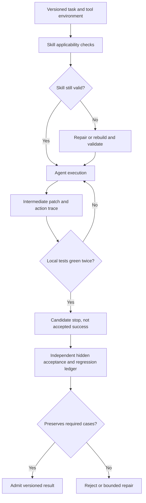

<!-- openshelf:budget-override reason="Complete five-paper primary-source briefing with mechanisms, author-reported results, evidence boundaries, comparisons and bounded experiments." -->

# Agentic AI Frontier — November 19, 2026

**Frontier thesis:** Persistent agent capability is useful only while its assumptions remain valid, its changes preserve task coverage, and its stopping and acceptance criteria reflect real outcomes. Today's papers distinguish skill invalidation, mechanism-level self-improvement, premature stopping, persistent instruction influence, and a robotics harness that moves fast physical control beneath a slow model. Four findings concern coding/research engineering and one explores physical robotics. All five are newly submitted November 16–17 primary research papers, not production deployments or independently replicated results.

## 1. When Agent Skills Go Stale — selective maintenance of reused experience

**Source date:** November 17, 2026. **Primary paper:** https://arxiv.org/abs/2611.22525. **Canonical record:** [[projects/when-agent-skills-go-stale]].

**Demonstrated capability:** The authors compare retained agent skills before and after software, API, form and environment changes across TerminalBench-2, historical IRS forms, AppWorld and ScienceWorld with two models. A skill that previously saved steps can become harmful: the authors report more than 10 percentage points of negative transfer in some settings, and up to nearly 40% more execution steps than no skill. Selective maintenance improves accuracy by up to 67 percentage points and reduces steps by up to 37% in selected conditions.

**General concept:** Stored agent experience is an applicability-conditioned optimization, not timeless knowledge. **Specific mechanism:** Construct checks from previously successful execution, replay them without model calls, inspect discrepancies, determine whether they conflict with stored state, repair affected instructions or code, and validate the repair. Rebuild if local repair cannot be validated. The procedure receives no description of the environment change.

**Novelty:** Unlike [[projects/framerslab-agentos]]'s retention/deletion controls or [[projects/skillcompiler]]'s admission of newly compiled skills, this evaluates **post-admission drift**. Procedural skills that retain discovery steps may resist changed identifiers better than cache-heavy skills, but not every kind of change. The paper estimates maintenance amortization after roughly 21–42 subsequent uses in its tax-form setting.

**Evidence limits:** Author-reported controlled transitions, not general production reliability; task performance and step savings can move in different directions. Replaying checks does not certify all semantic effects. **Practical implication:** Keep versioned skill preconditions and cheap executable checks beside every high-value procedure; retire or repair a skill when its assumptions fail.

**Bounded experiment:** On ten pinned API/repository fixtures, change endpoint names, schema fields and dependency versions. Compare no skill, unchanged stale skill, procedural skill and selective-maintained skill; score independent task correctness, steps, false alarms, maintenance overhead and regressions. Related synthesis: [[techniques/agent-skills-and-memory]], [[techniques/deterministic-workflow-reuse]].

## 2. ELITE — Evaluation-Free Recursive Self-Improvement for Coding Agents

**Source date:** November 16, 2026. **Primary paper:** https://arxiv.org/abs/2611.21056. **Canonical record:** [[projects/elite-evaluation-free-self-improvement]].

**Demonstrated capability:** Explore-then-Integrate (ELITE) improves an executable coding-agent harness without using downstream task outcomes to select candidate descendants during evolution. Authors report SWE-bench Pro performance increasing from 60.0% to 85.6%; the reported comparison is 86.7% for Darwin Gödel Machine and 88.3% for Huxley-Gödel Machine. ELITE's observed evolution wall time was 8.8× and 3.2× faster respectively under tested configurations; cross-benchmark transfer averaged 73.3% SWE-bench Verified and 69.3% Polyglot.

**General concept:** Mechanism-level synthesis instead of outcome-driven lineage selection. **Specific mechanism:** Generate multiple focused improvements from one parent, implement them independently, inspect their code for compatible, redundant and conflicting mechanisms, then reimplement a coherent combined descendant. Deterministic structural and operational checks remain in-loop.

**Novelty:** This directly contrasts evaluation-and-select self-improvement with source-level integration. It is **not** evaluation-free in the sense of having no final benchmark or no correctness risks. Compared with [[projects/agent-behavior-as-code]]'s compilation of task programs, ELITE modifies the coding-agent implementation itself. Compared with [[projects/evoaudit]] it has a different selection signal, but preservation of previously solved tasks still needs explicit measurement.

**Evidence limits:** Author-reported benchmarks and configuration-specific runtime comparison; the full paper HTML could not be fetched here, so the primary abstract supports the cited quantitative claims but deeper implementation details remain to inspect. No independent reproduction established. **Practical implication:** Try integrating complementary harness changes before spending large evaluation budgets on many candidate lineages, but retain held-out regression gates.

**Bounded experiment:** Produce three isolated harness improvements from one baseline; compare deterministic compatible-mechanism integration against evaluate-and-select under fixed wall-time budgets. Test 20 previously solved and 20 untouched tasks; record newly solved and lost tasks, cost and structural validity. Related synthesis: [[concepts/preservation-aware-agent-improvement]], [[concepts/capability-locus]].

## 3. Done, But Still Working — when coding agents should stop

**Source date:** November 17, 2026. **Primary paper:** https://arxiv.org/abs/2611.22901. **Canonical record:** [[projects/done-but-still-working]].

**Demonstrated capability:** An anytime evaluation method replays intermediate patches from approximately 6,000 runs of eight open models across two coding scaffolds on SWE-bench Verified, grading them with hidden tests. The hindsight cost savings available at passing self-tests range from under 1% to 57% by model/scaffold. A rule stopping after the *same patch* passes its own tests twice saved 23% in a preregistered replication. Fine-tuning to imitate the rule saved 30% across six seeds.

**General concept:** Cost-aware stopping with an uncertain acceptance signal. **Specific mechanism:** Preserve and replay intermediate repository states; evaluate hidden-test quality at checkpoints; simulate policies that stop or choose an earlier patch without changing the original trajectory.

**Novelty:** It distinguishes *the agent's own green tests* from *hidden acceptance*, and evaluates cost versus correctness along a trajectory instead of only at its end. It complements [[projects/toolpulse]], where changed tool behavior did not necessarily improve repair success.

**Evidence limits:** The preregistered quality test did **not** establish non-inferiority of early-stopped patches. Replay supports stop/select policies only when intermediate states are faithful; it does not simulate interventions that change later agent behavior. **Practical implication:** A stop rule is a candidate optimization, not a correctness guarantee.

**Bounded experiment:** On 20 pinned issues with hidden tests, compare full agent run, first green self-test, and twice-green identical patch. Record tokens, time, hidden-test correctness and later patch improvements or regressions. Related synthesis: [[concepts/verified-completion-vs-apparent-success]], [[techniques/evaluation-and-simulation]].

## 4. Values Shape What Self-Improving Coding Agents Build

**Source date:** November 17, 2026. **Primary paper:** https://arxiv.org/abs/2611.23067. **Canonical record:** [[projects/values-shape-self-improving-coding-agents]].

**Demonstrated capability:** Researchers insert one of four Schwartz higher-order value types into persistent coding-agent instructions and hold it fixed through multiple self-improvement iterations. They report that openness-to-change instructions improve held-out performance, conservation instructions can fall below no-values controls, and the instructions affect solution size, complexity and algorithmic approach. Allowing agents to rewrite their own values narrows the differences; values distilled from AI literature show no detectable gain.

**General concept:** Persistent instructions are part of the optimization environment. **Specific mechanism:** Vary fixed value statements while holding coding tasks and self-improvement process comparable; separately permit self-revision to test whether the instruction influence persists.

**Novelty:** It turns AGENTS.md-like prose from an assumed governance layer into a measurable experimental variable. Unlike a direct security enforcement mechanism, values shape proposals rather than constrain every side effect. The study is not a claim that any Schwartz category is universally better.

**Evidence limits:** Author-reported controlled coding tasks, with uncertain transfer to other domains and models. The value language is not a substitute for policy checks or independent acceptance. **Practical implication:** Treat mission statements and self-edit permissions as versioned, testable configuration; prevent agents from silently rewriting non-negotiable policy.

**Bounded experiment:** Run 12 deterministic tasks with no-values, openness and conservation prompts. Hold instructions fixed in one arm and permit self-revision in another. Compare independent correctness, code complexity, security invariant violations and instruction drift. Related synthesis: [[concepts/capability-locus]], [[concepts/preservation-aware-agent-improvement]].

## 5. ForceHarness — Turning Force into Action and Physics for Frozen Frontier Models

**Source date:** November 16, 2026. **Primary paper:** https://arxiv.org/abs/2611.21099. **Canonical record:** [[projects/forceharness]]. **Exploratory robotics selection.**

**Demonstrated capability:** A frozen API-only multimodal model controls contact-rich robot tasks through calibrated force feedback and self-terminating local force routines. Authors report real-arm zero-shot success for GPT-6 Astra increasing from 3.3% to 90.0% without a wrist force sensor. They also report +17.5 percentage points on ForceBench and +34.3 on their seven-task MuJoCo HiddenPhys benchmark.

**General concept:** Fast closed-loop physical control belongs below the slow model decision loop. **Specific mechanism:** Infer hand force from a wrist sensor or joint torques, execute local primitives that regulate force and terminate at a contact event, and translate force traces into physical quantities with uncertainty before returning a tool result to the model.

**Novelty:** Instead of requiring a model to interpret raw high-frequency force values, the harness presents semantically useful physical quantities and delegates fast feedback to deterministic local control. Compared with [[projects/robocoevo]]'s simulated recovery-and-retraining loop, ForceHarness reports a real-arm evaluation with frozen model weights and a control-layer intervention.

**Evidence limits:** Author-reported, task-specific physical and simulation results; not independent replication or a general robotics safety guarantee. **Practical implication:** Design agent tools to return calibrated, decision-relevant physical quantities, while time-critical feedback stays outside the model.

**Bounded experiment:** In a deterministic contact simulator, compare raw force telemetry, physical-quantity summaries and locally regulated force primitives on 12 held-out conditions. Measure success, force-limit violations and intervention latency. Related synthesis: [[techniques/embodied-and-scientific-agents]].

## Cross-item comparison

| Finding | State or boundary being changed | Strongest relevant check | Principal caveat |
|---|---|---|---|
| Stale skills | Stored procedure validity after environmental drift | Current-environment execution checks plus task acceptance | Replay coverage may miss semantic drift |
| ELITE | Executable harness mechanisms | Structural checks plus held-out regression | No candidate task scoring does not establish safe evolution |
| Stop policies | When a coding trajectory terminates | Hidden-test patch acceptance | Preregistered quality non-inferiority not established |
| Persistent values | Agent instruction/optimization environment | Independent outputs and policy checks | Self-editing can erode intended instruction differences |
| ForceHarness | Robot control and observation abstraction | Physical task outcome and force safety limits | Task-specific, author-reported robot evidence |

These are architectural comparisons, not a shared experiment. Their success percentages use different denominators and must not be pooled.

## Proposed combined experiment

A small autonomous repository-maintenance agent can test three independent factors: (A) stale versus selectively maintained skills, (B) ordinary versus mechanism-integrated harness, and (C) full-run versus twice-green stop policy. Freeze 20 previously solved and 20 untouched tasks, change five tool or repository interfaces between runs, and use hidden acceptance tests. Score per-task correctness, lost coverage, false success, runtime and maintenance cost. Keep policy instructions fixed, and run a separate controlled arm for instruction self-revision.

This is a proposed synthesis, not an implementation or benchmark reported by the cited authors. The stop condition should be experimentally varied rather than assumed safe.

## Frontier signal

**The reusable unit of autonomy is becoming a versioned, independently checked mechanism rather than a remembered instruction or a plausible final message.** The new studies expose four different ways a system can appear improved while its guarantees shrink: stale skill reuse, unevaluated harness integration, premature stopping, and self-edited values. ForceHarness shows the complementary upside of relocating control and observation into a calibrated tool layer. The engineering opportunity is to make applicability, acceptance, regression and authority explicit at each layer.
