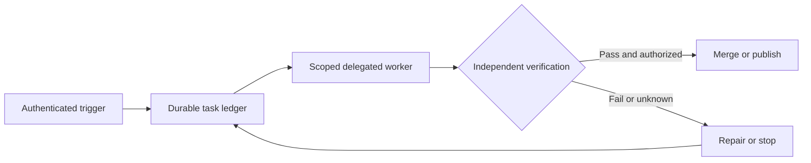

<!-- openshelf:budget-override reason="Full evidence-backed five-item research narrative with mechanisms, limitations, experiments and architecture must remain intact." -->

# Agentic AI Frontier — November 20, 2026

**Frontier thesis:** The meaningful boundary in autonomous engineering is shifting from what an agent says it completed to which external trigger, durable work state, publishing authority and evaluation artifact establish its actual outcome. Four findings are core engineering (80%) and one is exploratory benchmark integrity (20%). Sources are primary repository descriptions or release notes; no experiment here was independently reproduced.

## 1. OpenHands Agent Canvas 1.42

**Date:** 2026-11-18. **Primary URL:** https://github.com/OpenHands/OpenHands/releases/tag/v1.42.0. **Canonical record:** [[projects/openhands-agent-canvas]].

**Demonstrated capability:** The release adds exact connected Git-provider selection, restores native webhook-source validation, and provides non-loopback HTTP origins for verification runs.

**General concept:** Authenticated trigger provenance and repository identity. **Specific mechanism:** Explicit provider resolution and webhook validation precede automation effects.

**Novelty and evidence limits:** Incremental release, but consequential for security boundaries; no independent attack or reliability measurements. Compare [[projects/openbot]]'s general policy gateway; this change concerns webhook provenance and provider selection.

**Practical implication:** Pin authenticated triggers and repository identity before any write.

**Bounded reproducible experiment (proposed, not executed):** Simulate 20 valid/invalid webhook events against two mock providers; require correct target selection and zero unauthorized writes.

## 2. protoAgent Project Board

**Date:** 2026-11-19 (observed repository activity, not a release date). **Primary URL:** https://github.com/protoLabsAI/projectBoard-plugin. **Canonical record:** [[projects/protoagent-project-board]].

**Demonstrated capability:** A beads-backed Kanban work graph dispatches ready cards through ACP coding agents into disposable worktrees, gates PRs and reconciles unfinished work after restart.

**General concept:** Durable work-state reconciliation. **Specific mechanism:** Cards are projections of a single work graph; execution, review and merge update explicit states.

**Novelty and evidence limits:** Concrete workboard-to-PR integration; November 19 denotes repository activity, not verified release date. No independent throughput benchmark. Unlike [[projects/agent-client-protocol]], which standardizes agent session messages, this plugin binds cards to worktrees, review and PR state.

**Practical implication:** Use one authoritative work graph and reconcile it with actual PR state.

**Bounded reproducible experiment (proposed, not executed):** Interrupt six disposable cards before and after PR creation; verify no duplicate PRs or stranded tasks after restart.

## 3. extension.dev MCP

**Date:** 2026-11-19 (observed repository activity, not a release date). **Primary URL:** https://github.com/extensiondev/mcp. **Canonical record:** [[projects/extensiondev-mcp]].

**Demonstrated capability:** An MCP server gives agents tools to build, run, inspect, test and ship browser extensions, separating local tools from authenticated platform tools.

**General concept:** Capability-separated publication authority. **Specific mechanism:** Feature groups, --no-ship refusals, project scoping and owner approval gate publishing and store submission.

**Novelty and evidence limits:** Concrete domain-specific authorization boundary; November 19 denotes repository activity, not a release. No independent security audit. This is narrower than [[techniques/secure-agent-operations]]'s general security patterns but provides a concrete publication gate.

**Practical implication:** Expose local testing without implicitly granting deployment authority.

**Bounded reproducible experiment (proposed, not executed):** Build a harmless extension in no-ship mode; attempt ten forbidden platform operations and verify no external side effects.

## 4. openJiuwen Agent Core 0.1.20

**Date:** 2026-10-29. **Primary URL:** https://github.com/openJiuwen-ai/agent-core/releases/tag/v0.1.20. **Canonical record:** [[projects/openjiuwen-agent-core-020]].

**Demonstrated capability:** The release adds long-lived expert teams, scheduled verifier/challenger review, computer use and model routing, plus fixes to canceled queued tasks executing and restart-time MCP reconnect.

**General concept:** Cancel-safe delegated execution. **Specific mechanism:** Explicit scheduling, reviewer roles, timeouts and state-transition corrections across cancellation and recovery.

**Novelty and evidence limits:** Older substantial runtime release, not new November research. Maintainer release notes; no independent stress test. Compare [[projects/compozy]]'s cancellation recovery; related failure class, not a shared implementation or benchmark.

**Practical implication:** Test cancellation as a state transition, not just an API acknowledgment.

**Bounded reproducible experiment (proposed, not executed):** Queue 100 tasks, cancel 30 before start, restart, and assert none of the canceled tasks execute.

## 5. VTBench public dataset correction

**Date:** 2026-11-19. **Primary URL:** https://github.com/We-Math/V-Thinker. **Canonical record:** [[benchmarks/vthinker-vtbench-dataset-correction]].

**Demonstrated capability:** Maintainers disclosed that the publicly downloadable Instruction-Guided Interaction subset was a non-final export differing from the dataset used in experiments.

**General concept:** Benchmark artifact identity and reproducibility. **Specific mechanism:** A dataset export/version mismatch breaks the mapping between published score and publicly reproducible evaluation.

**Novelty and evidence limits:** Exploratory firsthand reproducibility incident, not a new agent algorithm. Correction pending as of November 20; no independent audit. The notice illustrates [[concepts/ground-truth-fallibility]] and [[concepts/scoped-assurance]] without proving all VTBench tasks invalid.

**Practical implication:** Pin public dataset and grader versions before trusting benchmark comparisons.

**Bounded reproducible experiment (proposed, not executed):** Hash available dataset artifacts, compare sample identifiers and defer reproduction claims until a pinned corrected release is available.

## Cross-finding synthesis

| Boundary | Evidence | Independent acceptance |
|---|---|---|
| Trigger and provider identity | OpenHands release | Rejected forged webhook and correct repository target |
| Durable coding work | protoAgent board | No duplicate PRs or stranded cards after restart |
| Publication authorization | extension.dev MCP | No unauthorized preview/store side effects |
| Cancellation and team review | openJiuwen release | Canceled queued tasks never execute |
| Evaluation provenance | VTBench disclosure | Public evaluation data matches reported protocol |

These are analytical comparisons of distinct systems, not head-to-head measurements or claims of interoperability. Release notes demonstrate a documented implementation claim, not independently established reliability.

## Proposed combined experiment

Use a disposable six-card coding repository with one delegated worker, a fake publishing endpoint and signed webhook simulator. Inject spoofed triggers, process termination before PR recording, cancellation of queued work and attempts to publish without approval. Compare independently passing tests, duplicate writes, stranded cards, unauthorized publication and token cost. Never infer success from a final agent message.

## Frontier signal

**Agent infrastructure is becoming an externalized control plane.** Authentication, durable task state, capability-limited tools and pinned evaluation artifacts constrain different failure modes. The five sources do not establish a combined end-to-end guarantee; the architecture above is a proposed synthesis.
