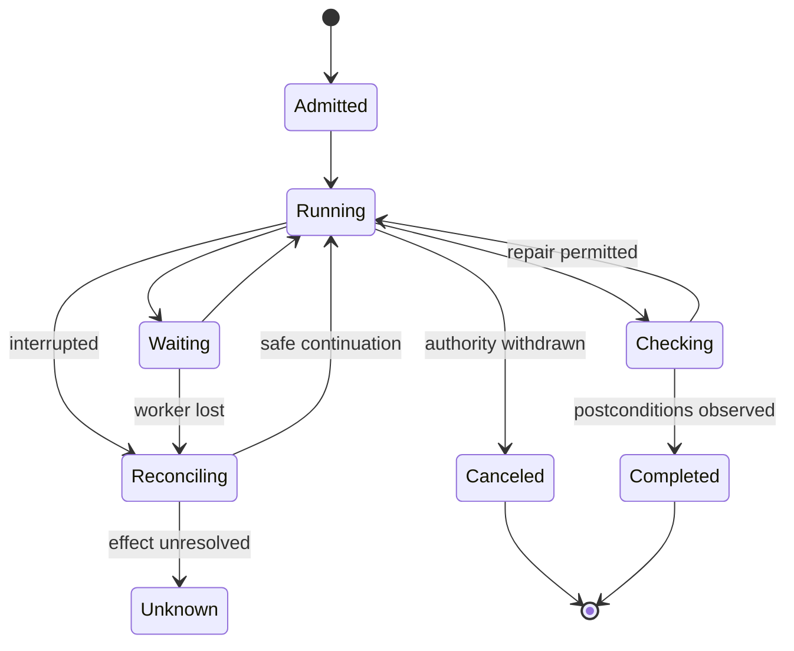

# Agent state and lifecycle

## The distinction

An agent's state is not one transcript. Useful distinctions are **session state** (messages and pending calls), **workspace state** (files and artifacts), **execution state** (workers, leases and outstanding work), and **external-world state** (effects on other systems). This is an analytical vocabulary for the documented mechanisms below, not a claim that every runtime uses these names.

A lifecycle describes allowed transitions of those states: work can be admitted, run, wait, finish, fail, be canceled or be reconciled after interruption. The important question is which transition has evidence and authority behind it. An event saying that replay finished does not show that a remote write succeeded.

## Concrete mechanisms

[[projects/agent-client-protocol]] documents an unstable-v2 `replay_complete` session update and subagent/configuration surfaces ([ACP changelog](https://raw.githubusercontent.com/agentclientprotocol/agent-client-protocol/4aab69b4e6bcb53965ff5b1141d2f04a62a25c6c/CHANGELOG.md)). These describe communication and reconstruction, not a common durable execution engine.

[[projects/compozy]] documents fixes for deleted/canceled children, parent wake delivery, orphan reconciliation at boot and descendant cancellation under terminal delegated sessions ([Compozy changelog](https://raw.githubusercontent.com/compozy/compozy/8cbf8a5a4dcb343f349e2b47635a461bea0c9b24/CHANGELOG.md), 0.7.1–0.7.2). The fixes show why a parent's waiting state must be reconciled with the child's actual lifecycle; they do not provide a measured recovery rate.

[[projects/rivet-agents]] persists calls and plan state, while its tool replay contract separately controls what may run again ([durable-agent guide](https://raw.githubusercontent.com/rivet-dev/agents/21c248b1d1d8c3a9d6c1cc7b85531a4a2d0e5c50/docs/content/guides/durable-ai-agents.mdx)). A reconstructed session and a safely repeated effect are distinct guarantees.

## An illustrative state model

This diagram is a proposed reasoning aid, not a protocol extracted from one implementation. In particular, canceling local work does not undo effects already committed elsewhere. A completion label needs the outcome evidence discussed in [[concepts/verified-completion-vs-apparent-success]].

## Bounds and tests

The source documents concern different layers and do not establish interoperability. Test a runtime by interrupting it between an effect and its recorded result, canceling a child while its parent waits, and replaying history into a fresh client. Check session reconstruction, parent termination, retained authority and external postconditions separately. A truthful unknown outcome is different from a verified success.

See [[concepts/replay-idempotency-and-effect-semantics]], [[concepts/delegated-authority-and-revocation]], [[techniques/durable-agent-execution]] and [[experiments/lifecycle-authority-and-retention]]. The comparisons are analyst interpretations; no source result was independently reproduced.

## Control-plane decisions versus execution-plane effects

An agent workboard, webhook receiver and tool runner may all describe the same job while controlling different things. The **control plane** admits and schedules work, binds a repository or principal, grants authority, records cancellation and decides whether publication is permitted. The **execution plane** performs tool calls and external mutations. Their records can diverge after interruption; a board marked complete does not prove a merged PR, and a cancellation acknowledgment does not undo a queued or already committed effect.

The November 20 records give distinct illustrations: [[projects/openhands-agent-canvas]] documents provider selection and webhook-source validation before dispatch; [[projects/protoagent-project-board]] documents durable cards/worktrees and reconciliation with PR state; [[projects/openjiuwen-agent-core-020]] documents cancellation and queued-work fixes. These are maintainer descriptions, not a shared measured architecture. [[concepts/delegated-authority-and-revocation]] governs permission boundaries; [[concepts/verified-completion-vs-apparent-success]] governs independent outcome checks.

**Proposed fault test:** For a disposable repository and mock webhook, inject invalid triggers, kill a worker between PR creation and board update, cancel queued work, and restart the scheduler. Compare authenticated admission, durable queue state and observed repository effects separately. Record duplicate PRs, unauthorized starts, post-cancellation effects and incorrectly declared completions.
