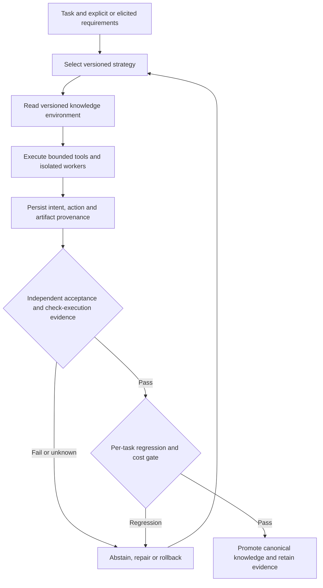

# Synthesized content layer: November 3–9

<!-- openshelf:budget-override reason="Cross-briefing evidence mapping, counterexamples and executable research agenda require more than the short evaluation-page guide." -->

## Scope and provenance

This is a **retrospective synthesis**, not a replacement for the immutable daily reports. Seven briefings, **41 selected findings** (5+7+7+5+5+5+5), were reviewed from [[briefings/2026/11/2026-11-03]] through [[briefings/2026/11/2026-11-09]]. Some findings are older gap-fills or GitHub PR proposals, not fresh November releases. Source-level assertions below refer to primary URLs; comparative relations are analyst interpretations unless a paper actually compares the methods. Historical October 30–November 2 reconstructed pages are outside this audit.

## Cross-briefing synthesis matrix

| Mechanism / question | Supporting implementations and evidence | Counterweight / limitation | Operational consequence |
|---|---|---|---|
| Does a successful agent output establish task success? | FINCOSMOS ([paper](https://arxiv.org/abs/2611.07464)); AgentSWE ([paper](https://arxiv.org/abs/2610.13361)); ChemE-as-Code ([paper](https://arxiv.org/abs/2611.07947)) | FINCOSMOS 0/150 full acceptance is benchmark-specific; ChemE design not engineer-reviewed; ControlAnything [paper](https://arxiv.org/abs/2611.08321) only verifies transport acknowledgements | Independent, requirement-complete acceptance and abstention |
| Does agent self-improvement preserve existing abilities? | Strategist ([paper](https://arxiv.org/abs/2611.03618)); EvoAudit ([paper](https://arxiv.org/abs/2611.07624)); RoboArchitect ([paper](https://arxiv.org/abs/2610.42141)) | EvoAudit: all 16 evolved agents gained and lost coverage; improvement metrics differ by domain | Per-task regression ledger and rollback |
| Where should persistent capability live? | EnvOpt ([paper](https://arxiv.org/abs/2611.07372)); SeaFlow ([paper](https://arxiv.org/abs/2611.01840)); tigerless [repo](https://github.com/tigerless-labs/agent-memory); Strategist | Environment edits can overfit benchmark tasks; memory quality and cross-user impact unmeasured | Version strategy, environment and memory separately |
| Can agent actions be trusted after retries and crashes? | AgentOS [releases](https://github.com/use-agent-os/agent-os/blob/main/RELEASES.md); Rivet [repo](https://github.com/rivet-dev/agents); BuilderIO [PR](https://github.com/BuilderIO/agent-native/pull/8670) | Proposed PR != shipped behavior; write acknowledgement != confirmed side effect | Durable intent ledger, idempotency keys, read-after-write |
| Do more agents improve engineering throughput? | Agensh [repo](https://github.com/microsoft/Agensh); MASBench ([paper](https://arxiv.org/abs/2610.04672)); ST-Bench ([paper](https://arxiv.org/abs/2610.07763)) | Coordination cost, partial observability, and conditional answer quality can erase benefits | Benchmark accepted output per token and per wall hour |
| Can agents self-extend into tools and physical work? | auto_research ([paper](https://arxiv.org/abs/2611.05251)); ControlAnything; FA-Agent ([paper](https://arxiv.org/abs/2611.06555)) | Tool tests can miss injected defects; physical effects and scientific accuracy have narrower verification | Sandbox new tools; instrument physical outcomes; allow abstention |
| Can provenance survive the conversation? | Tracybot ([paper](https://arxiv.org/abs/2611.09395)); ProcGrep ([paper](https://arxiv.org/abs/2606.16988)); ChemE-as-Code | Traceability does not by itself establish correctness; procedural fingerprints are descriptive | Link requirement → action → artifact → evidence → check |
| Are safeguards themselves reliable? | Production assurance [case](https://arxiv.org/abs/2610.08651); ToolGuardian ([paper](https://arxiv.org/abs/2607.21835)); AgenticBench (https://agenticbench.org/) | Missing checks can fail silently; vendor/platform evidence differs from independent replication | Fail closed on absent validators and test the validator |

## Synthesized architecture

The diagram is a **proposed integration**, not a system built or evaluated in these studies.

## Evidence-backed relationships and unresolved tensions

1. [[concepts/verified-completion-vs-apparent-success]] **extends** [[concepts/scoped-assurance]]: user acceptance, transport acknowledgement and internal test results are different warrant tiers. FINCOSMOS and ControlAnything offer contrasting concrete instances.
2. [[concepts/preservation-aware-agent-improvement]] **extends** [[concepts/capability-locus]]: harness and environment evolution are distinct intervention loci; EvoAudit supplies measured regression evidence that a single average obscures.
3. [[concepts/evaluator-circularity]] and [[concepts/ground-truth-fallibility]] **bound** self-scoring pipelines. auto_research adds a useful but imperfect staged gate: in its defect-injection study, 47 of 65 planted defects passed automated checks and one passed subsequent code review, while 40 of 69 correct changes were rejected (author-reported).
4. [[concepts/structural-constraint-over-instruction]] **motivates** constrained tool actions, but the production assurance case **contradicts** any inference that a named monitor always executed or checked the intended property.
5. [[concepts/abstention-as-first-class-verdict]] links FA-Agent's keep/correct/remove choices and the November 6 Code Simplifier's no-change outcome as analogous *decision structures*, not equivalent scientific validations.
6. **Unresolved:** Agensh scaling results, MASBench partial-information experiments and ST-Bench coverage/cost results do not establish a universal optimum team size. A controlled common-task comparison is required.
7. **Unresolved:** EnvOpt's optimized information layout and tigerless memory consolidation may interact; no cross-paper experiment establishes whether their benefits add or conflict.

## Prioritized experiments

### A. Hidden-acceptance, regression-aware OpenShelf pipeline (highest priority)

Build 30 tasks with withheld requirements, 20 held-out transfer cases and injected skipped validators. Compare baseline ingestion, versioned strategy library, and optimized information environment. Score independent acceptance, newly correct relations, previously correct relations lost, source-provenance completeness, abstentions, token cost and wall time. Promote only if critical regression count is zero and all required checks actually executed. Inspired by FINCOSMOS, EvoAudit, EnvOpt and the assurance case.

### B. Crash-safe tool execution

Run 20 controlled repository write tasks with induced crashes before, during and after remote acknowledgements. Compare naive retry with durable intent IDs, read-after-write reconciliation and idempotent tool wrappers. Measure duplicate commits, lost writes, orphan branches and repair time. This tests the AgentOS/BuilderIO/Rivet architectural claims without assuming they are interchangeable.

### C. Multi-agent value frontier

Run 1, 2, 4 and 8 agents on matched repo tasks under fixed total token and wall-clock budgets. Track accepted changes, regressions, conflict rate, communication overhead and partial-information errors. Separate increased coverage from conditional correctness; use TandemBench's omitted-optimum-plan probes.

### D. Provenance completeness audit

Sample 50 generated claims and changed code lines. Require source URL, excerpt or source span, originating task, action trace, artifact commit, executed validator ID and final verdict. Inject missing checks. Compare Tasklet-style provenance to trajectory-only logging. Do not equate provenance coverage with claim truth.

## Coverage and source-concentration audit

The seven reports contain 41 selections: **5, 7, 7, 5, 5, 5, 5** by day. Recurrent emphasis on software engineering, agent reliability and evaluation reflects the stated preference model; November 3 robotics, November 5 astronomy, November 7 seismic analysis and mixed-reality device control are deliberate exploratory coverage. Several November 8–9 items are older methodological gap-fills; these must remain labeled, and future editions should prioritize new implementation releases and deployment postmortems over repeatedly mining similar benchmarks.

**Source mix:** research preprints and GitHub repos dominate. Blind spots include independent replication, operational cost accounting, real industrial deployments, hardware/robotics field trials and longitudinal safety results. This audit is qualitative; it is not a source-domain frequency analysis and does not claim independent reproduction.

## Decision

**Build the acceptance and regression harness before optimizing agent autonomy.** The combined studies support a plausible engineering pattern, not a measured cross-system guarantee. Keep this synthesis separate from dated historical snapshots and revise it through versioned, evidence-attributed PRs.

## Evidence status

Retrospective comparative analysis of the archived primary-source reports, completed 2026-11-09. No code, benchmark or cited system was executed as part of this synthesis.
