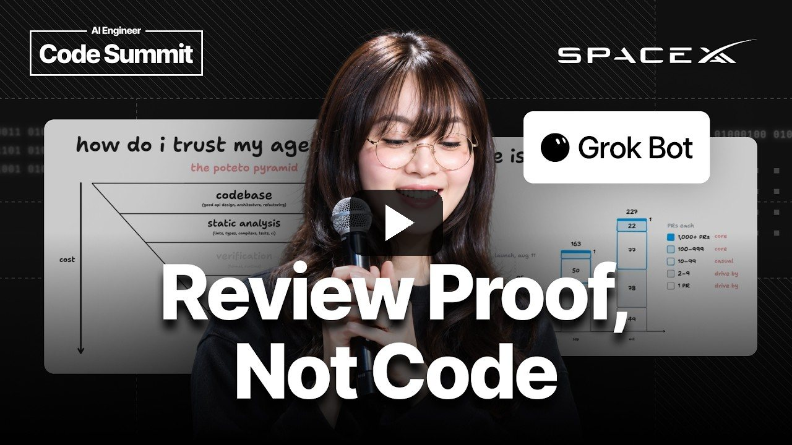

# All Code Is Slop (Except Mine)

**▶ [Watch on YouTube](https://www.youtube.com/watch?v=O_zcc6Xl12g)** · Lauren Tan (poteto) · AI Engineer Code Summit · 17:31 · published 2026-11-14

## What it is

A practitioner talk by Lauren Tan (poteto), of the Grok Bot team at SpaceXSI (the affiliation as styled in the talk), published on the AI Engineer channel on 2026-11-14. Tan describes how her team reached a state where AI coding agents merge most of their own pull requests: she reports shipping roughly 3,000 PRs to production herself in one month, and the Grok Bot team shipping 11,000 PRs in the month before the talk, at a revert rate steady around 0.5%. Her thesis is that code quality at agent volume is a trust problem, and trust is bought by investing in the agent's environment — codebase, deterministic tooling, verification — rather than by reviewing agent output harder. She calls the result a software factory; the talk's own framing is that the engineer's job is shifting from writing code to gardening the codebase agents read and write.

Every production figure in this page is speaker-reported from the talk; the mechanism claims are corroborated as artifacts by her public pstack plugin, discussed below. No independent replication is cited for any of it.

## The mechanism

### Spend order: code, then checks, then verification, then prose

The talk's organising device is an inverted pyramid of where to spend effort on an agent's environment. The base layers are deterministic: first the codebase itself (API design, architecture, refactoring), then the tooling around it (lint rules, type systems, compilers, tests). Verification — runtime and formal — layers on top of those. Prose (rules files, skills, AGENTS.md) is the last and thinnest layer, because it requires judgment and cannot be enforced. The two deterministic layers together constrain what agents can do and force the right thing by default.

### Corrections become checks, not instructions

The operating rule: whenever you correct an agent, convert the correction into a deterministic check, or eliminate the problem class through better API design or architecture — do not add another line to the rules. The reasoning is that a check in code is reproducible and enforceable, while an instruction is neither. Accumulated over six months of foundation work, this is what emptied her review queue: at some point, she says, there is nothing left to review, and agents can merge most of their own PRs.

The sharpest instance is comments. In Grok Bot and its framework, roughly 99% of comments are banned by lint. The talk gives three reasons: comments go stale and humans do not read them; agents use comment space to write justifications for workarounds instead of fixing root causes; and a comment is not enforceable — it cannot be trusted. Lint rules replace them, with error messages that tell the agent to fix the real problem.

The codebase-as-input argument sits underneath: the codebase is one of the largest inputs an agent conditions on, so anti-patterns, workarounds and deprecated code are copied by the next agent as established pattern. Debt that a human team routes around becomes, for agents, a template. Hence the gardening metaphor — the constraints are the concrete the new growth grows around.

### Dune: architecture as the constraint surface

Dune is the team's internal client framework for Grok Bot — "Next.js for Electron apps," in the talk's phrase — whose purpose is to encode lessons from building desktop applications as constraints:

- **Categorical elimination over review.** React's `useEffect` "requires a PhD to use well" and agents misuse it, so it is banned in product code and allowed only inside Dune's own APIs. The misuse class is eliminated once, categorically, instead of being caught in review forever.
- **Context through directory structure.** At Cursor (where Tan worked previously), agents imported main-process code into the renderer, causing long tasks and jank. Grok Bot's answer is convention enforced by tooling: top-level directories literally named for the Electron main and renderer worlds, with cross-imports forbidden by a dependency-graph analyzer and lint rules.
- **Architecture clashes surface as agent workarounds.** The Cursor timer story is the cautionary case: agents reached for imperative timers (`setTimeout`, `requestAnimationFrame`, `requestIdleCallback`) to patch over a clash between VS Code's imperative style and React's declarative style, producing garbage-collection jank — and wrote comments rationalising each patch. The failure was architectural; the agents' output made it look like a code-style problem.

### Verification: runtime, formal, and artifact review

Code review, in this account, has shrunk into reviewing verification artifacts — videos, screenshots, diagrams, formal-verification results — instead of diffs.

- **Runtime verification.** Agents run the application themselves with developer tooling (the talk names the Chrome DevTools Protocol). Two devices make this cheap: *feature maps*, a site map of the application's user-visible features that gives agents and humans shared vocabulary ("the thingy in the left sidebar" becomes a named feature), and custom CLIs packaged inside skills, so the driver is reused every run instead of re-improvised — testable, and cheaper in tokens.
- **Formal verification.** TLA+ model checking of major user flows (the example given: notifications across multiple devices and platforms), and Lean proofs for algorithms — their custom virtualization library, checked for flickering and jitter. Property-based testing of UIs with a library the talk's captions render as "Bombadil" has also caught bugs. The speaker's own bounds: formal verification has found "quite a few bugs," is "not a silver bullet," and is still experimental for them.
- **Token economics.** Most of the token budget goes to verification, not generation. The talk cites a practitioner post (by "Cindy") reporting 70% of daily tokens spent on verification and says her own usage tracks that figure. The underlying argument: testing and formal methods were always good engineering but often prohibitively expensive to write and maintain; agents collapse that cost, which is why she predicts a "golden age of software testing and verification."

### The outer loop

On top of the foundations sits orchestration: Grok Bot's connectors and routines kick off Cursor cloud agents in projects that can run hundreds or thousands of agents. The worked example: on each release cut (now roughly daily), Grok Bot spins up a Cursor project that fuzzes the entire build by using the application as a real user would, opens fix PRs for the bugs it finds, and auto-merges them. The claim is that this is safe *because* the inner loop is constrained — pull requests "tend to just be good by default," so most product code no longer needs deep human review.

### Artifact corroboration: pstack

Tan's public Cursor plugin, pstack (in the `cursor/plugins` repository, linked from the talk), ships the same machinery as skills, which corroborates that the mechanisms exist as artifacts rather than only as talk claims:

- `/correct` mines history for recurring mistake classes and fixes each at the highest level that works — architecture first, then types, lint and CI, then tests, with docs last. That is the correction-to-check pipeline, productised, with the pyramid's spend order made explicit.
- `/create-verification-skill` generates a project-local verification skill built around a feature map; `/maintain-verification-skill` re-checks the map against the app.
- `/statechart` checks a TLA+ model and draws the user-visible state machine, marking states that break a rule — verification output packaged for human review, as the talk describes.
- `/no-comments` strips comments before review and offers encodings for claimed constraints — the comment ban as a tool.

pstack corroborates mechanism, not outcomes: it is a public skills package, and none of the Grok Bot production numbers can be checked against it.

## Evidence and limitations

**The numbers (all speaker-reported).** 11,000 team PRs in one month; ~3,000 of them hers; revert rate ~0.5%, described as steady-to-falling as volume rose; 227 people contributing at least one PR in October; stable releases cut about daily; client performance (startup, typing, opening and switching chats) improved over the same period. Six months of foundation work preceded the volume.

**Limits.**

- **Single source, no replication.** One talk by the system's own lead; no public telemetry or third-party audit accompanies it, and no other team reports the same pipeline at the same scale in the sources consulted.
- **Revert rate is a coarse quality proxy.** It counts changes that were backed out, not subtle defects that shipped and stayed. The talk itself opens this hole: it cites a practitioner who could not trust her agents precisely because of subtle bugs being merged — the failure mode a revert rate does not see. The 0.5% figure is consistent with both "quality held" and "defects are being absorbed silently."
- **No cost accounting.** Verification-heavy pipelines trade tokens for trust; the talk gives the 70%-of-tokens figure for one practitioner's day and no cost per merged PR, no foundation-work hours, and no comparison against the review labour displaced.
- **Transfer is untested by the source.** The codebase is a client application built on an in-house framework created for this purpose, by a team able to ban language features and restructure directories. Whether the pipeline survives a legacy, multi-language, or externally-constrained codebase is outside the evidence.
- **Transcript fidelity.** The talk's auto-generated captions leave two names unverified against a written source — the property-testing library ("Bombadil" as captioned) and the employer styling ("SpaceXSI").

## What would settle it

Independent telemetry from the Grok Bot repository or a comparable deployment: defect-escape rates (post-release bugs traced to agent PRs) rather than reverts; cost per merged PR including verification tokens; and a replication on a codebase without a bespoke framework — a team adopting only the correction-to-check pipeline and the verification layers, reporting quality before and after. The KB's own settling experiment for the general claim is on [[signals/reliability-is-a-systems-property]]; this talk is the production-scale instance that experiment would need to explain.

## Evidence status

- **Mechanism (corrections → deterministic checks; lint-enforced architecture; feature-map runtime verification; TLA+/Lean layers):** described in the talk and corroborated as public artifacts in pstack (read 2026-11-18). The Grok Bot deployment itself is speaker-described only.
- **Production results (PR volume, revert rate, contributor count, performance):** speaker-reported, single source; no independent replication is cited.
- **Token-share figure (70% to verification):** a second practitioner's self-report quoted in the talk, plus the speaker's agreement — anecdote, not measurement.

## Related pages

- [[concepts/structural-constraint-over-instruction]] — the talk is this concept's strongest production instance: trust placed in lint rules, architecture and directory structure, with prose instruction deliberately demoted to the thinnest layer.
- [[concepts/scoped-assurance]] — the standing bound on the talk's claim: each check warrants only the scope it exercises. The categorical bans are the limiting case — they do not widen a check's scope, they delete the unchecked space.
- [[concepts/improvement-lives-in-external-state]] — corrections accumulate in code, lint rules and framework design around frozen weights; the rules file is explicitly where improvement is *not* stored.
- [[techniques/verification-and-evidence]] — the technique layer this deployment runs at scale: runtime verification with feature maps, formal methods as one layer among several, and review redirected at verification artifacts.
- [[signals/reliability-is-a-systems-property]] — the corpus's reliability loop (verify → recover → gated update); the talk evidences the verify link at production scale and is silent on recovery, which remains the loop's untested-at-scale half.
- [[projects/death-of-the-code-review]] — the same bottleneck surveyed from the review side: where Tan's team engineered review away by constraining generation, Voss documents review relocating into harnesses, rubrics and production, with the mergeability evidence (METR, FrontierCode) for why test-passing alone never emptied a review queue.
