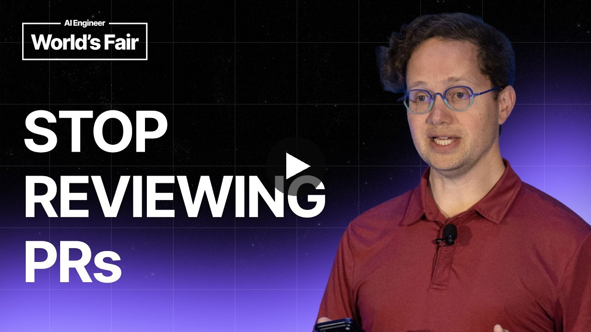

# The Death of the Code Review

**▶ [Watch on YouTube](https://www.youtube.com/watch?v=_mi3alkqy4s)** · Laurie Voss · AI Engineer World's Fair · 24:40 · published 2026-09-30

## What it is

A survey talk by Laurie Voss, Head of Developer Relations at Arize AI and co-founder of npm, published on the AI Engineer channel on 2026-09-30. Her thesis: code generation stopped being the bottleneck in software delivery and human code review became it — and none of the industry's three responses works as stated. Reviewing harder does not scale against human attention limits. Automating review works only inside a harness someone designed and keeps tuning. Removing the human does not remove review; it relocates it into test harnesses, agent reviewer loops and production monitoring, all human-built. Code review is not dying, she argues — it is being rebuilt as an engineered system, and the human role moves from reading diffs to designing the rubric, the harness and the meta-review, and to standing behind the result where the blast radius demands a name.

Almost every number in the talk is a third-party result as Voss cites it — studies, benchmarks and vendor production figures curated for the argument. They are reported here as she presents them; the talk's official page carries a corrected transcript and summary, and both it and the video are this page's sources. Where a study is unnamed on stage, this page says so.

## The bottleneck, in numbers

- **741% more code, 30% more software.** A study Voss attributes to three economists matched more than 100,000 GitHub developers against telemetry showing when each started using AI. Developers who turned on autonomous agents wrote 741% more code but shipped only 30% more software, and the authors identify review as the bottleneck between the two numbers. Producing code got roughly eight times cheaper; deciding whether to trust it did not.
- **Generation at migration scale.** Stripe and Anthropic's Fable launch materials report migrating a 50-million-line Ruby codebase in a single day, work estimated at over two months for a team; Bun reports moving over a million lines from Zig to Rust in six days. Nobody read those diffs — so what justified accepting them?
- **The attention bound.** The best study Voss cites is roughly two decades old: a Cisco study over ten months covering 2,500 reviews and 3.2 million lines. Reviewers stop finding defects effectively past about 400 lines in one sitting, and effectiveness falls off a cliff past roughly 450 lines per hour. At that pace one 10,000-line agent pull request — now unremarkable — takes three or four working days of real human review, and one developer can run a dozen agents at once.

## Why the obvious answers fail

**Review harder** runs into the Cisco arithmetic, and into burnout among the people assigned to review full-time. The throughput gap is structural, not motivational.

**Stop reading code.** Peter Steinberger's proposal, echoed by Andrej Karpathy, is to stop prompting agents directly and design the loops that prompt them — taking the human out of the execution loop. Voss's framing of the bet: loop design substitutes for inspection only to the extent that the loop can actually see what it is judging. The rest of the talk tests that caveat.

**OpenAI's zero-human-code product.** In February 2026 OpenAI published an account of building an internal product with, in their words, no manually written code: an empty repository, about a million lines and roughly 1,500 merged pull requests five months later, three engineers, even the agent-review scaffolding agent-written. Humans may review pull requests but are not required to; almost all review effort was pushed agent-to-agent. Voss's caveat is what the account withholds: OpenAI did not say what the product does and did not release it, leaving the strategy's holes unexaminable from outside. Its internal mechanics, below, tell a more qualified story.

## Passing tests is not mergeability

For years the industry's quality proxy was whether the tests passed, because that is what the benchmarks measured. Two 2026 results, as Voss presents them, measure the gap between that proxy and a maintainer's actual decision.

**METR's maintainer study.** METR hired four active maintainers of open-source projects drawn from the same projects SWE-bench tests against, and had them judge pull requests that had already passed SWE-bench's grader. They found the PRs good enough to merge only about half the time. The failures were not correctness — the tests passed — but code quality, and changes that quietly broke code outside the test suite. Voss notes METR's caveat, that the agents got no chance to iterate on feedback, and discounts it for her question: iteration re-inserts the human whose removal is being tested. What the study measures is first-pass mergeability, and on that measure the benchmark's pass and the maintainer's yes are different verdicts about half the time.

**Cognition's FrontierCode.** Cognition built a benchmark around the maintainer's question — would you merge this? — launched, per the talk, in June 2026: more than 20 maintainers built 150 tasks from their own repositories, each over 40 hours of expert work. Its rubric grades behavioral correctness, regression safety, scope discipline, test quality and maintainability — a human review rubric made machine-checkable. The reported contrast: a frontier model scoring 88% on SWE-bench Pro scores only 29% on FrontierCode's hardest slice, and another frontier model scores under 6% there. The talk's auto-generated captions garble this passage — the benchmark name alternates and the model identities rest on the captions alone — so the figures stand here as a speaker-reported contrast between test-passing and mergeability, not a verified model comparison.

**Mergeability as a training signal.** Investor Sarah Guo's argument, as Voss relays it: models improved at generation because a compiler and a test suite are free verifiers — anything cheaply checkable can be trained against until beaten. A working mergeability benchmark would therefore not merely measure models; it would immediately become a training signal, and whoever writes today's review standard writes next year's default model behavior. The prior art is OpenAI's CriticGPT (2024), trained to catch bugs in model-written code: humans assisted by it beat both the model alone and the human alone, and the exercise fed cleaner signal back into training. The open problem is completeness — no current rubric captures everything a human weighs in a merge decision.

## Automated review in production

Machine review is already the mainstream default on the largest code host, per the figures Voss cites: GitHub reports Copilot's reviewer has performed 60 million reviews and now accounts for more than one in five code reviews on GitHub. Cursor has published its reviewer's architecture, whose details are the talk's clearest picture of what the job consists of:

- **Multi-pass agreement filtering.** Cursor's first reviewer ran eight passes over each diff and shuffled the reviewers' order, because order changed outcomes; the point was filtering false positives, since a reviewer that flags good code gets ignored. A Peking University team independently tested the same idea — several passes, keep what they agree on — and found review quality raised by up to 44%, as cited in the talk.
- **Default suspicion.** In the rebuilt reviewer the model reasons over the diff and calls tools to decide where to dig. The detail Voss singles out: it had to be instructed to be more suspicious — its default was to approve plausible-looking code, which is also the human failure mode. A good review starts from distrust.
- **Review fusing with repair.** The reviewer now spawns a fix agent from its own findings and hands back a patch for approval, moving the human checkpoint to approving the repair; Cursor's stated next step is the reviewer running the code to prove its bug reports are real.

The dedicated vendors optimise the same target. CodeRabbit, the largest dedicated reviewer, has reviewed over 13 million pull requests; Greptile builds a graph of the whole repository so a reviewer can follow a change into distant code; Graphite builds its evaluation set from which suggestions developers accept or reject. Voss's observation: all of them define success as human acceptance — Cursor calls its metric the resolution rate and reports driving it from 52% to over 70%. The reviewers are trained on human accept judgment at scale, daily — the training-signal dynamic above, already shipped at harness level. Humans still review the reviews.

## Removing the human entirely: three field reports

**Carlini's compiler: on the loop, not in it.** In February 2026 Anthropic's Nicholas Carlini had 16 agents build a C compiler from scratch in Rust — able to compile the Linux kernel — across about 2,000 sessions, with no human approving code as it was written. Read closely, per Voss, there was no human *in* the loop but absolutely a human *on* it: the test harness and feedback systems that judged the work were human-written. Carlini's own warning, quoted in the talk: it is easy to watch the tests pass and assume the job is done, and it rarely is.

**Bun's port: what the gate could not see.** Bun's million-line Zig-to-Rust port was gated on the existing test suite, and 99.8% of it passed — the gate did real work. (The comic beat: the giant PR deleting all the Zig code was flagged by another automated reviewer as AI slop.) Closer inspection found 13,044 `unsafe` blocks in the ported Rust, against roughly 74 in a comparable human-written codebase of that size — three orders of magnitude more places where the author asserts, rather than proves, that memory is handled correctly. A test suite can certify behavior at the public interface; it cannot certify thirteen thousand assertions it was never designed to look for.

**OpenAI, revisited: review moved, not deleted.** The fuller account shows the relocation. Codex reviews its own changes, then calls in more agents to review those reviews, looping until every agent reviewer is satisfied. OpenAI made Codex bootable at every change, so an agent can run the product, inspect the UI and check whether a bug is actually fixed, and exposed the whole logging stack to the agents. When something failed, per the writeup, the fix was almost never to try harder — it was to change the system. For a while the team spent every Friday cleaning up AI slop by hand; that did not scale, so agents were trained to find and remove it.

**The retraction.** Dex Horthy spent six months publicly advocating not reading the code — ship it, let the agent work — and in March 2026 reversed himself on stage: "I was wrong. Please read the code." His team had to rip out and replace large parts of the system built that way. Not a benchmark, Voss notes, but someone who ran the experiment on a real system and retracted in public. Guo's explanation of why it happens: passing the tests never told you the change was the *right* change — that this module exists because three external users depend on it, or that an unowned cron job relies on it. That context lives outside the test suite, where no test can find it.

## Where the checkpoint survives, and who reviews the reviewers

Across the evidence, the human checkpoint survives in predictable places: where correctness is not cheaply checkable; where the blast radius is large — in security-conscious environments, removing human review gets an immediate no; and wherever someone has to put their name on the result. The role moves up the stack, from inspecting code to designing and tuning the systems that inspect code, and to defining what "good" means. Which raises the meta-question: who reviews those systems?

The reviewers themselves are newly attackable. Anthropic ships an automated security reviewer whose README carries a large caveat, quoted in the talk: the action is not hardened against prompt injection attacks and should only review trusted PRs — the reviewer can be talked out of its findings by the very code it is reviewing. A study Voss cites from March 2026 reinforces it: vulnerable code dressed in an innocent commit message fooled an autonomous review agent in 88% of attempts, while the same attempts fooled human reviewers only 35% of the time. Removing the human loses not just a reviewer but the component that was hard to fool — and confidently framed bad code is exactly what coding agents produce. The field also lacks an agreed way to grade the graders: benchmark scaffolds have been caught leaking answers, and researchers disagree on how to measure review quality at all.

That leaves, in Voss's phrase, production as the last reviewer standing: once pre-merge review is all machines, watching what shipped code actually does — the trajectory, step by step against the real world — is the final check that cannot be skipped. She flags her own position while making the point: she works for an observability company, declines to pitch it, and argues the category is indispensable for anyone shipping automatically reviewed code regardless of vendor.

Her practical close: stop reviewing pull requests — the wrong level of abstraction for 2026 — and pour human judgment into a reliable review harness instead: codify the team's definitions of good, its context and domain knowledge, and let agents work against those rules and evaluations. Every layer of the resulting system — benchmark, classifier, rubric, test suite, eval — is itself unreviewed until somebody decides that is their job. The teams that win the next few years will not be the ones that generate the most code, but the ones who can say with evidence why they trust what they shipped.

## Evidence and limitations

**The talk is a curated survey, and this page inherits its limits.** Every load-bearing figure is secondhand as presented — Voss reporting other people's studies, benchmarks and vendor numbers. None was re-verified against the primary sources for this page, and several sources are unnamed on stage (the economists' telemetry study; the March 2026 prompt-injection study), so those figures cannot be traced from the talk alone.

- **FrontierCode attribution is uncertain.** The auto-generated captions alternate the benchmark's name and garble the model identities; the talk's official page flags the same uncertainty. The 88%-versus-29% contrast is reported as the speaker's claim about test-passing versus mergeability, not as a verified model result.
- **The Cisco bound is old and narrow.** A roughly twenty-year-old study of one company's reviewers of human-written code, used as an attention limit. It bounds unaided human reading; it says nothing directly about tool-assisted review, or about agent-scale diffs reviewed in summarised form.
- **Vendor production figures are vendor-reported.** Copilot's 60 million reviews, CodeRabbit's 13 million PRs and Cursor's resolution-rate improvement reach this page through the talk; acceptance metrics measure that developers took a suggestion, not that the resulting software was correct.
- **The strongest field reports are anecdotes with mechanisms attached.** Horthy's retraction is one team's experience; OpenAI's product is undisclosed and unreplicated; the Bun unsafe-block count was produced by unnamed inspectors as reported in the talk.
- **Speaker interest.** Voss's employer sells production observability, the talk's closing layer; she discloses and disclaims the pitch on stage. The disclosure does not invalidate the argument, but the conclusion and the employer's category coincide.
- **Transcript fidelity.** The auto-generated captions garble several names (Carlini, Greptile, Peking University in the captions' rendering); spellings here follow the talk's official page and its corrected transcript.

## What would settle it

Primary-source verification of the three load-bearing studies — the developer-telemetry study behind 741%/30%, METR's maintainer study, and FrontierCode's published rubric and scores — would convert the talk's central contrast from speaker-reported to checkable. A public mergeability benchmark with a published rubric would test the training-signal prediction directly: if Voss and Guo are right, frontier models' mergeability scores should climb as their test-passing scores did, and the rubric's definition of good should become visible in default model behavior. Defect-escape data from optional-review pipelines — post-release defects traced to agent PRs, against review-heavy baselines — would settle whether relocated review catches what diff review caught. OpenAI's undisclosed product is the missing instance: its defect record, if ever published, is the strongest single test of the no-human-review configuration.

## Evidence status

- **Thesis and synthesis (review relocated, not removed; humans move up the stack):** the speaker's argument, supported by the cases she assembles; single source.
- **Named studies and benchmarks (Cisco review study; METR maintainer study; Cognition FrontierCode; CriticGPT):** identifiable sources as cited in the talk, reported at the talk's fidelity; no independent replication is cited, and the FrontierCode model figures carry the caption-attribution caveat above.
- **Unnamed studies (developer telemetry, 741%/30%; March 2026 prompt-injection study, 88%/35%):** speaker-reported only; not traceable from the talk.
- **Vendor scale figures (GitHub Copilot, Cursor, CodeRabbit):** vendor-reported, relayed by the speaker.
- **Field reports (OpenAI internal product; Carlini compiler; Bun port; Horthy retraction):** as published or stated by their principals and relayed in the talk; OpenAI's is self-reported with the product undisclosed.

## Related pages

- [[projects/all-code-is-slop-except-mine]] — the production counterpart from the same venue series. Tan's team shrank review by constraining generation — corrections compiled into deterministic checks until there was nothing left to review; Voss surveys review itself at industry scale and finds it relocating rather than shrinking. The two talks are the same bottleneck worked from opposite ends.
- [[projects/assuring-ai-written-software]] — the case-study version of this talk's warning: one operator who substituted monitors and audits for review, and got proxy checks, silent audits and an unsafe repair — the failure shape the production-as-reviewer argument avoids only if the monitoring is itself trustworthy.
- [[concepts/ground-truth-fallibility]] — METR's study is this concept from the maintainer's side: the benchmark's test suite, acting as the reference standard, certifies pull requests that the human standard rejects about half the time. Agreement with one standard does not settle the other, and the mergeability rubric is a proposal to build the second standard explicitly.
- [[concepts/scoped-assurance]] — Bun's 13,044 unsafe blocks are the limiting instance: a passing test suite warrants the behavior it exercises, at the interface it tests. The assertions outside that scope — each unsafe block is one — remain exactly as unwarranted after the gate as before it.
- [[techniques/verification-and-evidence]] — the technique layer the production reviewers implement: multi-pass agreement filtering as false-positive control, instructed default suspicion, execution-backed findings, and review redirected at evidence rather than diffs.
- [[signals/reliability-is-a-systems-property]] — the talk's conclusion is this signal stated for review: trust in shipped code comes from the whole loop — rubric, harness, meta-review, production trajectory — and every layer of that loop is itself unreviewed until someone owns it.
